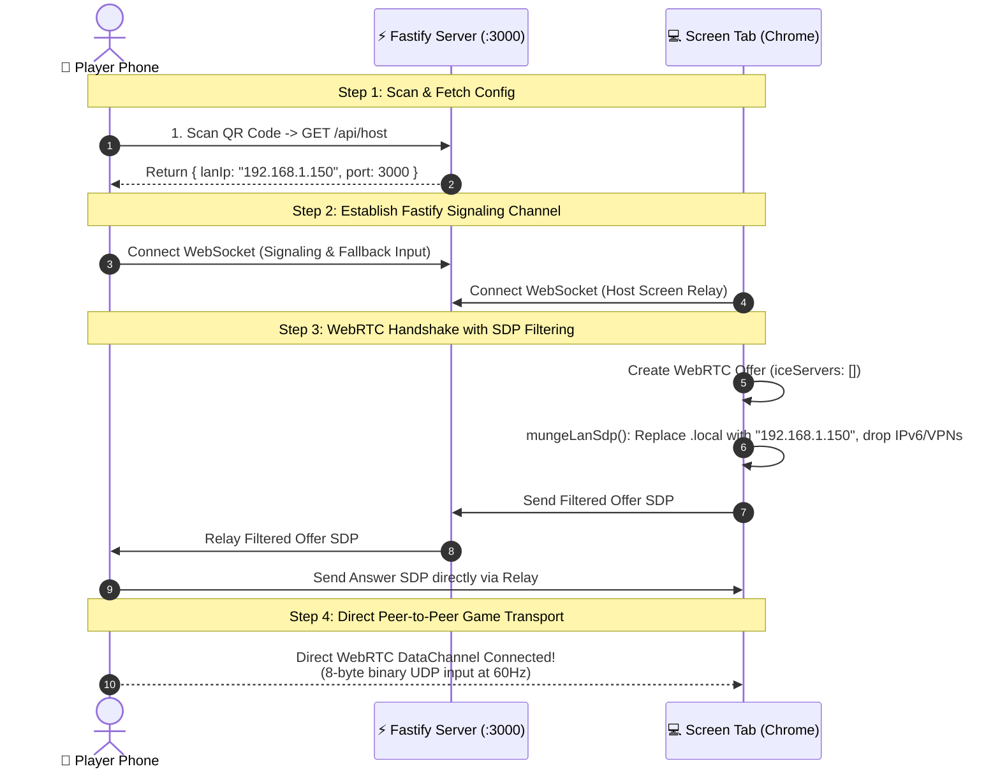

# Architecture Decision Log

This document records durable architectural decisions for `local-party-console`. It is written so both human developers and agents can immediately understand **why** technical choices were made, **how the network protocols work under the hood**, and what trade-offs were chosen.

## Index

| ID | Title | Status | Date |
| :--- | :--- | :--- | :--- |
| [ADR-001](#adr-001-local-only-lan-webrtc--sdp-filtering) | Local-Only LAN WebRTC & SDP Filtering | Accepted | 2026-11-24 |
| [ADR-002](#adr-002-multi-button-input-loss-protection--toggle-bits) | Multi-Button Input Loss Protection: Toggle Bits vs Rolling Window | Accepted | 2026-11-25 |

---

## ADR-001: Local-Only LAN WebRTC & SDP Filtering

- **Status:** Accepted
- **Date:** 2026-11-24

### 1. The Human Problem: "Why can't my phone connect to my laptop?"

When 8 friends sit in a living room to play a party game on a TV or laptop screen, they scan a QR code with their phones. We want zero-latency touch controls without installing an App Store app.

Standard WebRTC is designed for video calls across the internet. When used inside a private living room on local Wi-Fi, it runs into three frustrating problems:

1. **The mDNS Privacy Wall:** Modern browsers (Safari on iOS, Chrome on Android/Mac) mask private IP addresses (`192.168.x.x`) with random privacy names like `7f2d39a1-4b1e-4c3a-8b9a.local` unless you grant camera or microphone permissions. Home Wi-Fi routers frequently block or fail to resolve these `.local` names between devices, causing connection timeouts.
2. **The "Multi-Homed Laptop" Problem:** A developer's MacBook or docked PC often has 5+ active network interfaces: Wi-Fi, Ethernet, Docker bridges, VPNs, and IPv6. WebRTC gathers candidates for all of them. The phone attempts ICE handshakes on dead adapters, adding seconds of lag or picking the wrong network path.
3. **No Internet Access:** Party games should work in cabins, hotel rooms, or offline routers. Traditional WebRTC relies on external STUN/TURN servers to discover IP addresses. Without internet, STUN requests fail.

---

### 2. High-Level Connection Architecture

Instead of relying on cloud STUN servers or asking users for microphone permissions, the local Fastify server tells devices the real LAN IP address, and rewrites the WebRTC handshake (SDP) on the fly:



---

### 3. Detailed Decision & How It Works

#### A. Direct Host-Tab WebRTC with Zero ICE Servers
- The primary `/screen` browser tab owns 8 independent `RTCPeerConnection` instances (slots `0..7`).
- Both screen and phone initialize WebRTC with `iceServers: []`. This ensures zero internet requests are made; WebRTC only looks at local physical network adapters.
- Pre-negotiated unreliable DataChannels (`ordered: false, maxRetransmits: 0, negotiated: true, id: 0`) are opened immediately for ultra-low latency.

#### B. Server-Resolved RFC 1918 IPv4 and SDP Munging
- When the host screen prepares the connection offer, `mungeLanSdp()` inspects the raw SDP candidate lines:
  - **Replaces `.local` mDNS candidates:** Converts `typ host ... a7f3b...local` into the real IPv4 address (e.g., `192.168.1.150`).
  - **Prunes garbage candidates:** Discards IPv6 addresses, VPN tunnels, Docker adapters, and public reflexive candidates (`srflx`, `relay`).
  - Result: The phone receives exactly one clean candidate: the host laptop's real Wi-Fi IP address.

#### C. Bulletproof Dual-Transport Fallback
If a restrictive router blocks UDP peer-to-peer traffic altogether:
- The host displays `LOCAL NETWORK BLOCKED — CHECK WI-FI`.
- The controller automatically falls back to streaming binary inputs over the existing Fastify WebSocket connection. Players never get a black screen or disconnect error.

| Scenario | Primary Path (WebRTC DataChannel) | Fallback Path (Binary WebSocket) |
| :--- | :--- | :--- |
| **Transport** | Unreliable, unordered UDP | Reliable, ordered TCP |
| **Typical Latency** | 2ms – 6ms | 8ms – 16ms |
| **Failure Mode** | Network drops UDP packets | Buffers behind TCP head-of-line blocking |
| **When Used** | Normal gameplay on standard Wi-Fi | Guest Wi-Fi / client-isolation enabled |

---

## ADR-002: Multi-Button Input Loss Protection: Toggle Bits vs Rolling Window

- **Status:** Accepted
- **Date:** 2026-11-25

### 1. The Human Problem: "Why did my character not jump/dash?"

In fast-paced arcade games (like *Sumo Dash* or *Cyber-Citadel*), players rapidly tap buttons for **DASH**, **FIRE**, **SHIELD**, or **REVIVE**.

Because phone inputs travel over UDP-backed WebRTC for lowest latency:
1. **Wi-Fi is lossy:** Living room Wi-Fi frequently drops 1 or 2 packets in a burst.
2. **Touch taps are brief:** A player tapping "Dash" might touch the screen for only 30 milliseconds. At a 60Hz phone transmission rate (1 packet every ~16.6ms), a quick tap is represented in only **1 or 2 packets**.
3. **The disappearing tap:** If the router drops those 2 packets, the host simulation never sees the button turn on. To the player, the button felt completely unresponsive.

```
Player Action:     [ Tap DASH (30ms) ]
Packets Sent:      Packet #10 (Dash=1) ---> [DROPPED BY WI-FI]
                   Packet #11 (Dash=1) ---> [DROPPED BY WI-FI]
                   Packet #12 (Dash=0) ---> Delivered to Host!

Host sees:         Dash was NEVER pressed! (Input swallowed)
```

---

### 2. The 8-Byte Packet Constraint

All game controllers broadcast a compact 8-byte binary packet every frame:

```
+------------+------------+---------------+------------+------------+------------+
| Byte 0 - 1 | Byte 2 - 3 |    Byte 4     |   Byte 5   |   Byte 6   |   Byte 7   |
|   Seq u16  | PhoneTs u16|  TouchLag u8  | Buttons u8 |  AxisX i8  |  AxisY i8  |
+------------+------------+---------------+------------+------------+------------+
```

To prevent network bloat and memory allocations on garbage-collected mobile browsers, we must solve dropped taps **within Byte 5 (`Buttons: u8`)** without increasing the packet size.

---

### 3. Bit Layout: How Byte 5 Works

We split Byte 5 into two 4-bit sections (nibbles):

```
                     BYTE 5 (buttons: u8)
 ┌─────────────── Upper Nibble ───────────────┬─────────────── Lower Nibble ──────────────┐
 │ Bit 7    │ Bit 6    │ Bit 5    │ Bit 4     │ Bit 3    │ Bit 2    │ Bit 1    │ Bit 0    │
 │ Toggle Y │ Toggle X │ Toggle B │ Toggle A  │ Held Y   │ Held X   │ Held B   │ Held A   │
 └──────────┴──────────┴──────────┴───────────┴──────────┴──────────┴──────────┴──────────┘
```

#### Lower 4 Bits: Held State (0 or 1)
- `1` = Finger is physically touching the screen right now.
- `0` = Finger is lifted.
- *Use case:* Continuous actions (e.g. holding Shield up or firing a continuous laser beam).

#### Upper 4 Bits: Toggle Bits (Flips on every tap)
- Does **not** mean "button is on or off".
- Acts like a **light switch toggle counter** for each button. Every time the player taps the button, its toggle bit flips: `0 -> 1 -> 0 -> 1`.
- Crucially: **The toggle bit stays at its new value forever until the next tap.**

---

### 4. Step-by-Step Walkthrough: Why Toggle Bits Never Miss a Tap

Here is what happens when Wi-Fi drops packets during a quick tap:

| Step | Player Action | Phone Packet Sent | Packet Dropped? | Host Receives | Host Logic | Game Reaction |
| :---: | :--- | :--- | :---: | :--- | :--- | :--- |
| **1** | Idling | `Held=0, Toggle=0` | No | `Held=0, Toggle=0` | Toggle matches old (0==0) | No action |
| **2** | **Taps DASH** | `Held=1, Toggle=1` | ❌ **DROPPED** | *(Lost in air)* | — | — |
| **3** | Finger lifts | `Held=0, Toggle=1` | ❌ **DROPPED** | *(Lost in air)* | — | — |
| **4** | Idling | `Held=0, Toggle=1` | No | `Held=0, Toggle=1` | **Toggle changed! (0 -> 1)** | 💥 **DASH TRIGGERED!** |
| **5** | Idling | `Held=0, Toggle=1` | No | `Held=0, Toggle=1` | Toggle matches old (1==1) | No action |

Even though the actual packets during the touch were dropped, Packet #4 arrived with `Toggle=1`. The host notices: *"Hey, the toggle was 0 before, but now it is 1! A tap happened while I was not looking!"* The host latches the dash edge, and the player's character dashes instantly.

---

### 5. What About Tapping Twice? (The 50ms Human Boundary)

**Question:** *"If the toggle flips 0 -> 1 on Tap 1, and 1 -> 0 on Tap 2, what if both taps happen while packets are dropping?"*

- **Tap 1 flips toggle:** `0 -> 1`
- **Tap 2 flips toggle:** `1 -> 0` (back to 0!)
- If **every single packet** between Tap 1 and Tap 2 is dropped, the host would see `0` followed much later by `0`, missing the taps.

#### Why this is impossible in practice:
Human biomechanics establish that the fastest professional gamers in the world can tap a touchscreen at most **10 to 12 times per second**.
- Time between distinct physical taps: **~80ms to 100ms minimum**.
- Controller transmission rate: **16.6ms per packet (60Hz)**.
- For two distinct taps to be lost, the Wi-Fi would have to completely black out for **more than 5 to 6 consecutive packets (>80ms)** without a single packet sneaking through.
- If Wi-Fi is dead for >80ms, the game has much larger network disconnection issues. For all typical Wi-Fi jitter and burst drops (1 to 4 packets dropped, ~16ms–60ms), **every single tap is guaranteed to be detected**.

---

### 6. Deep Dive: What Was Option 1 and Why Was It Rejected?

To solve packet loss without growing the 8-byte packet, we evaluated two competing architectures:

#### What Was Option 1? (The Rolling History Window)
In Option 1, **no bits are toggled or inverted**. Instead:
- `1` strictly means **button is pressed/down**.
- `0` strictly means **button is released/up**.

To protect against lost packets, each packet carries both the **current button state** and a rolling history reflecting the **last $N$ packets** (e.g. $N=2$):

```
               Option 1: Byte 5 Layout (Rolling History Window, N=2)
┌──────────────── Upper 4 Bits (History) ───────┬────────────── Lower 4 Bits (Current) ─────────┐
│ State of buttons from previous packet (N - 1)  │ State of buttons in current packet (N)        │
│ Bit 7: Old Y │ Bit 6: Old X │ ...             │ Bit 3: Curr Y │ Bit 2: Curr X │ ...           │
│ (1 = pressed in last packet, 0 = released)    │ (1 = pressed right now, 0 = released)         │
└───────────────────────────────────────────────┴───────────────────────────────────────────────┘
```

#### The Concrete Example: Option 1 Fails vs Option 2 Succeeds

Here is an exact, realistic scenario that proves why Option 1 fails and how Option 2 rescues the player:

**The Story:** A player taps **DASH (Button A)** for 20ms during a match. At 60Hz, their phone sends one packet every 16.6ms. Right as they tap, their home Wi-Fi suffers a tiny 35ms blip and drops 2 packets in a row.

---

##### What Happens in Option 1 (Rolling History Fails):

In Option 1, the upper bits echo the last packet's state (`1 = pressed, 0 = released`).

```
Time 0ms:    Player taps DASH. Phone sends Packet 1 [Curr=1, Hist=0] -> ❌ DROPPED BY WI-FI
Time 16ms:   Player lifts finger. Phone sends Packet 2 [Curr=0, Hist=1] -> ❌ DROPPED BY WI-FI
Time 33ms:   Player is idling. Phone sends Packet 3 [Curr=0, Hist=0] -> ✅ ARRIVES AT HOST!
```

- When **Packet 3** arrives at the host:
  - `Current = 0` (nothing pressed right now)
  - `History = 0` (nothing was pressed in Packet 2)
- **Result:** The host sees `0000 0000`. The host has **zero record** that DASH was ever tapped! The player yells: *"I pressed Dash and my character just stood there!"*

---

##### What Happens in Option 2 (Toggle Bits Succeeds):

In Option 2, the upper bits are a **toggle switch** that flips when tapped (`0 -> 1`), and **stays at 1 forever** until the next tap.

```
Time 0ms:    Player taps DASH. Toggle flips 0 -> 1.
             Phone sends Packet 1 [Held=1, Toggle=1] -> ❌ DROPPED BY WI-FI
Time 16ms:   Player lifts finger.
             Phone sends Packet 2 [Held=0, Toggle=1] -> ❌ DROPPED BY WI-FI
Time 33ms:   Player is idling.
             Phone sends Packet 3 [Held=0, Toggle=1] -> ✅ ARRIVES AT HOST!
Time 50ms:   Player is idling.
             Phone sends Packet 4 [Held=0, Toggle=1] -> ✅ ARRIVES AT HOST!
```

- When **Packet 3** arrives at the host:
  - The host checks: *"What was the player's last toggle? It was `0`. What is the incoming toggle? It is `1`!"*
  - **The toggle changed (`0 -> 1`)!**
- **Result:** Even though Packets 1 and 2 were completely lost, Packet 3 **still carries `Toggle=1`**. The host instantly triggers the DASH! 
- Even if Packet 3 had also dropped and only Packet 4 arrived, Packet 4 **still carries `Toggle=1`**, so the tap would still be caught!

---

#### Summary of the Core Difference:
- **Option 1 has amnesia after 1 packet:** The button press is only remembered for 1 extra frame (16ms). If that single frame is lost, the memory is wiped clean.
- **Option 2 has permanent memory:** The button press flips a switch that stays flipped indefinitely across all future packets until the user taps again. It is completely immune to Wi-Fi packet drop bursts.

---

### 7. Options Comparison & Trade-Offs

| Evaluation Criteria | Option 1: Rolling History Window (Reflecting Last $N=2$ Packets) | Option 2: State + Toggle Bits (Selected) |
| :--- | :--- | :--- |
| **Bit Meaning** | Standard binary: `1` = pressed, `0` = released. | Lower 4 bits: `1` = held down, `0` = released.<br/>Upper 4 bits: **Toggle counter** (`0 -> 1 -> 0 -> 1`) that inverts on every tap. |
| **How History is Tracked** | Upper 4 bits reflect/echo the button state from the previous packet ($N-1$). | Upper 4 bits flip on a new tap and **stay flipped indefinitely** across all future packets until the next tap. |
| **Burst Loss Resilience** | ⚠️ **Fails easily:** Survives only 1 dropped packet. If Wi-Fi drops 2 packets in a row, the tap vanishes completely. | ✅ **Survives burst drops:** Because the toggle bit remains flipped in packets 3, 4, 5, 10..., it survives any burst loss (even 5–10 dropped packets). |
| **Handling Rapid Releases** | ⚠️ **Sticky inputs:** Echoing pressed states across frames artificially delays release detection. | ✅ **Instant release:** Lower 4 bits show `Held=0` the exact millisecond the finger lifts. |
| **Out-of-Order Packets** | Filtered by `seqAccepted()`. | Filtered by `seqAccepted()`. |
| **Packet Budget** | Max 4 buttons (fits in Byte 5). | Max 4 buttons (fits in Byte 5). |
| **Decoding Complexity** | Host inspects both current and previous nibble. | Host performs single XOR (`taps = incoming_toggles ^ last_toggles`). |

---

### 8. Implementation Blueprint

1. **Controller (`controller/src/send-input.ts`):**
   - Maintain a 4-bit local variable `toggleBits`.
   - On every touch start (rising edge) of button $i \in \{0, 1, 2, 3\}$, execute `toggleBits ^= (1 << i)`.
   - Byte 5 is packed as: `(toggleBits << 4) | (heldBits & 0x0F)`.
2. **Host (`screen/src/host-loop.ts`):**
   - Store `lastToggles: u8` per player slot.
   - On each arriving packet accepted by `seqAccepted()`:
     - Detect new taps: `taps = (packet.buttons >> 4) ^ lastToggles`.
     - Latch taps and held buttons into the 120Hz physics simulation tick.
     - Update `lastToggles = packet.buttons >> 4`.
3. **Stream Keep-Alive:**
   - Update `stickHeld()` in `send-input.ts` to keep transmitting packets while any button is held (`heldBits !== 0`), preventing silence timeouts on stationary joysticks.
4. **Backward Compatibility:**
   - Single-button games (e.g., *Sumo Dash*, *Color Clash*) continue reading Bit 0 (`A`), remaining 100% backward compatible.

---

### References

- [shared/src/codec/input-packet.ts](../shared/src/codec/input-packet.ts)
- [controller/src/send-input.ts](../controller/src/send-input.ts)
- [screen/src/host-loop.ts](../screen/src/host-loop.ts)
- [specifications/SPEC.md](../specifications/SPEC.md)
