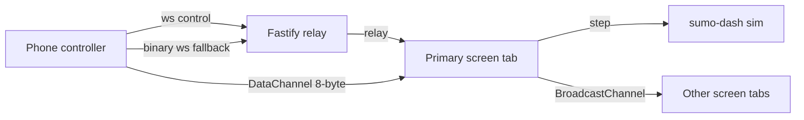

# v1 Day-1 shell and sumo-dash

## Overview

Hudson asked Kernel: "/ak-plan could you use Grok 4.7 for this task and plan high quality step by step for v1".

This plan builds that v1 and nothing past it. The repo has specs and skills only. The work adds a Vite workspace, a Fastify + `ws` relay, a SolidJS `/screen` and `/controller`, and `sumo-dash` registered through `GameDefinition`.

The host Chrome `/screen` tab runs the only sim and is the WebRTC peer. Phones join by QR. Other monitor tabs render `BroadcastChannel` snapshots. Fastify does not simulate.

## Scope Challenge

- Existing code: specs, `AGENTS.md`, and `.agents/skills/`. No `package.json` and no app source.
- Requested scope: Day-1 shell + `sumo-dash` per `SPEC.md`, `games-spec/README.md`, and `games-spec/sumo-dash.md`.
- Complexity: greenfield, about 40 source files, 6 phases. The seams are separate runtimes, so fewer phases would hide the test gates.
- Selected mode: REDUCTION. `--yagni` is pre-authorized. Stretch 1–4, v1.1 bots, Tauri, and extra games stay out.

## Goals

| # | Goal | Priority |
|---|------|----------|
| 1 | QR join from host Chrome to phone Safari/Chrome | P1 |
| 2 | `GameTransport`, `GameSimulation`, and `GameDefinition` exist as real seams | P1 |
| 3 | `sumo-dash` plays for 2–8 humans on one holistic screen | P1 |

## Out of scope

v1.1 heuristic bots. Stretch 1 Tab HUD, TDMA, NTP, and the 30Hz send cap. Stretch 2 SharedWorker, SAB, WASM. Stretch 3 flight recorder and `adaptive-1tick`. Stretch 4 ONNX. Tauri. Socket.IO. A cloud SFU. Phaser Arcade or Matter. A second game.

`sumo-dash.md` line 263 mentions an auto 30Hz cap. `sumo-dash.md` line 119 and `SPEC.md` lines 94 and 115 say v1 warns only. This plan warns only.

## Decisions locked by the specs

- Packages live at `shared/`, `server/`, `screen/`, `controller/`, and `games/sumo-dash/`. The shared package name is `@shared`.
- Toolchain is pnpm with `packageManager` set to a full `pnpm@10.x.y`, TypeScript, Vite (the peer range of `@solidjs/vite-plugin` 3.x), Vitest, `solid-js@2.0.3`, `@solidjs/web@2.0.3`, Tailwind 4, `phaser@4`, Fastify, and `ws`.
- Dev HTTPS uses mkcert. Fastify listens on `0.0.0.0`. The QR host is the LAN IPv4 from `GET /api/host`.
- The `ws` server is attached to Fastify's HTTP server with `perMessageDeflate: false` and `socket.setNoDelay(true)`.
- The host tab is the offerer. DataChannel options are `{ ordered: false, maxRetransmits: 0, negotiated: true, id: 0 }` and `iceServers: []`. The phone is the answerer because the spec injects the LAN address into the host offer.
- Primary tab: only `view=holistic` calls `navigator.locks.request('party-sim-'+room, { mode: 'exclusive', ifAvailable: true })`. The callback returns a promise that settles on `pagehide`. Offers and `viewport:claim` run only after that callback receives a lock. Each screen tab also holds `party-antinap-{room}-{tabId}` and a silent oscillator.
- `POST /api/rooms` returns `{ roomId, hostToken }`. `hostToken` stays in the screen tab. A screen socket must present it. Controllers use the room code only.
- Broadcast player records omit `sessionToken`. The token is only in `room:joined` to that socket. Tokens are 128-bit.
- SDP munge runs on the host offer only. A `.local` host candidate keeps its port and gains the LAN IPv4. Every other candidate is dropped. The phone answer is not rewritten.
- Binary `ws` fallback: the phone sends 8 bytes. The server prepends the sender's slot and forwards 9 bytes to the current primary socket. A socket with no slot is not forwarded. Screen-socket close clears `primarySocket`.
- Host loop repeats the last real packet for at most `INPUT_SILENCE_MS = 100`, then applies zeros. A rising edge compares the last two real packets. Synthesized zeros are not a release.
- Dash sets the velocity component along the stick (or along facing when the stick is dead) to 920 and keeps the perpendicular component. Dash-versus-idle knockback uses 1.75× on the victim only.
- Rematch buttons call the restart on the primary tab first, then send `sumo:rematch` for everyone else. `game:mount` carries `gameId`. Clients load the manifest from the local registry.
- Room alphabet is `ABCDEFGHJKLMNPQRSTUVWXYZ`.
- At most two new tests per change. Write each failing test first.

## Phases

| Phase | Name | Status |
|-------|------|--------|
| 1 | [Monorepo and shared contracts](./phase-01-monorepo-and-contracts.md) | Done |
| 2 | [Sumo simulation](./phase-02-sumo-simulation.md) | Done |
| 3 | [Fastify relay](./phase-03-fastify-relay.md) | Done |
| 4 | [Screen shell](./phase-04-screen-shell.md) | Done |
| 5 | [Controller shell](./phase-05-controller-shell.md) | Done |
| 6 | [Sumo plugin and acceptance](./phase-06-sumo-plugin-acceptance.md) | Pending |

## Dependencies

- Phase 2 and Phase 3 depend on Phase 1.
- Phase 4 depends on Phases 2 and 3.
- Phase 5 depends on Phases 1 and 3.
- Phase 6 depends on Phases 2, 4, and 5.
- Cook runs the phases in order. Do not start Phase 2 until Phase 1's gate is green.

## Success Criteria

- [ ] Host Chrome on the LAN URL shows a room code and a QR code that opens `/controller` on a phone.
- [ ] Two phones join, the primary tab steps `sumo-dash`, and a second screen tab shows `STANDBY // THIS GAME USES HOLISTIC VIEW` for `view=team-1`.
- [ ] Input uses the DataChannel. A phone that never opens the channel sends the same 8 bytes on binary `ws` after 3 seconds.
- [ ] `pnpm -r test` passes. The manual checklist in Phase 6 is filled or the gaps are listed.

## Research

- [Scout](./reports/scout-report.md)
- [Day-1 scope](./research/researcher-01-day1-scope.md)
- [Stack](./research/researcher-02-stack.md)

## Red Team Review

Four hostile reviews ran on 2026-11-24. Findings were merged. Evidence is the spec and this plan. The app tree is empty, so missing source files are expected.

| # | Finding | Severity | Disposition |
|---|---------|----------|-------------|
| 1 | Any socket can claim the sim, including a team tab | Critical | Accept. Holistic lock holder only. `hostToken` required. |
| 2 | `sessionToken` rides on the broadcast player list | Critical | Accept. Token stays on `room:joined`. |
| 3 | Phone SDP is rewritten to the Mac address | Critical | Accept. Munge the host offer only. |
| 4 | Binary fallback has no slot and sticks to a dead socket | Critical | Accept. Server prefixes the slot. Close clears primary. |
| 5 | Primary never receives its own rematch echo | High | Accept. Apply locally, then send. |
| 6 | `seq` is not written, and the wrap rule is wrong | High | Accept. Little-endian raw bytes. Half-range mod 65536. Reset on rejoin. |
| 7 | Accumulator debt after the 4-step cap | Critical | Accept. Zero the accumulator when the cap hits. |
| 8 | One scratch buffer drops the dash edge | Critical | Accept. Latch the edge. Compare real packets only. |
| 9 | Countdown discards aim and a held dash fires at the whistle | High | Accept. Aim updates. No motion. Held bit is not a new edge. |
| 10 | 200ms hold synthesizes a dash release | High | Accept. 100ms silence. Synthesized zeros are not a release. |
| 11 | `mkcert -install` on the Mac does not trust the phone | Critical | Accept. README includes phone trust. Checklist requires `isSecureContext`. |
| 12 | Two Vite apps and a catch-all `ws` server share one upgrade | Critical | Accept. Base paths and an upgrade split. |
| 13 | `register-games.ts` was modified before it existed | High | Accept. Phase 4 and Phase 5 create the empty files. |
| 14 | Rejoin payload was unnamed | High | Accept. `{ name, sessionToken }` plus a rejoin test. |
| 15 | Make the phone the WebRTC offerer so Safari owns id 0 | High | Reject. `SPEC.md` line 101 puts the LAN address in the host offer. Fallback covers a channel that stays closed. |

### Whole-Plan Consistency Sweep

Decision delta applied: host token, private session token, offer-only SDP munge, slotted binary fallback, local rematch, seq rules, accumulator reset, dash latch, countdown aim, 100ms silence, phone trust, Vite upgrade split, register-file ownership.

Searched the plan for `200ms`, `startLocked`, circle placeholders, phone-side SDP rewrite, and broadcast `sessionToken`. The leftover "forwarded unchanged" sentence in Phase 3 now excludes `game:mount` and `sumo:*`. No unresolved contradiction remains.

## Validation Log

### Session 1 — 2026-11-24

**Trigger:** Hard-mode gate after red team.
**Questions asked:** 0. The specs and the red-team edits close the forks. Hudson's audit card is the remaining review.

#### Confirmed Decisions

- Day-1 scope stays shell + `sumo-dash`. Stretch stays out.
- Warn on 30Hz. Do not cap the send rate.
- Host Chrome tab is the offerer and the only sim.
- Tests stay at one or two per change.

#### Verification Results

- Claims checked: 8
- Verified: 6 | Failed: 0 | Unverified: 2
- Tier: Full
- Verified: no `package.json` before this plan; `SPEC.md` line 37 DataChannel options; `SPEC.md` line 115 v1 milestone; `sumo-dash.md` line 13 import `@shared/types`; `AGENTS.md` lines 36–38 test budget; `.gitignore` ignores `plans/`.
- Unverified: the exact `pnpm@10.x.y` Corepack will fetch, and the Vite peer range of `@solidjs/vite-plugin` 3.x. Cook reads those at install time. [UNVERIFIED]

### Whole-Plan Consistency Sweep

Validation did not rename files or APIs beyond the red-team delta. Phase links in `plan.md` match `phase-01` through `phase-06`. Ready for Hudson to choose cook or hold.

<!-- slug: v1-day1-shell-sumo-dash -->
