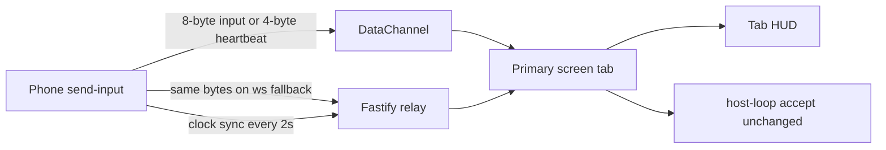

# Stretch 1 RF timing and telemetry HUD

## Overview

Stretch 1 adds RF timing and a developer HUD on top of the playable Day-1 shell at `b64f758`. The host Chrome tab stays the WebRTC peer. Fastify stays a relay. Phones gain a staggered send clock, a 4-byte keep-alive, and a 30Hz cap. The screen gains a `Tab` overlay.

Cook this plan on a new branch from `b64f758`. Suggested name: `feat/stretch1-rf-telemetry-hud`. Do not commit it on `main`. The sibling plan `plans/261124-1040-v11-heuristic-bots/` cooks on its own branch at the same time.

A cook can follow the phase files with no AgentKit skills. Each phase names the failing test first, then the code, then the command.



## Scope Challenge

- Existing code: 8-byte header, warn-only preflight, `routeFastInput`, screen peer, and text fan-out. See [scout](./reports/scout-report.md).
- Requested scope: TDMA `slot * 2ms`, anti-PSM keep-alive, NTP offset, adaptive 30Hz cap, coalesced and predicted samples, and the `Tab` HUD.
- Complexity: 4 phases, about 12 new files, 8 edited files. The phases stay split because their files do not overlap.
- Selected mode: REDUCTION. `--yagni` is pre-authorized. The cuts are listed under Out of scope.

## Goals

| # | Goal | Priority |
|---|------|----------|
| 1 | Eight phones do not share one transmit instant | P1 |
| 2 | An idle phone keeps the Wi-Fi radio awake | P1 |
| 3 | A weak or low-power phone sends input at 30Hz | P1 |
| 4 | `Tab` on the primary monitor shows net, jitter, and loss | P1 |

## Out of scope

Kalman coefficients. `getPredictedEvents` is the prediction. SharedWorker, `SharedArrayBuffer`, WASM, 128-byte slots, and the DisplayLink `+0..35ms` slider. Flight-recorder export, JSON/CSV dump, and replay. Those HUD cells render `—` or `+0ms`. Heuristic bots, `supportsBots`, and `games/sumo-dash/**`. Edits to `screen/src/host-loop.ts`. A new server parser for NTP. Cloudflare Tunnel. Socket.IO. React.

## Decisions locked by the specs

- Control-plane clock sync rides the existing text fan-out. The server does not learn a new message type. SPEC.md line 45.
- The 8-byte header stays the telemetry piggyback. The heartbeat is a separate 4-byte frame. SPEC.md lines 102 and 187–195.
- v1 warned on 30Hz and did not cap. This plan caps. SPEC.md lines 103 and 136.
- The overlay uses JetBrains Mono and the neo-brutalism ban list. SPEC.md lines 75–84 and 201–211.
- One or two new tests per phase. Write the failing test first. The names are in the phase files.
- Offset `theta` feeds the HUD and the phone phase. It does not enter `applyInput`.

## Parallel cook ownership

This branch may land in the same night as the v1.1 bots branch. A file has one owner.

| Path | Stretch 1 | v1.1 bots |
|------|-----------|-----------|
| `shared/src/stretch1/**` | Phase 1 creates it | Do not touch |
| `shared/src/ui/virtual-joystick.tsx` | Phase 2, sample pick only | Do not touch |
| `shared/src/codec/**`, `shared/src/controller/preflight.ts` | Frozen | Do not touch for this work |
| `controller/src/**` | Phase 2 | Do not touch |
| `screen/src/telemetry/**` | Phase 3 creates it | Do not touch |
| `screen/src/peer.ts` | Phase 3 | Do not touch |
| `screen/src/session.ts` | `onPacket`, `onHeartbeat`, and forward `clock:*` / `phone:*` | `start`, `playAgain`, and the `createHostLoop` call |
| `screen/src/app.tsx` | Mount `<TabHud>` beside `<Badge>` | `startEnabled` memo and `<Lobby>` bot props |
| `screen/src/host-loop.ts` | Do not touch. Do not add a `createHostLoop` parameter | One `fillBot` call and an optional fourth argument |
| `screen/src/bot-fill.ts`, `screen/src/register-games.ts` | Do not touch | Owned here |
| `screen/src/lobby.tsx` | Do not touch | Bot-count control |
| `games/sumo-dash/**` | Do not touch | Owned here |
| `supportsBots` and heuristic policy | Do not touch | Owned here |
| `server/src/relay.ts`, `server/src/relay.test.ts` | Phase 4, length-4 forward only | Do not touch |
| `server/src/rooms.ts`, `server/src/player-slot.ts` | Do not touch | Do not touch |

The bots plan is `plans/261124-1040-v11-heuristic-bots/`. It does not edit `controller/src/**`, `server/**`, or the HUD files. If both diffs still touch `session.ts`, land the bots branch first, then replay the two telemetry seams. Stretch 1 does not add parameters to `createHostLoop`. Cross-ref 2026-11-24: v1.1 owns the bot-count control in `screen/src/lobby.tsx`, the `<Lobby>` bot props in `app.tsx`, and `returnToLobby` plus `setBotCount` in `session.ts`. Stretch 1 still does not edit those lines.

Inside this plan the phases are also disjoint:

| Phase | May run with | Exclusive files |
|-------|----------------|-----------------|
| 1 Shared math | Phase 4 | `shared/src/stretch1/**` |
| 2 Controller RF | Phase 3 and Phase 4, after Phase 1 is green | `controller/src/send-input.ts`, `controller/src/peer.ts`, `controller/src/app.tsx`, `shared/src/ui/virtual-joystick.tsx` |
| 3 Screen HUD | Phase 2 and Phase 4, after Phase 1 is green | `screen/src/telemetry/**`, `screen/src/peer.ts`, the named seams in `session.ts` and `app.tsx` |
| 4 WS forward | Phase 1 | `server/src/relay.ts`, `server/src/relay.test.ts` |

## Phases

| Phase | Name | Status |
|-------|------|--------|
| 1 | [Shared Stretch 1 math](./phase-01-shared-math.md) | Pending |
| 2 | [Controller RF send](./phase-02-controller-rf-send.md) | Pending |
| 3 | [Screen telemetry HUD](./phase-03-screen-telemetry-hud.md) | Pending |
| 4 | [WebSocket heartbeat forward](./phase-04-ws-heartbeat-forward.md) | Pending |

## Dependencies

- Phase 2 and Phase 3 import `shared/src/stretch1/`. Start them after `pnpm --filter @shared test` is green.
- Phase 4 has no code dependency. It may start with Phase 1.
- The manual HUD checklist runs after Phases 2, 3, and 4 are on the same branch.

## Success Criteria

- [ ] `pnpm -r test` passes.
- [ ] The failing tests named in Phases 1, 3, and 4 exist and failed before their implementation.
- [ ] `Tab` on the primary screen shows transport, touch, net p50/p99, jitter, and loss.
- [ ] A low-power phone sends input at 30Hz. An idle phone sends a 4-byte heartbeat at 25Hz on its slot phase.
- [ ] `git diff -- games/sumo-dash screen/src/host-loop.ts` is empty against the branch base.
- [ ] The manual checklist in Phase 3 is filled, or the gaps are listed in the phase report.

## Verification

```bash
pnpm --filter @shared test
pnpm --filter @screen test
pnpm --filter @server test
pnpm --filter @controller test
pnpm -r test
git diff --name-only -- games/sumo-dash screen/src/host-loop.ts
```

Manual checklist: Phase 3, plus one fallback pass. Close the phone DataChannel or block the offer, wait 3 seconds, and confirm the screen row reads `WS-FALLBACK` while 5-byte binary frames still arrive.

## Research

- [Scout](./reports/scout-report.md)

## Red Team Review

Reviewed in this planning session on 2026-11-24. No subagents. Evidence is the Day-1 source at `b64f758`. Accepted items are already written into the phase files.

| # | Finding | Severity | Disposition |
|---|---------|----------|-------------|
| 1 | A 4-byte frame that calls `accept` would move a body | Critical | Accept. Heartbeat never calls `accept`. Magic `0xA5`. `screen/src/host-loop.ts` lines 102–120 stay as they are. |
| 2 | Forwarding every non-8 length breaks the 7-byte drop | High | Accept. Only length 4 is added. `server/src/relay.test.ts` lines 172–174 stay true. |
| 3 | Two screen tabs would both answer `clock:sync` | High | Accept. `fanOut` hits every tab (`server/src/relay.ts` lines 155–160). Only `primary` replies. |
| 4 | `phoneTs` mod 65536 wraps the one-way math | High | Accept. `oneWayMs` unwraps. `shared/src/codec/input-packet.ts` lines 21–22. |
| 5 | A new `onAxes` signature edits Sumo | Medium | Accept. Signature stays. Sample pick is inside `virtual-joystick.tsx`. Sumo calls it at `controller-view.tsx` line 57. |
| 6 | A second `decode` allocates on the hot path | Medium | Accept. Pass numbers. Do not rewrite the codec. `input-packet.ts` lines 28–37. |
| 7 | Spoofed `clock:offset` can lie about another slot | Medium | Accept the HUD risk. `fanOut` does not stamp the sender (`relay.ts` lines 215–221). `theta` never reaches `applyInput`. |
| 8 | Kalman filter and flight-recorder buttons are missing | Medium | Reject. SPEC.md line 103 names the pointer APIs, not coefficients. SPEC.md lines 119 and 137 put the recorder in Stretch 3. |
| 9 | `session.ts` will conflict with the bots plan | Medium | Accept. Stretch 1 edits `onPacket` and four message types. Bots edit `start`, `playAgain`, and `createHostLoop`. `host-loop.ts` stays with bots. |

### Whole-Plan Consistency Sweep

Decision delta: heartbeat is not input, only length 4 is new on the relay, primary answers NTP, offset is HUD-only, joystick callback is unchanged, no Kalman, no export buttons, no `host-loop.ts` edit.

Searched the phase files for `host-loop`, `Kalman`, `SharedArrayBuffer`, `onAxes`, and `accept`. Phase 2 and Phase 3 agree on `clock:sync`, `clock:sample`, `clock:offset`, `phone:tier`, and `phone:longtask`. Phase 4 does not parse them. The sibling bots plan now names its `session.ts` and `app.tsx` lines. This plan avoids those lines. No unresolved contradiction remains.

## Validation Log

### Session 1 — 2026-11-24

**Trigger:** Parallel plan gate. Specs plus the scout close the forks.
**Questions asked:** 0.

#### Confirmed Decisions

- REDUCTION stands. Placeholders for Stretch 2 and Stretch 3 fields. No export buttons.
- NTP stays on the host tab. The relay only forwards the existing text and the 4-byte binary frame.
- Tests stay at one file of two tests in Phase 1, one test in Phase 3, and one test in Phase 4.

#### Verification Results

- Claims checked: 12
- Verified: 12 | Failed: 0 | Unverified: 0
- Tier: Standard
- Verified: `BINARY_FRAME` at `server/src/relay.ts:19`. 7-byte drop at `server/src/relay.test.ts:172`. `onPacket` sole caller at `screen/src/session.ts:91`. `accept` args at `screen/src/host-loop.ts:102`. `sendButton` bypass at `controller/src/send-input.ts:88`. Joystick emit at `shared/src/ui/virtual-joystick.tsx:43`. Sumo joystick at `games/sumo-dash/src/controller-view.tsx:57`. `decode` allocates at `shared/src/codec/input-packet.ts:30`. Text fan-out at `server/src/relay.ts:160`. Preflight copy at `controller/src/app.tsx:256`. `classifyPower` at `shared/src/controller/preflight.ts:1`. `PlayerSlot` at `shared/src/types/game.ts:3`.

### Whole-Plan Consistency Sweep

Validation did not rename files or message types. Phase links match `phase-01` through `phase-04`. After the sibling bots plan gained real seams, the ownership table was updated to match it. Ready for audit, then cook.

<!-- slug: stretch1-rf-telemetry-hud -->
