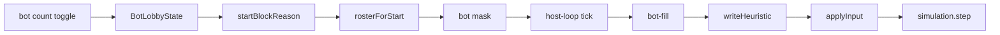

# v1.1 heuristic bots

## Overview

Hudson asked for a v1.1 heuristic-bot plan that can cook overnight as PR branch B beside the Stretch 1 plan. Base commit is `b64f758` on `main`.

This plan turns on `supportsBots` for `sumo-dash`, adds the steer and dash policy from `sumo-dash.md`, and calls `applyInput` for the host-chosen bot slots from the host tab. Bots use the same input function as phones. The sim `step` stays free of bot code.

The lobby count is a host control. It is not an auto-fill to `minPlayers`. Hudson stated the lobby rules in chat on 2026-11-24. Those rules replace Assumption L1. Cook implements every row of the test matrix below.

Cook branch when implementation starts: `feat/v11-heuristic-bots`. This plan does not create the branch.



## Scope Challenge

- Existing code: `applyInput` and the 120Hz host loop exist. `supportsBots` is `false`. No heuristic module. `canStart` in `shared/src/view/policy.ts` requires `minPlayers` connected humans. `screen/src/lobby.tsx` has a player list, a notice line, and a Start button. It has no bot control. `plans/261124-1040-stretch1-rf-telemetry-hud/` owns the Tab HUD and must not edit the lobby control.
- Requested scope: the v1.1 bot policy, the safety test, the host-selected bot count, the frozen match count, and the Vitest matrix. File ownership must stay clear of Stretch 1.
- Complexity: pure roster helpers, one host fill module, one lobby control, and one `it` per matrix row. Three phases. Phase 2 imports Phase 1. Phase 3 binds the helpers to SolidJS 2.
- Selected mode: REDUCTION. `--yagni` is pre-authorized for ONNX, a mode picker, a second game, and Stretch 1 surfaces. The lobby toggle is in scope because Hudson required it. The test budget for Phase 2 is the matrix, because Hudson required a case for every lobby rule.

## Goals

| # | Goal | Priority |
|---|------|----------|
| 1 | `writeHeuristic` matches the three steer and dash rules | P1 |
| 2 | The host chooses the bot count. Start follows the locked lobby rules. Each chosen bot reaches `applyInput` | P1 |
| 3 | Stretch 1 files stay untouched by this cook | P1 |

## Out of scope

Stretch 4 ONNX. A Human / Heuristic / ONNX picker. SPEC.md line 134 forbids that picker in the v1 lobby, and this plan does not add one. A second game. Bot-only matches with zero phones. Replacing a disconnected human with a new bot. Setting `IS_BOT` in the sim buffer. Renderer labels and bot name rows. The count control is not a player-list row. Edits to `simulation.step`. Edits to `canStart`. Stretch 1 send rate, heartbeat, Tab HUD, NTP, and TDMA. SharedWorker, flight recorder, and Tauri. A new `/shared/ui` primitive. The six primitives stay the only ones.

## Parallel-cook ownership

Sibling plan: `plans/261124-1040-stretch1-rf-telemetry-hud/` (PR branch A). This plan is PR branch B. Neither plan blocks the other when the table holds.

**v1.1 owns**

| Path | Change |
|---|---|
| `games/sumo-dash/**` | `supportsBots: true`, `heuristic.ts`, safety Vitest, spec lines that quote the flag |
| `screen/src/bot-fill.ts` | Roster helpers, freeze helpers, 60Hz sample holder |
| `screen/src/bot-fill.test.ts` | Matrix rows 1–14 and the extra rows in Phase 2 |
| `screen/src/host-loop.ts` | One `fillBot` call inside the slot loop, plus an optional fourth argument |
| `screen/src/register-games.ts` | Optional `writeBotInput` on `ScreenGame` |
| `screen/src/session.ts` | `setBotCount`, `start`, `playAgain`, `returnToLobby`, and the `createHostLoop` call |
| `screen/src/app.tsx` | `startEnabled` memo and the `<Lobby>` bot props |
| `screen/src/lobby.tsx` | Bot-count control and the existing notice line |

**v1.1 must not edit**

- `controller/src/**` (Stretch 1 send path, 30Hz cap, heartbeat)
- Tab HUD UI files
- NTP, TDMA, and shared telemetry packages
- `shared/src/view/policy.ts` (`canStart` stays the human count check)
- `server/**`
- `screen/src/styles.css` (reuse `.notice` and `.key`)
- `shared/src/ui/**` (no seventh primitive)

Merge order: land the bots PR first if both diffs touch `host-loop.ts` or `session.ts`. Stretch 1 should keep the HUD in a new screen component and should not add parameters to `createHostLoop`. The silence and dash-latch body in `host-loop.ts` stays in place so a later HUD diff can wrap the loop without rewriting input. Stretch 1 does not edit the lobby control or the `<Lobby>` bot props.

## Assumptions

The spec says an empty slot calls `applyInput`, and it forbids an ONNX lobby mode. Hudson chose the count rule in chat on 2026-11-24. Cook uses these labeled rules.

- **L1 (host bot-count toggle).** Quote: "Toggle to set how many bots; default 0; depends on players joining. Example: 4 bots + 4 players OK; 5th player joins → disable Start because 5+4=9 over max; show banner: exceed max — modify bot count. Bot join count fixed for the whole game after Start (cannot change mid-match). Need ≥1 real player to toggle bots and to Start. If 1 player + 2 bots then that player quits → Start disabled + warning need minimum one real player. Sumo still has `minPlayers: 2`, `maxPlayers: 8`." A raise above the free seats is rejected. A human join does not change the stored count and does not evict a bot. `sumo-dash` keeps `minPlayers: 2` and `maxPlayers: 8` on the manifest.
- **L2 (count, not a roster row).** The bot is a joined sim slot. The player list does not gain a bot name. The count control sits with the Start button. The existing puck draw uses `PUCK[slot]`. There is no bot badge.
- **L3 (freeze and return).** Start copies the count into a locked state. `playAgain` uses that same frozen count with the humans still connected. `returnToLobby` unlocks the toggle at that same count. A new session still starts at 0.
- **N1 (nearest tie).** Equal center distance keeps the lower slot index.
- **N2 (no opponent inside the home radius).** Axes and the dash bit are `0`.
- **R1 (60Hz).** The host steps at 120Hz. The policy runs when `tickId` is even and the last Int8 sample is applied on the odd substep. Both substeps call `applyInput`.

Disconnects stay on the human path. Silence still writes zeros after 100ms. A bot never takes that slot. A disconnect during a match does not spawn another bot. The frozen bot slots keep the heuristic. That follows `SPEC.md` line 134 and `sumo-dash.md` FR-6.

## Decisions

- Policy module: `games/sumo-dash/src/heuristic.ts`. Host module: `screen/src/bot-fill.ts`. The screen calls the writer from the registry. It does not contain steer math.
- Axes are Int8, divided by 127 inside the existing `applyInput`.
- `IS_BOT` stays 0. Preserving bit 2 would mean editing every `flags` store in `simulation.ts`. The host mask is enough for v1.1.
- Pure helpers: `clampBotCount`, `nextBotCount`, `startBlockReason`, `startNotice`, `rosterForStart`, `createBotLobby`, `lockBotCount`, `unlockBotCount`, `botMaskAfterHumanLeave`. Phase 2 tests call these functions. The Solid tree does not own the rules.
- `nextBotCount` rejects a requested count above `clampBotCount`. It does not lower an over-cap count on a + press. The host lowers the count with an explicit smaller request.
- Check order inside `startBlockReason`: `no-human`, then `over-cap`, then `below-min`. Zero humans wins even when the bot count alone would pass `minPlayers` or break `maxPlayers`.
- Banner source strings: `exceed max — modify bot count` and `need minimum one real player`. `.notice` uppercases them on screen. The unit test asserts the source strings. Cook does not edit `styles.css`.
- The lobby control is two existing `button.key` controls, minus and plus. It is not a new `/shared/ui` primitive. `ArcadeButton` stays on the phone.
- Tests: Phase 1 keeps one new safety test plus the manifest flag flip. Phase 2 writes one `it` per matrix row in `screen/src/bot-fill.test.ts` before `bot-fill.ts` exists. Phase 3 is an eyeball checklist. The matrix is the exception to a one-test phase, because Hudson required every scenario.
- SolidJS 2: `Lobby` stays a `VoidComponent`. New props are `botCount`, `botControlEnabled`, `botNotice`, and `onBotStep`. The parent holds the session state. The component renders it.

## Phases

| Phase | Name | Status |
|-------|------|--------|
| 1 | [Heuristic policy](./phase-01-heuristic-policy.md) | Pending |
| 2 | [Host bot count](./phase-02-host-bot-fill.md) | Pending |
| 3 | [Lobby bot toggle](./phase-03-lobby-bot-toggle.md) | Pending |

## Dependencies

- Phase 2 depends on Phase 1. Cook Phase 1 to a green test before Phase 2.
- Phase 3 depends on Phase 2. The buttons call the helpers. They do not grow a second rule.
- Day-1 shell on `b64f758` is the base. This plan does not reopen `plans/261124-0639-v1-day1-shell-sumo-dash/`.
- Parallel with `project:261124-1040-stretch1-rf-telemetry-hud`. No file overlap when both cooks follow the ownership table.

## Test matrix

Cook writes these as failing tests first. Rows 1–14 and 16–18 live in `screen/src/bot-fill.test.ts`. Row 15 stays in Phase 1. Sumo numbers in the tests are `minPlayers: 2` and `maxPlayers: 8`. `supportsBots` is `true` unless the row says otherwise.

| # | Scenario | Assertion |
|---|----------|-----------|
| 1 | Default bot count is 0 | `createBotLobby()` returns `{ botCount: 0, locked: false }` |
| 2 | Toggle is a no-op with zero humans | `nextBotCount(state, 2, 0, 8, true)` returns the same `botCount` |
| 3 | 1 human + 1 bot | `startBlockReason` is `null`. `rosterForStart` length is 2 and one mask bit is 1 |
| 4 | 1 human + 0 bots | `startBlockReason` is `below-min`. Roster is `null` |
| 5 | 4 humans + 4 bots | Reason is `null`. Roster length is 8 |
| 6 | 4 humans + 4 bots, then a 5th human | Reason is `over-cap`. `startNotice` is `exceed max — modify bot count`. Stored count stays 4 |
| 7 | After Start, a count change is ignored | `lockBotCount`, then `nextBotCount` with another request, returns the frozen count |
| 8 | 1 human + 2 bots, then that human leaves | Reason is `no-human`. `startNotice` is `need minimum one real player`. Stored count stays 2 |
| 9 | 0 humans + 2 bots | Reason is `no-human` even though 2 meets `minPlayers` |
| 10 | 5 humans + 4 bots, then set bots to 3 | `nextBotCount` stores 3. Reason becomes `null` |
| 11 | Raise above free seats | `clampBotCount(5, 4, 8)` is 4. `nextBotCount` from 4 to 5 stays 4. Reason stays `null` |
| 12 | Rematch and return | `playAgain` uses the locked count. `unlockBotCount` keeps that count and clears `locked`. A fresh `createBotLobby()` is still 0 |
| 13 | Human disconnect during the match | `botMaskAfterHumanLeave` keeps every bit. The human slot stays 0. No new bot bit appears |
| 14 | Second human joins before Start at 1 human + 1 bot | Count stays 1. Reason stays `null`. The join path does not call `nextBotCount` |
| 15 | Manifest and safety vector | Phase 1: `supportsBots: true` and the `0.85 * R` test (`axisX === -127`, `axisY === 0`, dash bit `0`) |
| 16 | Away slot stays occupied | Connected index 0, disconnected index 1, bot count 1 places the bot on slot 2. `botMask[1] === 0` |
| 17 | Flag off | `supportsBots: false` places no bots. One human is `below-min`. Two humans start with a zero mask |
| 18 | Bot sample reaches `applyInput` | `createBotFill(writeHeuristic)` on the armed bot slot returns `true` and writes aim. The human slot returns `false` |

`startBlockReason` reads counts. `rosterForStart` also returns `null` when the free indices cannot hold the bot count. Start is enabled only when the roster is non-null. The notice is empty when the reason is `null` or `below-min`.

## Success Criteria

- [ ] A bot spawned at `0.85 * R` in the Phase 1 test reports axis `(-127, 0)` and dash bit `0`. `supportsBots` is `true`.
- [ ] Rows 1–14 and 16–18 exist as separate `it` blocks in `screen/src/bot-fill.test.ts` and pass.
- [ ] Default count 0. One human can start after the host sets at least one bot. Four humans and four bots can start. Five humans and four bots cannot start, and the notice source is the over-cap sentence.
- [ ] Start locks the count. `playAgain` uses that count. `returnToLobby` unlocks it at the same count. A disconnect during the match does not add a bot.
- [ ] A disconnected human slot is not marked bot. Zero humans cannot start.
- [ ] `corepack pnpm --filter @games/sumo-dash test` and `corepack pnpm --filter @screen test` exit 0.
- [ ] The cook diff does not touch `controller/src/**`, `shared/src/view/policy.ts`, `screen/src/styles.css`, or NTP/TDMA/HUD files.

## Verification

```bash
corepack pnpm --filter @games/sumo-dash test
corepack pnpm --filter @games/sumo-dash exec tsc --noEmit
corepack pnpm --filter @screen test
corepack pnpm --filter @screen exec tsc --noEmit
```

Phase 1 runs the first two. Phase 2 runs all four. Phase 3 re-runs the screen test and `tsc`, then the eyeball checklist. After Phase 1, the body of `writeHeuristic` contains no `new`, no array literal, and no object literal. The import line may use braces. `fill` allocates nothing. `rosterForStart` and `nextBotCount` run on lobby actions and on Start, not inside `simulation.step`.

## Cook

`/ak:cook /Users/hudson/Developer/local-party-console/plans/261124-1040-v11-heuristic-bots/plan.md --yagni`

If AgentKit cook is unavailable, a Grok session executes Phase 1, then Phase 2, then Phase 3. Each phase writes its failing test first. Phase 2 stays red until every matrix `it` passes. Do not edit the forbidden list to get a green test. Do not collapse the matrix into one `test()`.

## Validation Log

### Session 1 — 2026-11-24

**Trigger:** Fast plan with `--yagni` and a Stretch 1 ownership table.
**Questions asked:** 0. The first L1 filled empty slots up to `minPlayers`. Session 2 replaces that rule.

#### Confirmed Decisions

- Bots call `applyInput` only. `step` does not grow a policy.
- `IS_BOT` stays 0.
- Phase 1 still has one new safety test.

#### Verification Results

- Claims checked: 10
- Verified: 10 | Failed: 0 | Unverified: 0
- Tier: Light (fact check)
- `games/sumo-dash/src/manifest.ts` line 10: `supportsBots: false`
- `games/sumo-dash/src/manifest.test.ts` line 10 expects `false`
- No `heuristic.ts` in the repo
- `simulation.ts` `applyInput` divides by 127 (lines 227–228) and ignores a slot that `startMatch` did not join (lines 220–221)
- `placeSpawn` assigns `flags = ALIVE` (`simulation.ts` line 86), so bit 2 would not survive a round reset
- `sumo-dash.md` line 253 is the `0.85 * R` safety vector. Lines 104–106 are the three policy rules
- `host-loop.ts` lines 138–160 apply input only for `joined` slots, then `step`
- `session.ts` lines 285–305: `start` and `playAgain` pass `connectedSlots()`. `returnToLobby` releases the loop
- `policy.ts` lines 12–14: `canStart` is `connectedCount >= minPlayers`
- `app.tsx` lines 66–73 call `canStart`. `lobby.tsx` has a player list, a `.notice` slot, and a Start button
- Sibling Stretch 1 folder exists

### Session 2 — 2026-11-24

**Trigger:** Hudson replaced auto-fill with the host bot-count toggle and required the test matrix.
**Questions asked:** 0. The task locked the lobby rules, the reject-on-raise choice, the freeze, and the return-to-lobby unlock. No open product question remained.

#### Confirmed Decisions

- L1 is the host toggle. Default count is 0. Start needs at least one connected human.
- Over cap disables Start and shows `exceed max — modify bot count`.
- A raise past the free seats is rejected. A human join does not change the stored count.
- Start freezes the count for the match and for `playAgain`. `returnToLobby` unlocks that same count.
- Pure helpers take the matrix. The lobby checklist covers the Solid binding only.
- `canStart` stays unchanged. `screen/src/styles.css` stays unchanged.

#### Verification Results

- Claims checked: 8
- Verified: 8 | Failed: 0 | Unverified: 0
- Tier: Standard (3 phases, fact check of the new seams)
- `lobby.tsx` lines 23–28 and 69–80: one `.notice` for `props.notice`, Start uses `disabled={!props.startEnabled}` and `class="key start"`
- `styles.css` lines 82–86: `.notice` sets `text-transform: uppercase`
- `app.tsx` lines 66–74 and 85–120: `startEnabled` uses `canStart`. Match UI has Play Again and Return to Lobby. The lobby unmounts while `match()` is true
- `session.ts` lines 225–239 and 285–305: `begin` checks `canStart(slots.length, minPlayers)`. `playAgain` calls `startMatch(connectedSlots())`. `returnToLobby` calls `loop.release()`
- `policy.ts` lines 12–14: `canStart` is still the human check. This plan does not edit it
- `manifest.ts` lines 6–7 and 10: `minPlayers: 2`, `maxPlayers: 8`, `supportsBots: false`
- `shared/src/ui/` has six primitives. `ArcadeButton` is pointer-capture press state. The lobby keeps `button.key`
- SPEC.md line 116 allows v1.1 to fill empty slots through `applyInput`. Line 134 forbids a Human / Heuristic / ONNX lobby toggle. The count control is not that picker

### Whole-Plan Consistency Sweep

Searched this plan for auto-fill to `minPlayers`, for "one new test" as the Phase 2 budget, for a ban on `lobby.tsx`, and for a Human / Heuristic / ONNX picker as in-scope work. Phase 2 now uses the host count. Phase 3 owns `lobby.tsx`. Phase 1 still owns the single safety test and scenario 15. L1 in `plan.md` matches Phase 2 and Phase 3. The Stretch 1 ownership row for `screen/src/lobby.tsx` now names this plan as the bot-count owner. No unresolved contradiction.

<!-- slug: v11-heuristic-bots -->
