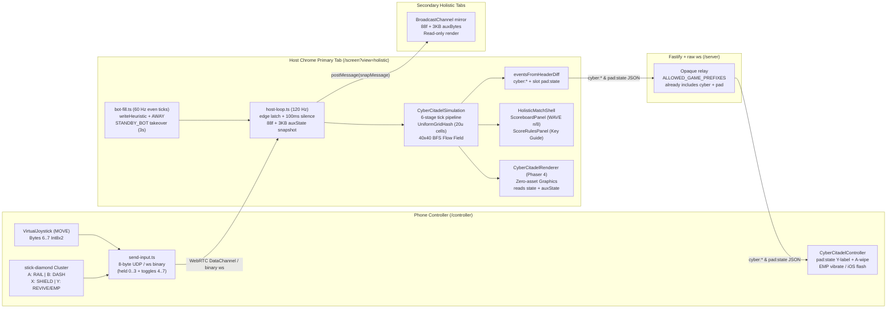

# Plan: Cyber-Citadel Defense (`cyber-citadel`) Implementation

## 1. Overview & System Architecture

This plan defines a staged, test-first roadmap to implement **Cyber-Citadel Defense** (`cyber-citadel`), the 1–8 player cooperative wave defense game specified in [specifications/games-spec/cyber-citadel.md](../specifications/games-spec/cyber-citadel.md). Cyber-Citadel runs inside the holistic console shell ([specifications/SPEC.md](../specifications/SPEC.md)) and follows the `GameDefinition` plugin contract ([specifications/games-spec/README.md](../specifications/games-spec/README.md)).

Base commit: `51d6d18` on `main`. Phase 1 platform seams are implemented in **PR #43** (`Hudson-Pufferfish/feat-cyber-citadel-p1`). Subsequent implementation phases target `feat/cyber-citadel` rebased on PR #43. This document defines the implementation plan; it does not implement game code.

### Core Architectural Invariants

1. **Strict Plugin Isolation:** All wave logic, flow-field pathfinding, enemy AI, boss state machines, and procedural visuals stay inside `games/cyber-citadel/`. Core shells (`/server`, `/screen`, `/controller`, `/shared`) contain zero game-specific branches.
2. **Deterministic Zero-Allocation Hot Path:** The 120 Hz simulation mutates pre-allocated `Float32Array(88)` primary state and a 3,072-byte `Uint8Array` `auxState` entity pool. `step()`, `applyInput()`, `rebuildFlowField()`, and `writeHeuristic()` perform zero heap allocations.
3. **Reusable Platform Primitives:** Cyber-Citadel uses `shared/src/physics-2d/` (including PR #43's `UniformGridHash`), `<ControllerShell>` (`stick-diamond` preset with PR #43's `pad:state`), and `<HolisticMatchShell>` (with PR #43's 8-player responsive HUD).
4. **Gradual Staged Delivery:** Execution follows the 7-phase roadmap tracked under Issue #18 so CI stays green at every merge boundary.

### System Architecture & Data Flow



---

## 2. Scope Challenge & Explicit Non-Goals

### Verified Codebase Findings (Reduce Scope Before Coding)

Code inspection against `main` (`51d6d18`) and **PR #43** (`Hudson-Pufferfish/feat-cyber-citadel-p1`) confirms five facts that prevent duplicate work:

1. **PR #43 completes Phase 1 core seams:** `UniformGridHash` (`shared/src/physics-2d/grid-hash.ts`), `pad:state` schema and `<ControllerShell>` dynamic labels / `disabled` bitmask / host cooldown wipes (`shared/src/types/game-control.ts`, `shared/src/ui/controller-shell.tsx`, `controller/src/app.tsx`), `CONTROLLER_REV = '0.4.0'` (`shared/src/sdp/qr-target.ts`), and 8-player responsive HUD clamping (`screen/src/styles/match.css`) already exist in PR #43. Do not re-implement them.
2. **Server allowlist requires zero edits:** `ALLOWED_GAME_PREFIXES` in `shared/src/types/game-control.ts:1` already includes `'cyber'` and `'pad'`. `server/src/relay.ts:195-200` forwards `cyber:*` and `pad:state` messages from the primary screen without server code changes.
3. **`auxState` pipeline is already wired end-to-end:** `screen/src/host-loop.ts:15,64-79` copies `sim.auxState` into `auxSnapshot`, `screen/src/session.ts:275-278,351-361,672-679` replicates `auxBytes` over `BroadcastChannel` and passes `readAux` to `createRenderer`, and `screen/src/bot-fill.ts:147,158,189` forwards `sim.auxState` to `WriteBotInput`.
4. **HUD primitives and 1-player start gating already exist:** `ScoreRules.guide` (`screen/src/score-rules.tsx:8-19`), `ScoreRow.ratio` proportional bars (`screen/src/score-rules.tsx:75-85`), `canStart(connectedCount, minPlayers)` (`shared/src/view/policy.ts:12-13`), and `rosterForStart` (`screen/src/bot-fill.ts:89-143`) support `minPlayers: 1` and co-op HP/guide display today.
5. **Two remaining platform seams belong in their consuming phases:**
   - **AWAY standby bot takeover** (`screen/src/bot-fill.ts`, `screen/src/register-games.ts`, `screen/src/session.ts`): build in Phase 6 alongside `heuristic.ts`, strictly opt-in so non-takeover games stay untouched.
   - **Lazy controller module loader** (`controller/src/register-games.ts`, `controller/src/app.tsx`): build in Phase 7 when registering Cyber-Citadel as the fourth controller game.

### Explicit Non-Goals (YAGNI / Out of Scope for v1)

- **Later Ideas from `cyber-citadel.md` Section 10:** Bot on-screen callouts (`"P3 BOT: PATCHING NORTH"`), downed spotter slow-ping, brute spin pinball, between-wave upgrade votes, post-match MVP titles, expressive Core face, barricade merging, and Core overcharge.
- **Opening Practice Phase:** Match starts directly in 3.0s `COUNTDOWN` -> Wave 1 (`cyber-citadel.md` Open Question 9).
- **Mid-Match Late Stranger Joins:** Unregistered tokens connecting mid-match receive `MATCH_IN_PROGRESS` (`server/src/rooms.ts:97-101`, Open Question 5).
- **Mid-Wave Pause:** Not supported in v1 (FR-8).
- **External Art or Audio Assets:** Zero PNG, SVG, sprite sheet, or audio sample files. All visuals use procedural Phaser 4 `Graphics`.
- **Platform Stretch Phases:** `SharedWorker` / `SharedArrayBuffer` / Rust WASM (Stretch 2), Binary Flight Recorder (Stretch 3), ONNX/WebGPU bots (Stretch 4), or a seventh `/shared/ui` primitive.
- **Multi-Monitor Team Views:** Strictly `viewConfig.mode === 'holistic'`. Secondary `team-N` tabs stay on standby (`INV-10`).

---

## 3. Component Reuse Matrix: Existing Games vs. Last Light vs. Cyber-Citadel Bespoke

This matrix separates direct platform reuse (including PR #43) from Last Light ([plans/last-light-implementation-plan.md](./last-light-implementation-plan.md)) and Cyber-Citadel bespoke modules.

| Dimension | Reuse from Existing Games (`sumo-dash` / `bomb-pass` / `color-clash` + PR #43) | Contrast vs. Last Light (`last-light`) | Cyber-Citadel Bespoke (`games/cyber-citadel/`) |
| :--- | :--- | :--- | :--- |
| **Genre, Players & Win/Loss** | `GameManifest` contract, `rosterForStart`, `minPlayers` policy (`shared/src/view/policy.ts:12-13`), `<MatchExitControl>`, and rematch podium flow. | 2–8 player competitive FFA bluffing; individual rank points toward target score + Sudden Death. | **1–8 player co-op wave defense (`minPlayers: 1`).** Shared win (clear Wave 8 Dreadnought) or shared loss (Core HP hits 0). Zero individual rank points. |
| **Physics & Spatial Broadphase** | Reuse `clampBoxBoundary` and `integrateMotion` (`shared/src/physics-2d/boundary.ts`, `motion.ts`) and PR #43's zero-alloc **`UniformGridHash`** (`shared/src/physics-2d/grid-hash.ts`: `insert`, `queryRadius`, `queryRay`). | Zero physics. Zero imports from `shared/src/physics-2d/`. | **20-unit broadphase over 800×800 arena** indexing up to 160 enemies for 60° auto-fire cones, 15° rail snap rays, dash collisions, and brute separation. Friendly fire and player-player collision disabled. |
| **State & `auxState` Memory** | Reuse `SNAPSHOT_FLOATS = 88` (`host-loop.ts:4`) and `ScreenSim.auxState` snapshot + `BroadcastChannel` sync (`session.ts:351-361`), proven by `color-clash`. | `Float32Array(88)` only; zero `auxState`; private `privateLockTick` barrier (`INV-8`). | **Dual-buffer layout:** 88-float primary buffer (352 B) + **3,072-byte `auxState`** (`DataView`) packing 160 enemies, 256 projectiles/tracers, 24 barricades, and 112 B meta trailer (+ optional 1,600 B debug flow field). |
| **Navigation & Pathfinding** | None in existing games (open circular/square arenas). | None (zero spatial movement). | **40×40 navigation grid + Core-centric BFS/Dijkstra flow field** (`flow-field.ts`) rebuilt on barricade dirty flag (max 1/tick) with sealed-corridor barricade-attack fallback (FR-9.15). |
| **Combat & Tactical Controls** | Reuse 4-button toggle-bit latching (`send-input.ts:101-120`, `host-loop.ts:127-156`) and deterministic Mulberry32 PRNG (`bomb-pass/src/simulation.ts:712`). | Single rising-edge lock tap (Bit 0) per blowout; axes ignored. | **Forward 60° auto-fire** (Core-distance priority + 10% stickiness, hitscan tracers) + **A RAIL** (15° snap, shield pierce, 2.5s CD), **B DASH** (impulse + 1.0s brute spin), **X SHIELD** (max 2/player, 8.0s barricade), **Y REVIVE/EMP** (priority context action). |
| **Escalation, Boss & Scaling** | Seeded match setup (`startMatch(slots, seed?)`). | Escalating non-linear hazard blowout window $[3.0, 12.0]\text{s}$; identical across $N=2..8$. | **8-wave escalation** (1→4 flanks, 2.0s telegraph glow), **Shielded Brutes** (120° frontal arc), **Wave 8 Dreadnought Boss** (3 phases at 66%/33% HP + dual-dash weak points), and **weighted squad scaling $W$**. |
| **Match Lifecycle & Respawn** | Standard `phaseEnum` (`0..3`), `MATCH_OVER = 3` (`host-loop.ts:11`). | 5 phases (`PRACTICE = 4`, 30s/20s breaks, `ROUND_END = 0.8s`). | **4 phases (`0=COUNTDOWN`, `1=WAVE_ACTIVE`, `2=WAVE_BREAK`, `3=MATCH_OVER`).** No opening practice. 15s wave breaks respawn dead/downed players and heal Core +10%. Downed bleed-out (15s/5s solo) + respawn (8s/4s solo, 3% Core cost, 12%/wave cap, 1 HP floor). |
| **HUD & 8P Responsive Layout** | Reuse `<HolisticMatchShell>`, `<ScoreboardPanel>` (`ScoreRow.ratio`), `<ScoreRulesPanel>` (`ScoreRules.guide`), `<MatchRejoinQr>`, and PR #43's **8-player responsive HUD clamping** (`screen/src/styles/match.css`). | Adds `<RoundRanking>` (`createRoundPanelModel`) with blind `'live'` mode. | **No `<RoundRanking>` needed** (`createRoundRanking` omitted). Right panel shows `WAVE <n>/8`, player tags, `LIVE`/`AWAY`, HP ratio bars, and `DOWN` text. Left guide shows `A: RAIL`, `B: DASH`, `X: SHIELD`, `Y: REVIVE / EMP`. |
| **Phone Controller & `pad:state`** | Reuse `<ControllerShell>` with existing **`stick-diamond`** preset (`shared/src/controller/layout.ts:21-24`), and PR #43's **`pad:state`** dynamic labels, `disabled` bitmask, host cooldown wipes, and `CONTROLLER_REV = '0.4.0'`. | Adds net-new `'tap-only'` preset (no joystick); host-confirmed `LOCKED` button; blowout white flash. | **Dynamic Button Y labels via `pad:state`** (`REVIVE`, `EMP`, `JOINED`, or dimmed disabled when idle), host-synced Button A 2.5s radial wipe, Android `navigator.vibrate` + iOS screen flash / switch Taptic on `cyber:emp`. |
| **Disconnect & Mid-Match Rejoin** | Reuse `setConnectedMask` (`host-loop.ts:175`), 100ms silence zeroing, `<MatchRejoinQr>`, and `MATCH_IN_PROGRESS` (`server/src/rooms.ts:97-101`). | No bot takeover; lock persists; uses `rehydrateEvent` -> `light:state`. | **3.0s AWAY standby Medium bot takeover** via opt-in `isStandbyBot` seam (`bot-fill.ts`), paused bleed-out while downed AWAY, immediate human handback on rejoin (+ `pad:state` cooldown re-sync). |
| **Heuristic Bots** | Reuse `createBotFill` (`bot-fill.ts:168`), `assignBotScores` (`shared/src/bot-difficulty.ts`), difficulty ranges (`11-20`, `30-50`, `50-70`). | Information-barrier timing bot reading public state only. | **1.0s periodic tactical role planner** reading `state` + `auxState`: flank guard, brute intercept, human-first `<5.0s` urgent revive, and human-initiated EMP join (never starts EMP solo). |

---

## 4. Platform Seams & PR #43 Status

### 4.1 Already Completed in PR #43 (Phase 1 — Do Not Duplicate)

**PR #43** ([`feat(platform): Cyber-Citadel Phase 1 seams and responsive 8-player HUD`](https://github.com/Hudson-Pufferfish/local-party-console/pull/43), branch `Hudson-Pufferfish/feat-cyber-citadel-p1`) is open against `main` and passes `pnpm typecheck`, `pnpm -r test`, and Vite builds for both `controller` and `screen`. It delivers:

| Seam | Files Delivered in PR #43 | Key APIs & Guarantees |
| :--- | :--- | :--- |
| **Zero-Alloc Spatial Broadphase** | `shared/src/physics-2d/grid-hash.ts`<br/>`shared/src/physics-2d/grid-hash.test.ts`<br/>`shared/src/physics-2d/index.ts` | `UniformGridHash(config)` backed by `cellHead`, `nodeEntity`, `nodeNext`, and `visitStamp` TypedArrays. Exposes `clear()`, `insert(id, x, y, radius?)`, `queryRect(...)`, `queryRadius(cx, cy, radius, out)`, and 2D DDA `queryRay(x0, y0, x1, y1, out, padding?)` with Liang-Barsky bounds clipping. Zero hot-path heap allocations. |
| **Dynamic `pad:state` Protocol & Shell** | `shared/src/types/game-control.ts`<br/>`shared/src/types/game-control.test.ts`<br/>`shared/src/types/index.ts`<br/>`shared/src/ui/controller-shell.tsx`<br/>`shared/src/ui/primitives.css`<br/>`controller/src/app.tsx`<br/>`controller/src/register-games.ts`<br/>`controller/src/controller-shell.test.tsx` | Exports `PAD_STATE_TYPE = 'pad:state'`, `PadStatePayload` (`{ slot, labels?, disabled?, cooldownEndsAt? }`), `parsePadStatePayload`, and `readPadStateMessage`. `controller/src/app.tsx` filters `pad:state` by `knownSlot` and passes `padState` into `ControllerViewProps`. `ControllerShell` updates dynamic labels (e.g., Button Y `REVIVE` / `EMP` / `JOINED`), applies the 4-bit `disabled` bitmask with tactile dimmed CSS, and syncs host `cooldownEndsAt` radial wipes. |
| **Controller Cache Bust** | `shared/src/sdp/qr-target.ts`<br/>`shared/src/sdp/qr-target.test.ts` | Bumps `CONTROLLER_REV` from `'0.3.0'` to `'0.4.0'`. |
| **8-Player Responsive Holistic HUD** | `screen/src/styles/match.css`<br/>`screen/src/score-rules.test.tsx` | Clamps `.match-side`, `.scoreboard`, `.score-row`, `.score-rules`, and `.round-ranking` gaps and scales typography via `clamp(14px, 2.2dvh, 28px)` so 8 players fit cleanly on both 720p and 1080p displays without clipping. |

> [!IMPORTANT]
> **Base Requirement:** Rebase Phase 2+ implementation work onto `main` after PR #43 merges (or branch from `Hudson-Pufferfish/feat-cyber-citadel-p1`). Do not re-create `grid-hash.ts`, `pad:state`, or `match.css` clamping.

### 4.2 Remaining Minimal Platform Seams (Deferred to Owning Phases)

Only **two** small, game-agnostic platform seams remain, each owned by the phase that first requires it:

1. **Opt-In AWAY Standby Bot Takeover + Reconnect Rehydration (Phase 6):**
   - `screen/src/register-games.ts`: Add optional `standbyBotLevel?: (state: Float32Array, slot: number) => number` (returns `0` when human-controlled, or `1..100` skill level when a disconnected human slot is under standby bot takeover) and optional `rehydrateEvents?: (state: Float32Array, slot: number) => Envelope[]` (coordinates with Last Light's `rehydrateEvent` seam; if Last Light lands first with `rehydrateEvent?: (state: Float32Array) => Envelope | null`, extend it cleanly to accept `Envelope | readonly Envelope[] | null` and optional `slot`).
   - `screen/src/bot-fill.ts`: Update `createBotFill(write, levelsFor?, standbyLevelFor?)` so `fill(slot, sim)` checks `botMask[slot] === 1` first, else checks `standbyLevelFor?.(sim.state, slot) ?? 0`. When `> 0`, it calls `write(sim.state, slot, axisX, axisY, buttons, standbyLevel, sim.auxState)` on even ticks (60 Hz) and feeds `sim.applyInput` every 120 Hz substep, returning `true` so `host-loop.ts:189` skips the silence-zero path. All existing games omit `standbyBotLevel`, keeping behavior 100% unchanged.
   - `screen/src/session.ts`: Forward `activeRuntime?.standbyBotLevel` into `createBotFill`, and inside `applyPlayers()` on `!before && after` reconnect during an active match, emit any envelopes from `rehydrateEvents(loop.state, slot)` so a rejoining phone receives current `pad:state` cooldowns and Button Y context immediately (FR-9.9).
2. **Lazy Controller Module Loader (Phase 7):**
   - `controller/src/register-games.ts` & `controller/src/app.tsx`: Refactor `controllerGames` from eager static component imports (`controller/src/register-games.ts:3-8`) to eager `manifest` + lazy `load: () => Promise<VoidComponent<ControllerViewProps>>`, matching `screen/src/register-games.ts:189-211` before shipping Cyber-Citadel as the fourth game (`cyber-citadel.md` Section 9).
   - Bump `CONTROLLER_REV` by one MINOR version (`'0.4.0'` -> `'0.5.0'`, or `'0.5.0'` -> `'0.6.0'` if Last Light ships first) when `CyberCitadelController` registers.

---

## 5. Memory Layouts & Binary Contracts

### 5.1 Primary Simulation State Buffer — `Float32Array(88)` (`352 bytes`)

Matches `SNAPSHOT_FLOATS = 88` (`screen/src/host-loop.ts:4`) and `cyber-citadel.md` Section 4.C:

#### Global Header (Indices `0..7`)

| Index | Constant (`CYBER_HEADER`) | Type / Range | Semantics |
| :---: | :--- | :--- | :--- |
| `0` | `tickId` | Monotonic integer (`0..`) | Fixed-step 120 Hz tick counter. |
| `1` | `phaseEnum` | `0 \| 1 \| 2 \| 3` | `0 = COUNTDOWN`, `1 = WAVE_ACTIVE`, `2 = WAVE_BREAK`, `3 = MATCH_OVER` (matches `PHASE_MATCH_OVER = 3` in `host-loop.ts:11`). |
| `2` | `phaseTimer` | Float seconds (`>= 0`) | Countdown remaining (`3.0..0`), wave break remaining (`15.0..0`), or `0` during active wave / match over. |
| `3` | `wave` | Integer (`1..8`) | Active or upcoming wave index. |
| `4` | `coreHp` | Float (`0..CORE_MAX_HP`) | Central Core hit points. `0` = defeat; respawn floor clamps at `>= 1` (`INV-5`). |
| `5` | `empCharge` | Float (`0.0..1.0`) | Squad EMP charge progress. Resets to `0` on discharge or wave start. |
| `6` | `empFiredCount` | Monotonic integer (`0..8`) | Increments on every EMP discharge; `eventsFromHeaderDiff` emits `cyber:emp` on increment. |
| `7` | `bossPhase` | Integer (`0 \| 1 \| 2 \| 3`) | `0` = no boss active; `1` = Wave 8 Phase 1 (`>66%` HP); `2` = Phase 2 (`33%..66%`); `3` = Phase 3 (`<=33%` Core enrage). |

#### Per-Player Stride (`10 floats × 8 slots`, Indices `8..87`, `base = 8 + slot * 10`)

| Offset | Constant (`CYBER_PLAYER_OFFSET`) | Type / Range | Semantics |
| :---: | :--- | :--- | :--- |
| `+0` | `x` | Float `[-400, 400]` | World X position (`INV-2`). |
| `+1` | `y` | Float `[-400, 400]` | World Y position (`INV-2`). |
| `+2` | `heading` | Float radians `[-π, π]` | Facing angle (follows velocity vector; retained when stationary). |
| `+3` | `hp` | Float `[0, PLAYER_MAX_HP]` | Current player health (`0` when `DOWNED` or `RESPAWNING`). |
| `+4` | `flags` | Bitmask `0..255` | `Bit0 (1) = ACTIVE`, `Bit1 (2) = DOWNED`, `Bit2 (4) = IS_BOT`, `Bit3 (8) = DISCONNECTED`, `Bit4 (16) = EMP_JOINED`, `Bit5 (32) = STANDBY_BOT`, `Bit6 (64) = RESPAWNING`, `Bit7 (128) = JOINED`. |
| `+5` | `downTimer` | Float seconds `>= 0` | Remaining bleed-out timer when `DOWNED` (`15s` or `5s` solo) or respawn timer when `RESPAWNING` (`8s` or `4s` solo). |
| `+6` | `railCooldown` | Float `[0, 2.5]` | Remaining RAIL cooldown seconds (`INV-4`). |
| `+7` | `dashCooldown` | Float `[0, DASH_COOLDOWN_SEC]` | Remaining DASH cooldown seconds (`>= 0`, `INV-4`). |
| `+8` | `reviveChannel` | Float `[0, 2.5]` | Active revive channel progress seconds (on the downed target or reviver; resets to `0` if interrupted). |
| `+9` | `barricades` | Integer `0..2` | Count of active kinetic barricades owned by this slot (`INV-6`). |

> [!NOTE]
> Adding `Bit7 (128) = JOINED` on `flags` preserves exact squad membership for `scoreboardRows` and `W` scaling across downed, respawning, and disconnected states without relying on `(x, y)` coordinates.

### 5.2 Auxiliary Entity Pool Buffer (`auxState` — `Uint8Array(3072)`, Exact 3.0 KB)

Allocated once inside `createCyberCitadelSimulation()` and wrapped in one pre-allocated `DataView` (little-endian). Replicated automatically each tick by `host-loop.ts:77-79` and `session.ts:351-361`.

#### Fixed-Point Encoding Formulas (Resolves `cyber-citadel.md` Line 284 TBD)

- **World coordinate `[-400, +400]` -> `Uint16` `[0, 65535]`:**
  $$u = \text{clamp}\!\left(\text{round}\!\left((w + 400) \cdot \frac{65535}{800}\right),\, 0,\, 65535\right), \qquad w = u \cdot \frac{800}{65535} - 400$$
  Spatial resolution is $\frac{800}{65535} \approx 0.0122$ world units (sub-pixel precision on 1080p).
- **Angle `[0, 2\pi)` -> `Uint8` `[0, 255]`:**
  $$a_{u8} = \text{round}\!\left(\frac{((\theta \bmod 2\pi) + 2\pi) \bmod 2\pi}{2\pi} \cdot 255\right) \in [0, 255] \quad (\approx 1.41^\circ \text{ resolution})$$
- **HP percentage -> `Uint8` `[0, 255]`:** `0` is strictly reserved for an empty/dead slot; live entities encode $\max(1, \lceil 255 \cdot \text{hp} / \text{maxHp} \rceil)$.

#### Exact Byte Offset Map (`3,072 bytes` Core / `4,672 bytes` with Optional Debug Flow Field)

| Region | Byte Range | Size | Stride / Count | Per-Entry Layout (Little-Endian) |
| :--- | :---: | :---: | :---: | :--- |
| **1. Enemies Pool** | `0..1279` | `1,280 B` | `160 × 8 B` | `+0..1 u16 x`, `+2..3 u16 y`, `+4 u8 hpPct` (`0`=free), `+5 u8 type` (`0=EMPTY, 1=DRONE, 2=FAST_DRONE, 3=BRUTE, 4=BOSS, 5=CARRIER`), `+6 u8 state` (`Bit0=ALIVE, Bit1=SHIELD_UP, Bit2=SPUN, Bit3=STUNNED, Bit4=ENRAGED, Bit5=LASER_SWEEP, Bits6..7=flankId`), `+7 u8 target` (`Bits0..3`: `0..7`=player slot, `8`=Core, `9`=barricade; `Bits4..7`: 16-sector quantized facing `0..15` for shield arc rendering). |
| **2. Projectiles / Tracers Pool** | `1280..2815` | `1,536 B` | `256 × 6 B` | `+0..1 u16 x` (target/tip X), `+2..3 u16 y` (target/tip Y), `+4 u8 owner` (`Bits0..2`=slot `0..7`, `Bit3`=isRailBeam, `Bit4`=isBossLaser, `Bit5`=isEnemyShot, `Bit6`=shieldDeflectSpark, `Bit7`=active), `+5 u8 ttl` (ticks left `0..255`; `0`=free). Hitscan auto-fire and rail tracers read shooter `(x, y)` from primary buffer `[base+0..1]` and endpoint `(x, y)` from this pool. |
| **3. Barricades Pool** | `2816..2959` | `144 B` | `24 × 6 B` | `+0 u8 cellX` (`0..39`), `+1 u8 cellY` (`0..39`), `+2 u8 owner` (`0..7`), `+3 u8 hpPct` (`0`=free, `1..255`), `+4 u8 ttlSteps` (0.05s steps, `0..160` = `8.0s`), `+5 u8 flags` (`Bit0=ACTIVE, Bit1=UNDER_ATTACK, Bit2=ORIENT_VERT`). |
| **4. Meta Trailer** | `2960..3071` | `112 B` | Fixed struct | `2960..2963`: `flankGlow[4]` (`u8` N/E/S/W 2.0s telegraph intensity `0..255`); `2964..2965`: `u16 bossLaserAngleU16`; `2966`: `u8 bossWeakPointMask` (`Bit0=flankA_hit, Bit1=flankB_hit, Bit2=vulnerable`); `2967`: `u8 bossHpPct`; `2968..2971`: `u32 squadDamageDealt`; `2972..2973`: `u16 enemiesRemaining` (active + queued); `2974`: `u8 empRingJoinedCount`; `2975`: `u8 empRingRequiredCount`; `2976..3007`: `u8 bruteHeading[32]` (full `0..255` heading for up to 32 active brutes/boss); `3008..3071`: reserved (`64 B`, zeroed). |
| **5. Flow Field (Optional Debug)** | `3072..4671` | `+1,600 B` | `40 × 40 × 1 B` | Allocated **only** when `debugFlowField: true` is passed to `createCyberCitadelSimulation()` (`total = 4,672 B`). Production default is `3,072 B`. Cell values: `0..7` = 8-way compass heading, `254` = Core, `255` = Blocked. |

### 5.3 Data-Plane Input (8 Bytes) & Control-Plane WebSocket Contracts

- **Data Plane (`sendFastInput` — 8 bytes):**
  - `Byte 0..1`: `[Uint16]` `sequenceNumber`
  - `Byte 2..3`: `[Uint16]` `clientTimestamp`
  - `Byte 4`: `[Uint8]` `touchLagMs`
  - `Byte 5`: `[Uint8]` Lower nibble `0..3` held (`Bit 0 = A RAIL`, `Bit 1 = B DASH`, `Bit 2 = X SHIELD`, `Bit 3 = Y REVIVE/EMP`); upper nibble `4..7` toggle bits latched on host (`host-loop.ts:127-156`).
  - `Byte 6..7`: `[Int8x2]` `axisX`, `axisY` (`-127..127`) `MOVE`.
- **Control Plane (`ws` JSON — `'cyber'` & `'pad'` already in `ALLOWED_GAME_PREFIXES`):**
  - `cyber:wave_start` (`{ wave: number }`): emitted on `COUNTDOWN | WAVE_BREAK -> WAVE_ACTIVE`.
  - `cyber:wave_end` (`{ wave: number, coreHp: number }`): emitted on `WAVE_ACTIVE -> WAVE_BREAK`.
  - `cyber:downed` (`{ slot: number }`): emitted when `FLAG_DOWNED` rises for `slot`.
  - `cyber:revived` (`{ slot: number }`): emitted when `FLAG_DOWNED` clears to `FLAG_ACTIVE` for `slot`.
  - `cyber:emp` (`{ wave: number }`): emitted when `empFiredCount` increments (triggers synced phone vibration + iOS screen flash).
  - `cyber:match_end` (`{ won: boolean, wavesCleared: number, squadDamage: number }`): emitted on `-> MATCH_OVER`.
  - `cyber:rematch` (`{ action: 'restart' | 'lobby' }`): emitted by `session.ts` via `rematchEventType: 'cyber:rematch'`.
  - `pad:state` (`{ slot: number, labels?: string[], disabled?: number, cooldownEndsAt?: number[] }`): edge-triggered per slot whenever Button Y context label (`'REVIVE' | 'EMP' | 'JOINED' | 'READY'`), `disabled` bitmask (e.g., bit 3 dimmed when neither revive nor EMP is available, all bits dimmed while `DOWNED`/`RESPAWNING`), or Button A/B cooldown end timestamp changes.

---

## 6. Core Mathematical Formulas & Deterministic Algorithms

### 6.1 40×40 Navigation Grid & Core-Centric Vector Flow Field

- **Coordinate-to-Cell Mapping:** Arena $[-400, 400]^2$, cell size $S = 800 / 40 = 20$ world units.
  $$c_x = \text{clamp}\!\left(\left\lfloor \frac{x + 400}{20} \right\rfloor,\, 0,\, 39\right), \quad c_y = \text{clamp}\!\left(\left\lfloor \frac{y + 400}{20} \right\rfloor,\, 0,\, 39\right), \quad \text{idx} = c_y \cdot 40 + c_x \in [0, 1599]$$
  Cell center: $x_c = -400 + (c_x + 0.5) \cdot 20$, $y_c = -400 + (c_y + 0.5) \cdot 20$.
- **Zero-Allocation Integration Field (Dial / Bucket Queue or Ring BFS):**
  - Pre-allocated arrays: `blocked = new Uint8Array(1600)`, `cost = new Uint16Array(1600)`, `queue = new Uint16Array(1600)`, `flowX = new Float32Array(1600)`, `flowY = new Float32Array(1600)`.
  - Fill `cost.fill(0xFFFF)`. Seed all cells intersecting the Core disk ($x_c^2 + y_c^2 \le (R_{\text{core}} + 10)^2$) with `cost[idx] = 0` and push to `queue`.
  - Expand 8 neighbors with cardinal weight `+10` and diagonal weight `+14` (diagonal allowed only when both adjacent cardinal cells are unblocked so enemies never clip barricade corners). Update neighbor when `nextCost < cost[nIdx]`.
- **Gradient Vector Extraction:** For every unblocked non-Core cell `idx` with `cost[idx] < 0xFFFF`, pick the neighbor with minimum `cost` using deterministic tie-break order `(N, E, S, W, NE, SE, SW, NW)` and store normalized $(\hat{f}_x, \hat{f}_y)$ in `flowX[idx]`, `flowY[idx]`.
- **Sealed-Corridor Fallback (FR-9.15):** If an enemy stands in a cell where `cost[idx] === 0xFFFF` (barricades completely sealed all paths to the Core), set the enemy's state to attack the nearest active barricade (resolved deterministically by squared distance, tie-broken by lowest barricade pool index) until a cell opens and sets `flowDirty = true`.
- **Rebuild Budget:** `rebuildFlowField()` runs **only** when `flowDirty === true` (barricade placed, expired, or destroyed), at most **once per tick** in Stage 5.

### 6.2 Weighted Squad Scaling ($W$) & Respawn Core Cost

- **Weighted Squad Size ($W$):**
  $$W = \sum_{h \in \text{humans}} 1.0 + \sum_{b \in \text{bots}} \left(0.5 + \frac{\text{level}_b}{200}\right)$$
  For bot levels $\text{level}_b \in [11, 70]$, each bot contributes $w_b \in [0.555, 0.850]$. Note: $W$ is locked at `startMatch` from the initial human + bot roster (an AWAY standby takeover does not alter $W$ mid-wave).
- **Dynamic Wave Multipliers:**
  $$M_{\text{count}}(W) = 0.6 + 0.2 \cdot W \qquad M_{\text{hp}}(W) = 1.0 + 0.1 \cdot W \qquad M_{\text{boss}}(W) = 1.0 + 0.35 \cdot (W - 1)$$
  | Squad Composition | $W$ | Count ($M_{\text{count}}$) | Enemy HP ($M_{\text{hp}}$) | Boss HP ($M_{\text{boss}}$) | Solo Timers? |
  | :--- | :---: | :---: | :---: | :---: | :---: |
  | 1 Human (Solo) | `1.00` | `0.80×` | `1.10×` | `1.00×` | **Yes** (`5s` bleed / `4s` respawn) |
  | 1 Human + 1 Easy Bot (`lvl 15`) | `1.58` | `0.92×` | `1.16×` | `1.20×` | No (`15s` / `8s`) |
  | 4 Humans | `4.00` | `1.40×` | `1.40×` | `2.05×` | No (`15s` / `8s`) |
  | 4 Humans + 4 Med Bots (`lvl 40`) | `6.80` | `1.96×` | `1.68×` | `3.03×` | No (`15s` / `8s`) |
  | 8 Humans | `8.00` | `2.20×` | `1.80×` | `3.45×` | No (`15s` / `8s`) |
- **Respawn Penalty, Wave Cap & 1 HP Floor (`INV-5`):**
  $$\Delta_{\text{raw}} = 0.03 \cdot \text{CORE\_MAX\_HP}, \qquad \Delta_{\text{cap}} = \max\!\left(0,\; 0.12 \cdot \text{CORE\_MAX\_HP} - \text{waveRespawnSpent}\right)$$
  $$\Delta_{\text{applied}} = \min(\Delta_{\text{raw}},\, \Delta_{\text{cap}}), \qquad \text{coreHp}' = \max\!\left(1,\; \text{coreHp} - \Delta_{\text{applied}}\right)$$

### 6.3 Brute 120° Frontal Shield Arc & Vulnerability Math

Let brute facing unit vector be $\hat{b} = (\cos\theta_b, \sin\theta_b)$, and let $\vec{v} = (x_{\text{src}} - x_b, y_{\text{src}} - y_b)$ point from the brute center toward the shooter or dashing player, with distance $d = \|\vec{v}\| > 0$ and $\hat{v} = \vec{v} / d$.

The 120° frontal shield spans $\pm 60^\circ$ ($\phi = \pi / 3$) around $\hat{b}$. Because $\cos(60^\circ) = 0.5$:

$$\text{hitsFrontalShield} \iff \text{shieldUp} \;\land\; (\text{spinTimer} \le 0) \;\land\; \left(\vec{v} \cdot \hat{b} \ge 0.5 \cdot d\right)$$

- **Avoids `Math.acos`:** Only requires `dot > 0 && dot * dot >= 0.25 * (vx * vx + vy * vy)` (zero `Math.sqrt` and zero trig on the hot path).
- **Interaction Rules:**
  - **Auto-Fire vs. Frontal Shield:** Deflected (`0` damage, sparks emitted via tracer pool `Bit6`). Auto-fire deals full damage when `spinTimer > 0` or from the 240° rear/flank arc ($\vec{v} \cdot \hat{b} < 0.5 \cdot d$).
  - **RAIL (Button A):** Ignores frontal shield unconditionally, deals full piercing damage, applies knockback $J_{\text{rail}}$ along the beam unit vector, and breaks/drops `SHIELD_UP` for `BRUTE_SHIELD_BREAK_SEC`.
  - **DASH (Button B):** Does **not** pierce frontal shield. Colliding with a brute body-checks it: sets `spinTimer = 1.0`s (resets to `1.0`s if already spinning; never stacks per FR-9.7) and flips facing $\theta_b \leftarrow \theta_b + \pi$ to expose the rear.

### 6.4 Auto-Fire 60° Forward Cone, Core-Distance Priority & 10% Stickiness

For player $p$ with position $\vec{p} = (x_p, y_p)$ and heading unit vector $\hat{h} = (\cos\theta_p, \sin\theta_p)$:

1. **Candidate Fetch:** Query `gridHash.queryRadius(x_p, y_p, AUTO_FIRE_RANGE, queryBuf)` (zero allocations).
2. **60° Forward Cone Filter ($\pm 30^\circ$, $\cos^2(30^\circ) = 0.75$):** Enemy $e$ at offset $\vec{\delta} = (x_e - x_p, y_e - y_p)$ is eligible iff alive, $d_e^2 = \delta_x^2 + \delta_y^2 \le R_{\text{auto}}^2$, $\text{dot} = \vec{\delta} \cdot \hat{h} > 0$, and $\text{dot}^2 \ge 0.75 \cdot d_e^2$.
3. **Deterministic Core-Distance Ranking (`INV-7`):** Primary key is squared distance to Core $c_e = x_e^2 + y_e^2$ (lower wins). Tie-break 1: lower player distance $d_e^2$. Tie-break 2: lower enemy pool index $e$.
4. **10% Target Stickiness (FR-9.6):** Let `prevId` be player $p$'s target on the prior shot, and `bestId` be the highest-priority eligible enemy on this tick. If `prevId` is still alive and passes the 60° cone and range check, switch to `bestId` **only if** `bestId` is at least 10% closer to the Core in Euclidean distance:
   $$\sqrt{c_{\text{best}}} \le 0.9 \cdot \sqrt{c_{\text{prev}}} \iff c_{\text{best}} \le 0.81 \cdot c_{\text{prev}}$$

### 6.5 RAIL 15° Priority Snap & Piercing Raycast

- **15° Snap Cone ($\pm 15^\circ$, $\cos(15^\circ) \approx 0.9659258$, $\cos^2(15^\circ) \approx 0.9330127$):**
  When Button A triggers with `railCooldown === 0`, scan alive shielded enemies (`SHIELD_UP` brutes and armored Dreadnought weak points) where $\text{dot} > 0$ and $\text{dot}^2 \ge 0.9330127 \cdot d_e^2$. Select the best shielded target using `INV-7` tie-breaks ($c_e \to d_e^2 \to$ pool index). If found, snap beam unit vector $\hat{r}$ directly toward that target; otherwise use player heading $\hat{h}$.
- **Piercing Ray:** Trace segment from $(x_p, y_p)$ to the arena boundary along $\hat{r}$ using `gridHash.queryRay(x_p, y_p, endX, endY, queryBuf, MAX_ENEMY_RADIUS + RAIL_HALF_WIDTH)`. For every candidate enemy, compute perpendicular line-segment distance; hit every enemy with $d_\perp \le r_e + \text{RAIL\_HALF\_WIDTH}$ (piercing all targets in one tick). Start `railCooldown = 2.5`s.

### 6.6 EMP Charge, Decay & Threshold Rules

- Living squad count $N_{\text{living}}$ = count of joined slots with neither `DOWNED` nor `RESPAWNING`.
- Required participants: $K_{\text{req}} = \max(1, \lceil 0.5 \cdot N_{\text{living}} \rceil)$.
- Active EMP participants: slots with `EMP_JOINED` set, inside Core ring ($x^2 + y^2 \le R_{\text{empRing}}^2$), `ACTIVE`, and not `DISCONNECTED`.
- **Charge Rule:** Charges iff `!empFiredThisWave && empJoinedCount >= K_req && empHumanJoinedCount >= 1`:
  $$\text{empCharge}' = \min\!\left(1.0,\; \text{empCharge} + \frac{dt}{T_{\text{empCharge}}}\right)$$
- **Pause & Decay Rule (FR-9.11):** If `empCharge > 0` and the charge condition drops below threshold (e.g., player leaves ring, goes downed, or goes AWAY):
  $$\text{empCharge}' = \max\!\left(0.0,\; \text{empCharge} - 0.10 \cdot dt\right)$$

### 6.7 Fixed-Step 6-Stage Tick Execution Order (FR-4)

Every `step(1 / 120)` tick executes strictly in this deterministic order:

1. **Process Inputs:** Update player velocity & heading from `(axisX, axisY)`, clamp to $[-400, 400]$ via `clampBoxBoundary`, decrement cooldowns (clamped $\ge 0$), process Button X barricade placement (validating $\le 2$ active, not on Core ring, not overlapping living entities -> marks `flowDirty = true`), process Button Y context priority (`DOWNED` ally in reach -> start/hold 2.5s revive channel; else inside Core ring & EMP ready -> set `EMP_JOINED`), tick 3.0s AWAY disconnect timers (`STANDBY_BOT` activation).
2. **Apply Dashes:** Trigger Button B dash impulse (`dashCooldown` check), integrate dash motion, stop cleanly on walls/Core/barricades with 0 damage, body-check brutes (`spinTimer = 1.0`s + 180° flip), record Dreadnought dual-dash opposite-flank hits (1.0s coordination window).
3. **Resolve Rail Beams:** Trigger Button A (`railCooldown === 0`), run 15° snap + `gridHash.queryRay`, break frontal shields, apply piercing damage + knockback, spawn rail tracer entry in `auxState`, set `railCooldown = 2.5`s.
4. **Process Auto-Fire:** Tick per-player fire interval; run 60° cone query + Core-distance priority + 10% stickiness; resolve hitscan damage (deflected by brute 120° frontal shield) and emit hitscan tracer in `auxState`.
5. **Update Enemy Movement & Spawns:** Rebuild `flow-field` once if `flowDirty`; tick wave spawn queue (delay 1 tick if spawn corridor blocked by barricade or pool at 160 cap); advance drones along flow field, brutes along aggro-player or Core flow field, and Wave 8 Dreadnought FSM; update `UniformGridHash`; resolve melee/laser/barricade attacks.
6. **Resolve Damage, Health & Phase Transitions:** Apply accumulated damage to enemies/barricades/players/Core; transition 0 HP players to `DOWNED`; advance revive channels, bleed-out timers (paused if downed + `DISCONNECTED`), respawn timers (3% Core cost, 12% wave cap, 1 HP floor), and EMP charge/discharge; check defeat (`coreHp <= 0` -> `MATCH_OVER`) and wave clear (all wave enemies defeated -> `WAVE_BREAK` 15s with respawn + Core `+10%`, or Wave 8 -> `MATCH_OVER` victory).

### 6.8 Initial Playtest-Tunable Constants (`constants.ts`)

All `TBD (tune in playtest)` parameters in `cyber-citadel.md` start with explicit, balanced defaults centralized in `CYBER_CITADEL_CONSTANTS` for single-file tuning:

| Constant | Initial Default | Spec Reference |
| :--- | :--- | :--- |
| `arenaSize` / `halfArena` | `800` / `400` world units | FR-1 (locked) |
| `gridCols` / `gridRows` / `cellSize` | `40` / `40` / `20` units | FR-1 (locked) |
| `coreRadius` / `empRingRadius` | `48` / `130` units | FR-1 TBD |
| `coreMaxHp` | `1000` HP | FR-4 TBD |
| `playerRadius` / `playerMaxHp` / `playerSpeed` | `24` units / `100` HP / `220` u/s | FR-2 / FR-7 TBD |
| `reviveRange` / `reviveRestoreHp` | `64` units / `60` HP (60%) | FR-2 / FSM TBD |
| `autoFireRange` / `autoFireCadenceSec` / `autoFireDamage` | `260` units / `0.20`s (5 Hz) / `12` dmg | FR-3 TBD |
| `railCooldownSec` / `railDamage` / `railHalfWidth` / `railKnockback` | `2.5`s (locked) / `90` dmg / `12` units / `140` u/s | FR-3 |
| `dashCooldownSec` / `dashDurationSec` / `dashSpeed` / `dashStaggerRadius` | `1.8`s / `0.16`s / `680` u/s / `52` units | FR-3 TBD |
| `barricadeMaxPerPlayer` / `barricadeTtlSec` / `barricadeHp` / `shieldCooldownSec` | `2` (locked) / `8.0`s (locked) / `180` HP / `1.5`s | FR-3 / INV-6 |
| `empChargeSec` / `empBlastRadius` / `empDroneDamage` / `empBruteStunSec` | `3.0`s / `360` units / `250` dmg / `4.0`s | FR-3 TBD |
| `droneBaseHp` / `droneSpeed` / `droneDps` / `droneRadius` | `30` HP / `115` u/s / `18` DPS / `12` units | FR-4 TBD |
| `bruteBaseHp` / `bruteSpeed` / `bruteAggroRadius` / `bruteRadius` | `220` HP / `72` u/s / `220` units / `22` units | FR-4 TBD |
| `bossBaseHp` / `bossSpeed` / `bossRadius` / `bossDualDashWindowSec` | `2400` HP / `48` u/s / `44` units / `1.0`s (locked) | FR-4 TBD |

---

## 7. Phased Implementation Roadmap (Phases 1–7)

### Phase Summary

| Phase | Name | Status | Effort | Primary File Ownership | Vitest / Build Gate |
| :---: | :--- | :---: | :---: | :--- | :--- |
| **1** | Platform Seams & Shared Broadphase | **DONE (PR #43)** | 4h | `shared/src/physics-2d/grid-hash.*`, `shared/src/types/game-control.*`, `shared/src/ui/controller-shell.tsx`, `controller/src/app.tsx`, `screen/src/styles/match.css` | Verified in PR #43 (`pnpm typecheck`, `pnpm -r test`, Vite builds) |
| **2** | Package Scaffold, Constants & Dual-Buffer State Accessors | Pending | 3h | `games/cyber-citadel/{package.json,tsconfig.json,vitest.config.ts,src/{constants,manifest,state}.*}` | `pnpm --filter @games/cyber-citadel test && tsc --noEmit` |
| **3** | Core Simulation, 40×40 Flow Field, Auto-Fire & Waves 1–2 | Pending | 6h | `games/cyber-citadel/src/{flow-field,simulation}.*` | Flow-field + auto-fire stickiness + 3,000-tick Wave 1–2 fuzz |
| **4** | Tactical Abilities (RAIL, DASH, SHIELD, REVIVE/EMP) & Events | Pending | 5h | `games/cyber-citadel/src/{abilities,events,simulation}.*` | All FR-9 edge cases + `pad:state` + EMP/revive/respawn floor tests |
| **5** | Shielded Brutes, Dreadnought Boss & Weighted Scaling (Waves 3–8) | Pending | 5h | `games/cyber-citadel/src/{waves,boss,simulation}.*` | 120° shield arc + 3-phase boss + dual-dash + $W$ scaling + pool cap |
| **6** | Heuristic AI Teammates & AWAY Standby Takeover | Pending | 4h | `games/cyber-citadel/src/heuristic.*`, `screen/src/{bot-fill,register-games,session}.*` | Role planner + 3.0s AWAY takeover + rejoin handback + zero-alloc |
| **7** | Procedural Phaser 4 Renderer, Controller UI, Lazy Loader & QA | Pending | 5h | `games/cyber-citadel/src/{renderer,scoreboard,banner,screen-runtime,controller-view}.*`, `screen/src/register-games.ts`, `controller/src/{register-games,app}.*` | Full `pnpm test && pnpm typecheck && pnpm build` + M5 Pro/Phone QA |

---

### Phase 1: Platform Seams & Shared Broadphase (`shared/`, `controller/`, `screen/`) — COMPLETED IN PR #43

**Status:** Implemented and verified in **PR #43** (`Hudson-Pufferfish/feat-cyber-citadel-p1`).

**Delivered Artifacts:**
- `shared/src/physics-2d/grid-hash.ts` & `grid-hash.test.ts` — `UniformGridHash` zero-allocation spatial broadphase (`clear`, `insert`, `queryRect`, `queryRadius`, 2D DDA `queryRay`).
- `shared/src/types/game-control.ts` & `game-control.test.ts` — `PAD_STATE_TYPE`, `PadStatePayload`, `parsePadStatePayload`, `readPadStateMessage`.
- `shared/src/ui/controller-shell.tsx`, `shared/src/ui/primitives.css`, `controller/src/app.tsx`, `controller/src/controller-shell.test.tsx` — Slot-scoped `pad:state` dynamic button labels, `disabled` bitmask dimmed styling, and host cooldown wipe synchronization.
- `shared/src/sdp/qr-target.ts` & `qr-target.test.ts` — `CONTROLLER_REV` bumped to `'0.4.0'`.
- `screen/src/styles/match.css` & `screen/src/score-rules.test.tsx` — 8-player responsive holistic HUD clamping (`clamp(14px, 2.2dvh, 28px)`).

**Deferred from Original Phase 1 Scope (Tracked in Later Phases):**
- Lazy `controller/src/register-games.ts` dynamic `import()` loader -> **Phase 7** (lands with the 4th registered controller game).

---

### Phase 2: Package Scaffold, Constants & Dual-Buffer State Accessors (`games/cyber-citadel/`)

**Objective:** Create the isolated `@games/cyber-citadel` workspace package, lock `CYBER_CITADEL_MANIFEST`, lock all numeric buffer indices, and build zero-allocation `DataView` read/write accessors over the 3,072-byte `auxState` pools.

**Step-by-Step Tasks:**
1. Create package boilerplate mirroring `games/color-clash/`:
   - `games/cyber-citadel/package.json` (`@games/cyber-citadel`, `phaser: 4.2.1`, `solid-js: 2.0.3`, `@solidjs/web: 2.0.3`, `vitest: 5.1.1`, `typescript: 7.0.2`).
   - `games/cyber-citadel/tsconfig.json`, `games/cyber-citadel/vitest.config.ts`, `games/cyber-citadel/src/css.d.ts`.
2. Write `games/cyber-citadel/src/constants.ts`:
   - Export `CYBER_CITADEL_CONSTANTS` (all locked and playtest-tunable values from Section 6.8).
   - Export `CYBER_HEADER`, `CYBER_PHASE`, `CYBER_PLAYER_BASE = 8`, `CYBER_PLAYER_STRIDE = 10`, `CYBER_PLAYER_OFFSET`, `CYBER_FLAG` (Bits `0..7`).
   - Export `AUX_LAYOUT` byte offsets (`ENEMIES_OFFSET = 0`, `ENEMY_STRIDE = 8`, `MAX_ENEMIES = 160`, `PROJECTILES_OFFSET = 1280`, `PROJECTILE_STRIDE = 6`, `MAX_PROJECTILES = 256`, `BARRICADES_OFFSET = 2816`, `BARRICADE_STRIDE = 6`, `MAX_BARRICADES = 24`, `META_OFFSET = 2960`, `AUX_CORE_BYTES = 3072`, `FLOW_DEBUG_OFFSET = 3072`, `AUX_DEBUG_BYTES = 4672`), `ENEMY_TYPE`, `ENEMY_STATE_FLAG`, `PROJECTILE_FLAG`, `BARRICADE_FLAG`.
3. Write `games/cyber-citadel/src/manifest.ts` exporting `CYBER_CITADEL_MANIFEST` (`id: 'cyber-citadel'`, `minPlayers: 1`, `maxPlayers: 8`, `supportsTeams: false`, `supportsBots: true`, `rendererType: 'phaser-2d'`, `viewConfig: { mode: 'holistic', inputBufferMode: 'zero-buffer' }`, `controllerLayout` using `stick-diamond` with A `RAIL` `cooldownMs: 2500`, B `DASH`, X `SHIELD`, Y `REVIVE`, Neo-Brutalist `themeTokens` without `#F5C518` game-accent collision).
4. **TDD First:** Write failing tests in `games/cyber-citadel/src/manifest.test.ts` and `games/cyber-citadel/src/state.test.ts` covering:
   - Manifest invariants (`holistic`, `zero-buffer`, `stick-diamond`, 1–8 players, 4 button specs).
   - `encodeCoordU16` / `decodeCoordU16` boundary clamping (`-400`, `0`, `+400`, NaN guard, max round-trip error $< 0.015$ units).
   - Non-overlapping `AUX_LAYOUT` regions fitting inside `3072` bytes (`4672` with debug flow field).
   - Enemy, projectile, and barricade pack/unpack round-trips and pre-allocated free-list push/pop stability (acquire all 160 slots, 161st returns `-1`, release & reacquire with zero leaks).
5. Implement `games/cyber-citadel/src/state.ts` providing `encodeCoordU16`, `decodeCoordU16`, `encodeAngleU8`, `decodeAngleU8`, `createAuxView`, typed pool write/read helpers, and `createFreeList(capacity)` backed by `Int16Array`.

**Vitest Gate:**
```bash
corepack pnpm --filter @games/cyber-citadel test && corepack pnpm --filter @games/cyber-citadel exec tsc --noEmit
```

---

### Phase 3: Core Simulation, 40×40 Flow Field, Auto-Fire & Waves 1–2 (`games/cyber-citadel/src/`)

**Objective:** Build the deterministic 120 Hz simulation core, the zero-allocation 40×40 navigation flow field, analog player motion, 60° forward auto-fire with Core-distance priority and 10% stickiness, and Wave 1–2 drone swarms.

**Step-by-Step Tasks (TDD — Write Failing Tests Before Code):**
1. Write failing tests in `games/cyber-citadel/src/flow-field.test.ts`:
   - Open arena: every cell vector points monotonically toward the Core `(0, 0)` with zero NaN values.
   - Partial barricade wall: flow vectors route cleanly around blocked cells without corner-cutting diagonally through blocked cardinal pairs.
   - Sealed corridor ring (FR-9.15): cells outside a complete barricade ring report `cost === 0xFFFF` (`isUnreachable(cx, cy) === true`), and `findNearestBarricade` deterministically selects the closest blocking barricade.
   - Dirty flag guard: calling `rebuildIfDirty()` without barricade changes is an O(1) no-op.
2. Implement `games/cyber-citadel/src/flow-field.ts`:
   - `createFlowField()` using pre-allocated `Uint8Array(1600)`, `Uint16Array(1600)` cost + BFS ring queue, and `Float32Array(1600)` `flowX`/`flowY`.
   - Exposes `setBlocked(cx, cy, blocked)`, `markDirty()`, `rebuildIfDirty()`, `sample(x, y, outVec)`, `isUnreachable(x, y)`, and `writeDebugBytes(auxState, offset)`.
3. Write failing tests in `games/cyber-citadel/src/simulation.test.ts` (initial suite):
   - Seeded `startMatch(slots, seed?)` enters `COUNTDOWN` (`3.0s`) -> `WAVE_ACTIVE` (Wave 1) with no opening practice phase.
   - Analog joystick drives player movement with `clampBoxBoundary` (`INV-2`, zero wall damage); players pass through teammates with zero stagger.
   - Auto-fire acquires enemies inside 60° forward cone and range, prioritizing lowest Core distance (`INV-7` tie-breaks: Core dist -> player dist -> pool index).
   - **10% Stickiness Test (FR-9.6):** Current lock at Core distance `200` is kept when a second enemy enters at `185` (`7.5%` closer), and switches when an enemy enters at `179` (`10.5%` closer).
   - Wave 1 (1 flank) and Wave 2 (2 flanks) spawn drone swarms that follow the flow field to the Core, deal Core melee damage, transition `WAVE_ACTIVE -> WAVE_BREAK (15s, Core +10%) -> WAVE_ACTIVE (2)` on clear, and transition to `MATCH_OVER` loss when `coreHp === 0`.
   - Initial **3,000-tick Wave 1–2 fuzz test** asserting `INV-1..8` and bit-exact replay determinism (`Buffer.compare` on `state` and `auxState`).
4. Implement `games/cyber-citadel/src/simulation.ts`:
   - `CyberCitadelSimulation` matching `ScreenSim` (`state: Float32Array`, `auxState: Uint8Array`, `applyInput`, `step`, `startMatch(slots, seed?)`, `setConnectedMask(mask)`).
   - Seeded Mulberry32 PRNG (matching `games/bomb-pass/src/simulation.ts:712`), zero `Math.random()` or `Date.now()`.
   - Instantiates `UniformGridHash({ minX: -400, minY: -400, width: 800, height: 800, cellSize: 20, maxEntities: 160, maxNodes: 640 })` and `createFlowField()`.
   - Implements the 6-stage fixed-step execution order (Section 6.7).

**Vitest Gate:**
```bash
corepack pnpm --filter @games/cyber-citadel test && corepack pnpm --filter @games/cyber-citadel exec tsc --noEmit
```

---

### Phase 4: Tactical Abilities (RAIL, DASH, SHIELD, REVIVE/EMP) & Control Events

**Objective:** Add all four tactical button abilities, downed/revive/respawn lifecycle with Core floor protection, squad EMP charge/blast, and edge-triggered `cyber:*` + slot-scoped `pad:state` control-plane events.

**Step-by-Step Tasks (TDD — Write Failing Tests Before Code):**
1. Add failing ability and lifecycle tests to `games/cyber-citadel/src/simulation.test.ts`:
   - **A (RAIL):** Pierces multiple aligned enemies in one tick; enforces 2.5s cooldown (`INV-4`, taps during cooldown ignored without queuing); 15° priority snap locks onto shielded targets with `INV-7` tie-breaks.
   - **B (DASH):** Impulse burst stops cleanly on outer walls, Core, and barricades with zero damage; passes through teammates; simultaneous `DASH + RAIL` on the same tick resolves `DASH` before `RAIL` (FR-9.17).
   - **X (SHIELD):** Places kinetic barricade occupying a $20 \times 20$ grid cell, marks `flowDirty = true`, expires at 8.0s (`INV-6`), enforces max 2 active barricades per player (3rd tap rejected or ignored), rejects placement inside Core ring or overlapping living players/enemies (FR-9.15).
   - **Y (REVIVE / EMP):** Priority resolution (FR-9.4): revives downed ally in reach first (2.5s channel; first reviver owns channel, second player falls through to EMP); else joins EMP inside Core ring; moving out of range or going `AWAY` cancels channel/EMP membership.
   - **Downed, Bleed-Out & Respawn:** 0 HP -> `DOWNED` (25% crawl speed, 15s bleed-out / 5s when $W < 1.5$); completed bleed-out -> `RESPAWNING` (8s / 4s solo) subtracting 3% Core HP capped at 12%/wave and floored at `coreHp >= 1` (`INV-5`); all-squad-down does not instant-fail while `coreHp > 0` (FR-9.2).
   - **EMP Charge & Discharge:** Charges only when `empJoinedCount >= ceil(0.5 * living)` AND `>= 1` human joined (FR-9.1, FR-9.12); decays at `10%/s` when dropping below threshold (FR-9.11); fires at most once per wave, increments `empFiredCount`, clears drones, and stuns brutes.
2. Implement `games/cyber-citadel/src/abilities.ts` (pure zero-alloc helper module called by `simulation.ts` for Stages 1–4 and Stage 6 lifecycle) and wire into `simulation.ts`.
3. Write failing tests in `games/cyber-citadel/src/events.test.ts`, then implement `games/cyber-citadel/src/events.ts`:
   - `createCyberEventsDiff()` emitting `cyber:wave_start`, `cyber:wave_end`, `cyber:downed`, `cyber:revived`, `cyber:emp`, `cyber:match_end`.
   - Edge-triggered per-slot `pad:state` emission (only emits when a slot's Y context label `'REVIVE' | 'EMP' | 'JOINED' | 'Y'`, `disabled` bitmask, or Button A/B cooldown end timestamp changes — zero per-tick WS spam).
   - Export `buildCyberRehydrateEvents(state, slot)` returning the current `pad:state` envelope for a rejoining player (FR-9.9).

**Vitest Gate:**
```bash
corepack pnpm --filter @games/cyber-citadel test && corepack pnpm --filter @games/cyber-citadel exec tsc --noEmit
```

---

### Phase 5: Shielded Brutes, Dreadnought Boss & Weighted Scaling (Waves 3–8)

**Objective:** Complete the full 8-wave campaign with Shielded Brutes, 2.0s corridor spawn telegraphing, Wave 8 Dreadnought multi-phase boss, dynamic weighted squad scaling $W$, and safe pool overflow queuing.

**Step-by-Step Tasks (TDD — Write Failing Tests Before Code):**
1. Write failing tests in `games/cyber-citadel/src/waves.test.ts` and `games/cyber-citadel/src/boss.test.ts`:
   - **Weighted Squad Scaling ($W$):** Verify exact $W$, $M_{\text{count}}$, $M_{\text{hp}}$, and $M_{\text{boss}}$ outputs for solo (`W=1.0`), 1H+1B (`W=1.58`), 4H (`W=4.0`), and 8H (`W=8.0`).
   - **Brute 120° Frontal Shield Arc:** Verify auto-fire at `±59°` is deflected (0 dmg), at `±61°` deals full damage, `RAIL` pierces at `0°` and breaks shield with knockback, and `DASH` into frontal shield sets `spinTimer = 1.0s` (resetting to `1.0s`, not stacking to `2.0s` on double dash) and exposes rear to auto-fire.
   - **Corridor Telegraph & Pool Overflow Queuing (`INV-3`, FR-9.16):** Verify `flankGlow` ramps for 2.0s before wave spawns emerge; barricade on spawn cell delays spawn 1 tick; filling enemy pool to 160 queues excess wave spawns until slots free without dropping enemies.
   - **Wave 8 Dreadnought Boss:** Verify 3-phase transitions at `66%` (deploys drone carriers) and `33%` (enrages toward Core), laser sweep damage arc, composite threat aggro (damage + dash hits + proximity), and dual-dash opposite-flank weak point exposure within `1.0s` (single dash alone does not expose; opposite dash within `1.0s` exposes; `>1.0s` expires). Clearing Wave 8 sets `MATCH_OVER` (victory).
2. Implement `games/cyber-citadel/src/waves.ts`:
   - Declarative Wave 1–8 composition tables (flanks `1..4`, drone/fast-drone/brute budgets, breach timings), `computeSquadWeight(humanCount, botLevels)`, scaling formulas, and zero-alloc spawn queue ring buffer (`Uint8Array` pending spawns + `flankGlow` telegraph timer).
3. Implement `games/cyber-citadel/src/boss.ts`:
   - Dreadnought 3-phase FSM (`bossPhase = 1..3`), laser sweep angle sweep, drone carrier spawns, composite threat table (`Float32Array(8)` per player), and dual-dash opposite-flank tracker (`firstDashFlank`, `firstDashSlot`, `dualDashTimer`).
4. Wire `waves.ts` and `boss.ts` into `simulation.ts` and expand the 3,000-tick fuzz suite to cover Waves 1, 4, and 8.

**Vitest Gate:**
```bash
corepack pnpm --filter @games/cyber-citadel test && corepack pnpm --filter @games/cyber-citadel exec tsc --noEmit
```

---

### Phase 6: Heuristic AI Teammates & AWAY Standby Takeover (`games/cyber-citadel/` + `screen/src/`)

**Objective:** Implement the 1.0s periodic role-planning heuristic bot policy and wire the opt-in 3.0s AWAY standby takeover seam into `bot-fill.ts` and `session.ts`.

**Step-by-Step Tasks (TDD — Write Failing Tests Before Code):**
1. **Platform Seam (TDD first in `screen/src/bot-fill.test.ts`):**
   - Add failing unit test proving `createBotFill(write, levelsFor, standbyLevelFor)` leaves `botMask` untouched for normal games, activates `write` at the returned skill level when `standbyLevelFor(state, slot) > 0`, and stops immediately when it returns `0`.
   - Update `screen/src/bot-fill.ts`, `screen/src/register-games.ts` (add optional `standbyBotLevel` and `rehydrateEvents`), and `screen/src/session.ts` (pass `standbyBotLevel` into `createBotFill` and call `rehydrateEvents` on `!before && after` reconnect during an active match).
2. **Heuristic Bot (TDD first in `games/cyber-citadel/src/heuristic.test.ts`):**
   - **Role Evaluation:** Verify 1.0s periodic role assignment assigns bots to: (a) urgent revive when a human is downed with `<5.0s` bleed-out (human prioritized over downed bot), (b) join Core EMP ring **only after** at least one human has `EMP_JOINED` (never initiates EMP solo, FR-9.12), (c) intercept nearest shielded brute (using RAIL or DASH spin), and (d) guard active flank / place kinetic barricade along high-density enemy lane.
   - **Difficulty Scaling:** Verify `Easy (11-20)`, `Medium (30-50)`, and `Hard (50-70)` scale reaction interval, aim jitter, and role refresh cadence via `assignBotScores` (`shared/src/bot-difficulty.ts`).
   - **AWAY Standby Takeover & Rejoin Handback:** Verify disconnecting a human via `setConnectedMask` pauses bleed-out if downed, sets `FLAG_STANDBY_BOT` after `3.0s` continuous disconnect, runs Medium (`level = 40`) heuristic via `standbyBotLevel`, and immediately hands control back on reconnect (canceling bot channels, respawning at Core with 0 cost if dead, FR-6 / FR-9.14).
   - **Zero-Allocation Audit:** Confirm `writeHeuristic` uses only module-level pre-allocated TypedArrays (`roleBySlot`, `roleTimer`, `targetCell`, `lastDecisionTick`).
3. Implement `games/cyber-citadel/src/heuristic.ts` exporting `writeHeuristic`, `levelsForMask`, and `standbyBotLevel`.

**Vitest Gate:**
```bash
corepack pnpm --filter @games/cyber-citadel test && corepack pnpm --filter @screen test \
  && corepack pnpm --filter @games/cyber-citadel exec tsc --noEmit && corepack pnpm --filter @screen exec tsc --noEmit
```

---

### Phase 7: Procedural Phaser 4 Renderer, Scoreboard/Controller UI, Lazy Registration & E2E Hardware QA

**Objective:** Build the zero-asset Industrial Neo-Brutalist Phaser 4 renderer, co-op HUD adapters, `stick-diamond` phone controller view, lazy controller loader, and complete end-to-end hardware verification.

**Step-by-Step Tasks:**
1. **Scoreboard & Banner (TDD first):**
   - Create `games/cyber-citadel/src/scoreboard.ts` & `scoreboard.test.ts`:
     - `scoreboardHeader(state)` -> `WAVE ${wave}/8` (or `CITADEL HOLDS` / `CORE LOST` on `MATCH_OVER`).
     - `scoreboardRows(state, names, players)`: displays 6-char tags, `PLAYER_COLORS`, `LIVE` / `AWAY` badge, HP as `ratio: hp / PLAYER_MAX_HP`, and `score: 'DOWN'` / `'RESP'` / `''` (or `Math.ceil(hp)`).
     - `scoreRules(state)`: returns `guide: ['PROTECT THE CORE ACROSS 8 WAVES', 'STAY CLOSE TO REVIVE OR CHARGE EMP']` and `rows` mapping `A: RAIL`, `B: DASH`, `X: SHIELD`, `Y: REVIVE / EMP`.
   - Create `games/cyber-citadel/src/banner.ts` & `banner.test.ts`:
     - `COUNTDOWN`: `3`, `2`, `1`; `WAVE_ACTIVE`: `WAVE <n>`; `WAVE_BREAK`: `BREAK <s>`; `MATCH_OVER`: `CITADEL HOLDS` (when `coreHp > 0 && wave === 8`) or `CORE LOST` (when `coreHp <= 0`).
2. **Procedural Phaser 4 Renderer:**
   - Create `games/cyber-citadel/src/renderer.ts` & `games/cyber-citadel/src/renderer.test.ts` (testing palette/geometry helpers and draw safety with null `auxState`):
     - Mounts `Phaser.CANVAS` 800×800 (`input: false`, `audio: { noAudio: true }`, `Phaser.Scale.NONE`) with one reused `Phaser.GameObjects.Graphics` object (zero per-frame allocations).
     - Renders: `#F4F1EA` matte paper arena + subtle 40×40 technical grid lines, 2.0s safety-orange/warning-red flank corridor telegraph glow (`flankGlow[0..3]`), central Core with thick `#111111` ink border + Core HP ring + dashed EMP gather ring (fills as `empCharge` climbs), kinetic barricades with remaining TTL trim, player circles (`radius >= 24px`) in `PLAYER_COLORS` with `#111111` stroke, forward directional notch, 60° faint sight ticks, 6-char tags, revive channel beam, neutral dark-gray enemies with bright safety-orange/red 120° brute frontal shield arcs & spin indicators, Dreadnought boss silhouette + sweeping laser + flank weak-point markers, and hitscan/rail tracers from `auxState` projectiles pool.
     - Zero `#F5C518` yellow inside game entities (reserved for console UI chrome per FR-7).
   - Create `games/cyber-citadel/src/screen.css` and `games/cyber-citadel/src/screen-runtime.ts` exporting `createCyberCitadelScreenRuntime()`.
3. **Phone Controller View (TDD first):**
   - Create `games/cyber-citadel/src/controller-view.test.tsx` & `games/cyber-citadel/src/controller-view.tsx` + `controller-view.css`:
     - Mounts `<ControllerShell layout={CYBER_CITADEL_MANIFEST.controllerLayout} padState={props.padState} control={props.control} ... />`.
     - Displays compact Neo-Brutalist wave/status pill in `hud` slot (`WAVE n/8`, `DOWNED`, `EMP READY`).
     - Triggers `navigator.vibrate(...)` on `cyber:emp`, `cyber:downed`, and rail/dash feedback, plus high-contrast full-screen CSS flash (`data-emp-flash="true"`, zero `rAF` loop) and iOS 18 `<input type="checkbox" switch>` Taptic Engine fallback on `cyber:emp` (FR-5, `SPEC.md` line 100).
4. **Lazy Controller Loader & Platform Registration:**
   - Refactor `controller/src/register-games.ts` and `controller/src/app.tsx` to load game controller views via dynamic `import()` (keeping manifests eager, matching `screen/src/register-games.ts`), and register `CYBER_CITADEL_MANIFEST` + lazy loader in both `screen/src/register-games.ts` and `controller/src/register-games.ts`.
   - Bump `CONTROLLER_REV` (MINOR bump in `shared/src/sdp/qr-target.ts` + `qr-target.test.ts`).
   - Update `specifications/games-spec/README.md` changing `cyber-citadel` status from `Design` to `Live (heuristic bots)`.

**Workspace Verification & Hardware QA Gate:**
```bash
corepack pnpm test && corepack pnpm typecheck && corepack pnpm build
```

**Hardware, Network & Latency Checklist (M5 Pro Mac + Phones — per `cyber-citadel.md` Section 7.3):**
- [ ] **Bundle Split:** Confirm `screen` and `controller` Vite builds split `games/cyber-citadel` runtime and CSS into lazy chunks outside initial lobby bundles.
- [ ] **Ergonomics (iOS Safari + Android Chrome):** Confirm `stick-diamond` controls maintain $\ge 36\text{px}$ edge clearance in portrait and landscape with zero iOS edge-gesture freeze.
- [ ] **Dynamic `pad:state`:** Confirm Button A renders host-synced 2.5s radial wipe and Button Y switches live between `REVIVE`, `EMP`, `JOINED`, and dimmed disabled state.
- [ ] **EMP Haptics & Flash:** Confirm Android vibrates and iOS Safari flashes high-contrast white/accent overlay + Taptic switch on `cyber:emp`.
- [ ] **AWAY Takeover & Rejoin:** Disconnect one phone mid-wave; confirm Medium standby bot takes over at 3.0s; scan `<MatchRejoinQr>` and confirm instant control handback + cooldown sync; verify stranger gets `MATCH_IN_PROGRESS`.
- [ ] **8-Player HUD & View Isolation (`INV-10`):** Test 8-slot squad on 720p and 1080p holistic screen (zero clipping); open `/screen?view=team-1` and confirm standby screen.
- [ ] **Host Exit & Rematch (FR-8):** Confirm `[x]` (`MatchExitControl`) resets all screens and phones cleanly to unselected lobby.

---

## 8. Open Questions & Plan Defaults for Hudson's Review

All 11 open questions from `cyber-citadel.md` Section 8 are locked into this plan unless Hudson overrides them during PR review:

| # | Question | Plan Default | Codebase / Spec Grounding |
| :---: | :--- | :--- | :--- |
| 1 | EMP input: tap or hold? | **Tap** (resolved 2026-11-25) | Matches FR-3 (`EMP_JOINED` persists until leaving ring, downed, or AWAY) |
| 2 | Revive channel: tap + stay in range vs. hold? | **Tap + stay in range** (2.5s auto-channel) | Avoids 100ms hold-masking complexity (`host-loop.ts:189-200`) |
| 3 | Solo rules ($W < 1.5$) | **Shorter timers** (`5s` bleed-out, `4s` respawn, 3% Core cost kept) | Keeps solo 1P viable while rewarding squad play |
| 4 | Respawn cost cap (12%/wave) & 1 HP floor | **Yes** (`INV-5`) | Prevents griefing or unavoidable Core death from respawn drain |
| 5 | Late stranger join during wave breaks | **Not in v1** (keep `MATCH_IN_PROGRESS`) | Enforced by `server/src/rooms.ts:97-101` |
| 6 | Auto-fire visual: hitscan tracer vs. slow bullets | **Hitscan + short tracer** in `auxState` projectiles pool | Zero bullet heap allocs; responsive at 120 Hz |
| 7 | `pad:state` scope: `cyber:pad` vs. shared `pad:state` | **Shared `pad:state`** (already implemented in PR #43) | Reusable by Last Light and future games |
| 8 | EMP effect, charge time & Core ring radius | Initial tunable defaults: `3.0s` charge, `130u` Core ring, `360u` blast clearing drones + `4.0s` brute stun | Centralized in `CYBER_CITADEL_CONSTANTS` for playtest tuning |
| 9 | Opening practice phase before Wave 1 | **None** (`COUNTDOWN 3.0s -> Wave 1`) | Keeps total 8-wave run within 12–15 minutes |
| 10 | Wave clear condition | **All spawned + queued wave enemies destroyed** | Clean FSM transition into 15s `WAVE_BREAK` |
| 11 | Between-wave squad upgrade vote | **Deferred (not v1)** | Listed in Section 2 Non-Goals |

---

## 9. Invariant Verification & 3,000-Tick Zero-Allocation Fuzzing Plan

### 9.1 Invariant Verification Matrix (`INV-1`..`INV-10`)

| Invariant | Automated Test File | Verification Assertion |
| :--- | :--- | :--- |
| **INV-1 (Finite State)** | `games/cyber-citadel/src/simulation.test.ts` | Every tick of the 3,000-tick fuzz asserts `Number.isFinite(state[k]) === true` for all $k \in [0, 87]$. |
| **INV-2 (Box Containment)** | `games/cyber-citadel/src/simulation.test.ts` | Every tick asserts `-400 <= x, y <= 400` for every joined player slot. |
| **INV-3 (Fixed Entity Pools)** | `games/cyber-citadel/src/simulation.test.ts`, `waves.test.ts` | Active counts stay `<= 160` enemies, `<= 256` projectiles, `<= 24` barricades; full pool queues spawns without drops. |
| **INV-4 (Cooldown Domain)** | `games/cyber-citadel/src/simulation.test.ts` | Every tick asserts `0 <= railCooldown <= 2.5` and `dashCooldown >= 0` for all 8 slots. |
| **INV-5 (Core 1 HP Floor)** | `games/cyber-citadel/src/simulation.test.ts` | Repeated bleed-out respawns never drop `coreHp < 1` and cap total respawn drain at `12%` per wave; only enemy attacks reduce `coreHp` to `0`. |
| **INV-6 (Barricade Limit)** | `games/cyber-citadel/src/simulation.test.ts` | Every tick asserts `barricades[slot] <= 2` and every active barricade has `ttl <= 8.0s`. |
| **INV-7 (Deterministic Tie-Breaks)** | `games/cyber-citadel/src/simulation.test.ts` | Equidistant targets break strictly by Core distance -> player distance -> lowest enemy pool index for both auto-fire and 15° rail snap. |
| **INV-8 (Bit-Exact Determinism)** | `games/cyber-citadel/src/simulation.test.ts` | Replaying identical seed, roster, and binary input tape yields `Buffer.compare === 0` on both `Float32Array(88)` and `Uint8Array(3072)` `auxState`. |
| **INV-9 (Zero-Alloc Hot Path)** | `games/cyber-citadel/src/simulation.test.ts` + Chrome DevTools MCP | Static hot-path scan + 3,000-tick warmed heap-growth check + Chrome DevTools `--memoryDebugging` allocation profile. |
| **INV-10 (Strict View Isolation)** | `games/cyber-citadel/src/manifest.test.ts` + Hardware QA | `viewConfig.mode === 'holistic'`; `/screen?view=team-1` renders standby screen. |

### 9.2 3,000-Tick Multi-Wave Fuzzing & Zero-Allocation Protocol

Implement a dedicated fuzz suite in `games/cyber-citadel/src/simulation.test.ts` with `{ timeout: 20000 }`:

1. **Scenario Matrix:** Execute 3,000 deterministic fixed-step ticks (`25.0s` simulated combat per run) across three wave & squad profiles:
   - **Profile A (Wave 1, Solo `1H`):** $W = 1.0$, verifies solo timers (`5s`/`4s`), boundary clamping, auto-fire stickiness, and Core damage.
   - **Profile B (Wave 4, Mixed `2H + 2B`):** $W \approx 3.4$, exercises drones + shielded brutes, simultaneous `DASH + RAIL`, barricade sealing & enemy breach fallback, downed revive channels, and AWAY disconnect/reconnect toggling across the 3.0s standby threshold.
   - **Profile C (Wave 8, Full `8H`):** $W = 8.0$, exercises Dreadnought 3-phase transitions, drone carrier spawns, pool-cap queuing (`160` enemies), 4+ player EMP charging/decaying, and max 16 simultaneous player barricades (`2 × 8`).
2. **Input Fuzz Generator (Seeded):** Each tick drives random stick sweeps (`-127..127`), edge bursts across all 4 button bits (`0x01..0x0F`, including simultaneous `DASH | RAIL`), and periodic `setConnectedMask` flips.
3. **Bit-Exact Replay Check:** Record the generated input tape into a pre-allocated `Uint8Array(3000 * 8 * 3)`, run a fresh `createCyberCitadelSimulation()` with the same seed and tape, and assert byte-exact equality of `state.buffer` and `auxState.buffer` at ticks `1000`, `2000`, and `3000`.
4. **Zero-Allocation Hot-Path Check (`INV-9`):**
   - **Static Guard Test:** Read `simulation.ts`, `flow-field.ts`, `abilities.ts`, `boss.ts`, and `heuristic.ts` hot-path functions in a Vitest guard verifying zero `new `, zero `.map(`/`.filter(`/`.slice(`, and zero `Math.random()` / `Date.now()` calls inside hot-path bodies.
   - **Warm 3,000-Tick Heap Check:** Run 500 warmup ticks to settle V8 TurboFan JIT, snapshot `process.memoryUsage().heapUsed` (with `global.gc?.()` when `--expose-gc` is active), execute 3,000 uninterrupted ticks with zero test-harness allocations, and assert heap growth remains below a strict micro-threshold (no linear per-tick allocation leak).
   - **Browser Verification (Phase 7):** Capture a Chrome DevTools MCP (`--memoryDebugging`) heap allocation timeline over 30 seconds of active 8-player Wave 6 play on the M5 Pro host confirming flat allocation floor in `step()` and `draw()`.

---

## 10. Risk Assessment & Mitigation Table

| Risk | Severity | Impact | Concrete Mitigation |
| :--- | :---: | :--- | :--- |
| **Flow-field rebuild spikes when 8 players spam barricades** | High | Frame drops on host 120 Hz tick loop | Gate `rebuildFlowField()` behind a boolean `flowDirty` flag so it executes at most **once per tick** regardless of how many barricades change, using flat `Uint16Array(1600)` ring BFS (~0.15ms on M5 Pro). |
| **Players seal all paths to Core with barricades** | High | Enemies stall indefinitely and waves never end | Detect `cost[idx] === 0xFFFF` on unreachable enemy cells (FR-9.15) and switch affected enemies to attack the nearest blocking barricade; reject barricade placement on the Core ring or over living entities. |
| **Enemy pool overflow in Wave 6–8 with 8 humans ($W=8.0$)** | High | Lost wave enemies soft-lock wave completion or corrupt memory | Enforce hard `MAX_ENEMIES = 160` cap (`INV-3`); route unspawned wave enemies through a pre-allocated spawn queue ring buffer that retries each tick until a slot opens and the spawn cell is clear (FR-9.16). |
| **`pad:state` WebSocket message flood at 120 Hz** | High | Saturates Wi-Fi control plane and causes phone UI re-render jank | Emit `pad:state` strictly on **state transitions** (diffing cached per-slot Y label, `disabled` bitmask, and rounded cooldown end timestamp inside `events.ts`), never on every simulation tick. |
| **AWAY standby bot takeover leaks into competitive games** | Medium | Breaks Sumo Dash, Bomb Pass, Color Clash, or Last Light disconnect rules | Make `standbyBotLevel` an opt-in optional callback on `ScreenGameRuntime` (`undefined` by default). Unit-test `bot-fill.ts` confirming existing games remain unaffected. |
| **`auxState` BroadcastChannel cloning overhead** | Medium | Secondary holistic tabs lag or trigger GC | Keep default `auxState` at exactly `3,072 bytes` (omit 1,600 B debug flow field in production) and reuse `session.ts:353-358`'s pre-allocated `publishAuxBytes` buffer. |
| **Merge/version conflict between PR #43, Last Light, and Cyber-Citadel** | Medium | Duplicate `CONTROLLER_REV` bumps or conflicting `ScreenGameRuntime` reconnect hooks | Rebase Phase 2 on PR #43; coordinate `rehydrateEvents` with Last Light's `rehydrateEvent` signature; apply `CONTROLLER_REV` MINOR bump only when Phase 7 controller view merges. |
| **iOS Safari lacks `navigator.vibrate` for EMP burst** | Low | Weak tactile feedback on iPhones | Pair `navigator.vibrate` with a high-contrast CSS screen flash (`data-emp-flash="true"`, zero `rAF`) and hidden `<input type="checkbox" switch>` Taptic Engine fallback (`SPEC.md` line 100). |

---

## 11. Extension Trace (Second Co-Op Wave Game) & Validation Log

### 11.1 Extension Trace: Credible Second Co-Op Wave Game (`payload-convoy`)

Per `ak-plan` extension-trace discipline and the multi-game mandate in `AGENTS.md`, trace a second cooperative wave game through every platform seam Cyber-Citadel uses or adds: **`payload-convoy`** — a 1–8 player co-op escort defense game where players defend a moving armored convoy across an 800×800 map against ambushes, deploying repair beacons, stun mines, revives, and squad overdrive boosts.

- **Stable Platform Contracts (Zero Platform Edits Required):**
  1. **Spatial Broadphase (`shared/src/physics-2d/grid-hash.ts` — PR #43):** `UniformGridHash` indexes ambush raiders, mines, and line-of-sight turret rays with zero changes (configure `cellSize` and `maxEntities` via `UniformGridConfig`).
  2. **Dynamic Controller State (`pad:state` + `<ControllerShell>` — PR #43):** `stick-diamond` layout dynamically relabels Button Y (`REVIVE` / `REPAIR` / `BOOST`) and syncs mine/ability cooldown wipes via `pad:state` with zero `ControllerShell` edits.
  3. **Extended World State (`ScreenSim.auxState`):** `host-loop.ts`, `session.ts`, and `bot-fill.ts` replicate and expose `payload-convoy`'s convoy waypoint/raider `Uint8Array` pool over `BroadcastChannel` and to heuristic bots automatically.
  4. **AWAY Standby Bot Takeover (`ScreenGameRuntime.standbyBotLevel` — Phase 6):** `payload-convoy` sets its own `STANDBY_BOT` flag after 3.0s disconnect and exports `standbyBotLevel`, automatically gaining mid-match bot cover and human handback without touching `bot-fill.ts` or `session.ts`.
  5. **8-Player Holistic HUD & Lazy Loading (PR #43 + Phase 7):** `<HolisticMatchShell>`, 8-player `match.css` clamping, `ScoreRow.ratio` (HP/shield bars), `ScoreRules.guide`, and lazy dynamic `import()` loaders in both `screen/src/register-games.ts` and `controller/src/register-games.ts` absorb `payload-convoy` with zero initial-bundle growth.
- **Pieces That Change for `payload-convoy`:**
  - Create `specifications/games-spec/payload-convoy.md` and plugin directory `games/payload-convoy/`.
  - Add `'convoy'` to `ALLOWED_GAME_PREFIXES` in `shared/src/types/game-control.ts`.
  - Register `PAYLOAD_CONVOY_MANIFEST` + dynamic `import()` loaders in `screen/src/register-games.ts` and `controller/src/register-games.ts` (and bump `CONTROLLER_REV`).
  - **Zero edits** to `/server`, `<HolisticMatchShell>`, `<ControllerShell>`, `host-loop.ts`, `bot-fill.ts`, or `session.ts`.
- **How This Plan Proves the Claim:**
  - PR #43's `grid-hash.test.ts`, `game-control.test.ts`, and `controller-shell.test.tsx` already test `UniformGridHash` and `pad:state` with game-agnostic inputs.
  - Phase 6 tests `standbyBotLevel` in `screen/src/bot-fill.test.ts` using a minimal synthetic `ScreenSim` with zero Cyber-Citadel imports.
  - Phase 7 tests the lazy loader in `controller/src/register-games.ts` using mock game descriptors.

### 11.2 Validation Log

#### Session 1 — 2026-11-25

- **Trigger:** Upgrade `plans/cyber-citadel-implementation-plan.md` to a full production-grade `/ak-plan` matching `plans/last-light-implementation-plan.md`, cross-referenced against `specifications/games-spec/cyber-citadel.md`, `specifications/SPEC.md`, `main` (`51d6d18`), and PR #43.
- **Facts Verified (15/15 passed, 0 failed):**
  - `gh pr view 43` & `git show origin/Hudson-Pufferfish/feat-cyber-citadel-p1:*` — Confirmed Phase 1 completed in PR #43: `UniformGridHash` (`shared/src/physics-2d/grid-hash.ts`, 447 lines, `clear`/`insert`/`queryRect`/`queryRadius`/`queryRay`), `pad:state` (`PAD_STATE_TYPE`, `PadStatePayload`, `parsePadStatePayload`, `readPadStateMessage` in `shared/src/types/game-control.ts`), `<ControllerShell>` dynamic labels / `disabled` bitmask / host `cooldownEndsAt` wipes (`shared/src/ui/controller-shell.tsx`, `controller/src/app.tsx`), `CONTROLLER_REV = '0.4.0'` (`shared/src/sdp/qr-target.ts`), and 8-player responsive HUD clamping (`screen/src/styles/match.css`, `clamp(14px, 2.2dvh, 28px)`).
  - `shared/src/types/game-control.ts:1` — Confirmed `ALLOWED_GAME_PREFIXES = ['sumo', 'bomb', 'color', 'cyber', 'pad']` (zero `/server` changes needed).
  - `server/src/relay.ts:195-200` — Confirmed opaque forwarding for all allowlisted game prefixes from primary screen.
  - `server/src/rooms.ts:97-101` — Confirmed `MATCH_IN_PROGRESS` rejection for unregistered mid-match joiners.
  - `screen/src/host-loop.ts:4,15,64-79,127-156,175,189-200` — Confirmed `SNAPSHOT_FLOATS = 88`, `auxState` copy, 4-button toggle-bit latching, `setConnectedMask`, and `fillBot` priority ahead of silence zeroing.
  - `screen/src/bot-fill.ts:89-143,145-195` — Confirmed `minPlayers: 1` support in `rosterForStart` and `auxState` delivery to `WriteBotInput` at 60 Hz even ticks.
  - `screen/src/session.ts:275-278,351-361,385-408,672-679` — Confirmed `auxState` `BroadcastChannel` replication and `applyPlayers()` reconnect hook point.
  - `screen/src/score-rules.tsx:8-19,50-92` — Confirmed `ScoreRules.guide` and `ScoreRow.ratio` proportional bars inside `<HolisticMatchShell>`.
  - `shared/src/physics-2d/{boundary,circle-collision,motion}.ts` — Confirmed `clampBoxBoundary`, `integrateMotion`, and `resolveCirclePair`.
  - `shared/src/controller/layout.ts:21-24` — Confirmed `stick-diamond` preset already exists.
  - `shared/src/bot-difficulty.ts:9-13` — Confirmed `easy: [11, 20]`, `medium: [30, 50]`, `hard: [50, 70]`.
  - `shared/src/registry.ts:1-10` — Confirmed 8-slot `PLAYER_COLORS` (zero yellow slot).
  - `controller/src/register-games.ts:3-8` — Confirmed eager static controller imports (queued for lazy `import()` refactor in Phase 7).
  - `games/bomb-pass/src/simulation.ts:705-734` — Confirmed seeded Mulberry32 PRNG pattern for `startMatch(slots, seed?)`.
  - `docs/last-light-implementation-plan:plans/last-light-implementation-plan.md` — Cross-referenced reuse contrast, PR #43 baseline, `CONTROLLER_REV` sequencing, and `rehydrateEvent` coordination.
