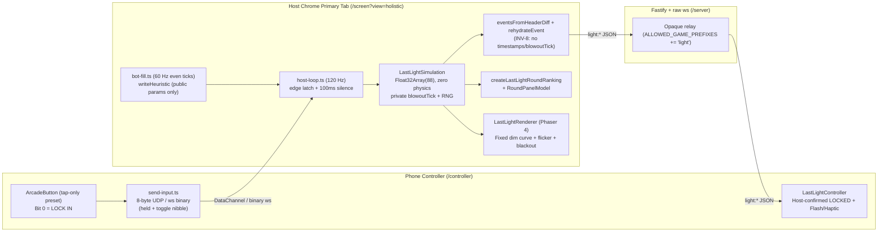

# Plan: Last Light (`last-light`) Implementation

## 1. Overview

This plan defines a staged, test-first roadmap to implement **Last Light** (`last-light`), the 2–8 player tap-to-lock lamp bluffing game specified in [specifications/games-spec/last-light.md](../specifications/games-spec/last-light.md). Last Light runs inside the existing holistic console shell ([specifications/SPEC.md](../specifications/SPEC.md)) and adheres strictly to the `GameDefinition` plugin contract ([specifications/games-spec/README.md](../specifications/games-spec/README.md)).

Base commit: `51d6d18` on `main`. Target implementation branch (when `/ak-cook` begins): `feat/last-light`. This document creates only the plan; it does not implement game code.

### System Data Flow



---

## 2. Scope Challenge & Non-Goals

### Verified Codebase Findings (Reduce Scope Before Coding)

Codebase inspection against `main` (`51d6d18`) uncovered three important facts that eliminate speculative work proposed in `last-light.md`:

1. **`ScoreRules.guide` already exists** (`screen/src/register-games.ts:30-33`, `screen/src/score-rules.tsx:8-19`). Both Bomb Pass and Color Clash already render a `HOW TO PLAY` list above the payout table. Do **not** add a duplicate `howTo` field to `ScoreRules`.
2. **`RoundRanking` and `createRoundPanelModel()` already exist** (`screen/src/round-panel-model.ts`, `screen/src/score-rules.tsx:94-147`) and mount inside `.match-side-left` of `<HolisticMatchShell>` directly beneath `<ScoreRulesPanel>`. Do **not** add a `lockedIn` field to `ScoreRules`. Instead, implement `RoundRankingAdapter` (`createLastLightRoundRanking`) so live lock status (`IN` / `LOCKED` / `WATCHING`) displays in `<RoundRanking>` sorted strictly by slot (never by `lockTick`), and post-blowout rankings (`1ST`..`8TH`, `OUT`, `+N`) automatically freeze for `ROUND_FREEZE_MS = 2000ms` via `createRoundPanelModel()`.
3. **`ScreenGameRuntime` lacks a mid-match reconnect snapshot hook.** In `screen/src/session.ts:385-408`, a reconnecting phone receives `game:mount` from `server/src/relay.ts:251-252`, and the primary screen clears sequence numbers and sends a WebRTC offer, but nothing emits `light:state`. Adding one optional generic hook `rehydrateEvent?: (state: Float32Array) => Envelope | null` to `ScreenGameRuntime` satisfies FR-5/FR-6/FR-9.6 without leaking any Last Light code into `/screen` or `/server`.

### Explicit Non-Goals (YAGNI / Out of Scope for v1)

- **Later Ideas from `last-light.md` Section 9:** Post-round visual lock timeline graph, practice ghost cut marker, match-over MVP titles ("Ice Veins", "Chicken", "Last Blink"), double-lamp rounds, and hot-seat modifier. (Note: synced phone flash and buzz on blowout *is* in v1 scope per FR-3 and FR-5.)
- **AWAY bot takeover:** Disconnected human slots never convert to heuristic bots (FR-6, Open Question 10).
- **2D Physics or `auxState`:** Do not import `shared/src/physics-2d/` or allocate `auxState`.
- **Platform Stretch Phases:** SharedWorker / SAB / WASM (Stretch 2), flight recorder (Stretch 3), ONNX bots (Stretch 4), or a seventh `/shared/ui` primitive.
- **External art assets:** Zero PNG, SVG, or sprite sheet files. All lamp visuals are procedural Phaser 4 graphics.

---

## 3. Component Reuse Matrix: Existing Games vs. Cyber-Citadel vs. Last Light Bespoke

This table separates direct reuse from existing games, architectural contrast with Cyber-Citadel ([plans/cyber-citadel-implementation-plan.md](./cyber-citadel-implementation-plan.md)), and Last Light's bespoke mechanics.

> [!NOTE]
> **PR #43 Baseline (`feat(platform): Cyber-Citadel Phase 1 seams and responsive 8-player HUD`):** PR #43 has already implemented `CONTROLLER_REV = '0.4.0'` (`shared/src/sdp/qr-target.ts`), `pad:state` dynamic button labeling + `disabled` bitmask with tactile dimmed styling + host cooldown wipes (`shared/src/types/game-control.ts`, `shared/src/ui/controller-shell.tsx`, `shared/src/ui/primitives.css`, `controller/src/app.tsx`), and 8-player responsive holistic HUD clamping (`screen/src/styles/match.css`). Last Light builds directly on PR #43 and must not duplicate any of those changes.

| Dimension | Reuse from Existing Games (`bomb-pass` / `color-clash` / platform + PR #43) | Contrast vs. Cyber-Citadel (`cyber-citadel`) | Last Light Bespoke Mechanics (`games/last-light/`) |
| :--- | :--- | :--- | :--- |
| **Core Genre & Players** | Competitive 2–8 player FFA party game with optional heuristic bots (`bomb-pass`, `color-clash`). | Cooperative 1–8 player wave defense (`minPlayers: 1`); everyone wins or loses together; weighted squad scaling $W$. | 2–8 player nerve/bluffing game; zero spatial movement; no avatars or arena boundaries. |
| **Physics & Memory Layout** | Standard `SNAPSHOT_FLOATS = 88` (`Float32Array`), zero `auxState` (same as `bomb-pass` / `sumo-dash`). | Heavy `shared/src/physics-2d/` + `UniformGridHash` broadphase (PR #43, `grid-hash.ts`) + $40 \times 40$ flow field + large `Uint8Array` `auxState` entity pools (160 enemies, 256 projectiles, 24 barricades). | **Zero physics.** Zero imports from `shared/src/physics-2d/` (does not use PR #43's `UniformGridHash`). Flat 88-float buffer stores only lamp phase/elapsed/flags and per-slot flags/lockTick/score/lastRoundPoints. |
| **Scoring & Target Formula** | Reuse Bomb Pass / Color Clash target formula $\max(3, (N - 1) \times 3)$, `ScoreRow` / `ScoreRules.guide` / `shortTag`, and ranked payouts $N - 1 - \text{strictly later}$ (`games/bomb-pass/src/scoreboard.ts`, `games/color-clash/src/scoreboard.ts`). | No individual scores or rank payouts; tracks Core HP, Wave 1–8, and kills/revives. | **Non-tapper zero rule:** Unlocked slots score `0` regardless of $N$. Same-tick locks share rank points. Void rounds (0 locks) score `0` with `NO LOCK` banner. |
| **Sudden Death** | Reuse Bomb Pass leaders-only Sudden Death pattern: skip 20s practice break, park non-leaders, sole winner earns `+1` (`games/bomb-pass/src/simulation.ts`, `scoreboard.ts`). | No Sudden Death (Wave 8 Dreadnought victory or Core 0 HP defeat). | **Same-tick Sudden Death tie replay:** Tied latest lock in Sudden Death awards `0` points and triggers immediate `COUNTDOWN` replay (FR-9.1). Void round in Sudden Death repeats `COUNTDOWN` (FR-9.9). |
| **Round Ranking & 8P HUD** | Reuse `createRoundPanelModel()` (`screen/src/round-panel-model.ts`), `<RoundRanking>` (`screen/src/score-rules.tsx:94-147`) inside `<HolisticMatchShell>`, and PR #43's **8-player responsive HUD clamping** (`screen/src/styles/match.css`, `clamp(14px, 2.2dvh, 28px)`) so 8 players fit cleanly on 720p/1080p displays. | Does not use ranked round progression; uses wave/Core HUD. | **INV-8 Blind Live Adapter (`round-ranking.ts`):** During `'live'`, emits `place: null`, `finalized: false`, `value: 'LOCKED' \| 'IN' \| 'WATCHING'`, sorted by `slot` so lock order never leaks. Reveals exact lock times (`8.4s`) and places only on `'final'`. |
| **Practice & Countdown Flow** | Reuse Color Clash practice timers (`practiceInitial = 30.0s`, `practiceBreak = 20.0s`), `COUNTDOWN = 3.0s`, `ROUND_END = 0.8s`, and `COUNTDOWN` held-button edge suppression (`games/color-clash/src/simulation.ts`). | 15s wave breather breaks with Core HP recovery and dead player respawn. | **Looping Practice Blowouts + 4.1s Guard:** Rapid $1.0\text{s} - 3.5\text{s}$ practice blowouts + 0.6s reveal loop inside `PRACTICE`. Suppresses new practice blowouts when $< 4.1\text{s}$ ($T_{\text{max}} + 0.6\text{s}$) remain on the practice clock (FR-9.11). |
| **Phone Controller Layout** | Reuse `<ControllerShell>`, `<ArcadeButton>`, `<PlayerBadge>`, `send-input.ts` toggle-bit rising edges, `host-loop.ts` edge latching, and PR #43's **`pad:state` dynamic button labeling, `disabled` bitmask with tactile dimmed styling, and `CONTROLLER_REV = '0.4.0'`**. | Uses existing `stick-diamond` (joystick + A/B/X/Y) + PR #43 `pad:state` context labels (Button Y: `REVIVE`/`EMP`/`JOINED`) + cooldown wipes. | **New `'tap-only'` preset** in `shared/src/controller/layout.ts` and `ControllerShell` (omits `<VirtualJoystick>`, centers large `LOCK IN` button with $\ge 36\text{px}$ edge clearance, plugs into PR #43's dynamic label and `disabled` bitmask support). **Host-confirmed `LOCKED`** state (no optimistic lock), synchronized white flash + vibration/iOS switch haptic on blowout. |
| **Disconnect & Rejoin** | Reuse `setConnectedMask(mask)` (`screen/src/host-loop.ts:175`), 100ms silence zeroing, `<MatchRejoinQr>`, and `MATCH_IN_PROGRESS` (`server/src/rooms.ts:97-101`). | Standby bot takes over AWAY human after 3.0s and hands back on rejoin. | **No bot takeover.** Existing lock persists across disconnect; unlocked AWAY slot cannot lock and scores `0`. Rejoin triggers generic `rehydrateEvent` seam -> `light:state`. |
| **Secret Timing & Dimmer** | Reuse seeded deterministic PRNG structure from `games/bomb-pass/src/simulation.ts:712`. | Deterministic seeded wave spawns; all state visible to renderer. | **Secret Blowout Timer + Decoupled Dimmer:** `blowoutTick` lives in private closure memory only. Non-linear escalating hazard rate in $[3.0, 12.0]\text{s}$ (scored) and $[1.0, 3.5]\text{s}$ (practice). Fixed luminescence curve ($100\% \to 20\%$ over $12.0\text{s}$) depends only on `lampElapsed`, never `blowoutTick`. Rare fake/ambient micro-flickers via `LAMP_FLAG_FLICKER`. |
| **Heuristic Bots** | Reuse `createBotFill` (`screen/src/bot-fill.ts`), `assignBotScores` (`shared/src/bot-difficulty.ts`), difficulty tiers (`Easy: 11-20`, `Medium: 30-50`, `Hard: 50-70`). | 1.0s tactical role planner (flank, brute intercept, revive, EMP) over full arena state. | **Information-Barrier Timing Bot (`heuristic.ts`):** Rolls target lock tick solely from public `(T_min, T_max, level, blowoutCount, slot)` with no-tap chance (20% / 8% / 3%). Zero access to `blowoutTick`. Resets bit 0 cleanly between 60 Hz even ticks. |

---

## 4. Platform Seams & Extension Trace

### Already Implemented in PR #43 (Do Not Duplicate)

**PR #43** (`feat(platform): Cyber-Citadel Phase 1 seams and responsive 8-player HUD`) already delivers three platform capabilities that Last Light consumes directly:

- **`CONTROLLER_REV` bumped to `'0.4.0'`** (`shared/src/sdp/qr-target.ts`, `shared/src/sdp/qr-target.test.ts`).
- **Dynamic `pad:state` control seam** (`shared/src/types/game-control.ts`, `shared/src/ui/controller-shell.tsx`, `shared/src/ui/primitives.css`, `controller/src/app.tsx`): slot-scoped dynamic button labels, `disabled` bitmask with tactile dimmed styling, and host cooldown wipes.
- **8-player responsive holistic HUD clamping** (`screen/src/styles/match.css`, `screen/src/score-rules.test.tsx`): clamped grid gaps, row heights, and scoreboard typography (`clamp(14px, 2.2dvh, 28px)`) so 8 players fit cleanly on 720p and 1080p monitors.

### Net-New Platform Seams for Last Light Phase 1 (Minimal, Game-Agnostic)

Because PR #43 covers dynamic button labels, disabled styling, `CONTROLLER_REV 0.4.0`, and 8-player HUD clamping, Phase 1 of Last Light needs only **three** net-new seams:

1. **`shared/src/types/game-control.ts`:** Add `'light'` to `ALLOWED_GAME_PREFIXES` (`['sumo', 'bomb', 'color', 'cyber', 'pad', 'light']`). Fastify relay (`server/src/relay.ts:195`) automatically forwards `light:*` control messages with zero server changes.
2. **`shared/src/controller/layout.ts` + `shared/src/ui/controller-shell.tsx` + `controller-shell.css`:**
   - Add `'tap-only'` variant to `ControllerLayout` union (`{ readonly preset: 'tap-only'; readonly buttons: readonly [ButtonSpec] }`).
   - Update `ControllerShell` to omit `<VirtualJoystick>` when `props.layout.preset === 'tap-only'`, rendering a centered full-stage `<ArcadeButton>` with $\ge 36\text{px}$ edge safety padding.
   - Wire the `'tap-only'` single button into PR #43's existing dynamic button label and `disabled` bitmask logic in `ControllerShell` (no duplicate `buttonDisabled` / `buttonLabels` mechanism).
3. **`screen/src/register-games.ts` + `screen/src/session.ts`:**
   - Add optional `rehydrateEvent?: (state: Float32Array) => Envelope | null` to `ScreenGameRuntime`.
   - In `screen/src/session.ts` inside `applyPlayers()`, when `primary && loop !== null && loop.inMatch` and any slot transitions `!before && after` (reconnect), call `currentRuntime()?.rehydrateEvent?.(loop.state)` and `send(event)` if non-null.

> [!NOTE]
> **Controller Cache Busting (`CONTROLLER_REV`):** PR #43 already sets `CONTROLLER_REV = '0.4.0'`. Do not re-bump to `0.4.0` in Phase 1. When Last Light's `'tap-only'` controller ships after PR #43 merges to `main`, apply one MINOR bump (`'0.4.0'` -> `'0.5.0'`) in Phase 7/8 per `AGENTS.md`.

### Extension Trace (Required by `ak-plan`)

Trace a credible second game through both new platform seams: **Quick-Draw Quiz / Buzzer Duel** (a 2–8 player single-button buzzer game where phones buzz once per question and reconnect mid-question).

- **Stable contracts:**
  - `ControllerLayout` `'tap-only'` preset mounts one centered `<ArcadeButton>` with zero joystick DOM, $\ge 36\text{px}$ edge insets, and reuses PR #43's dynamic label and `disabled` bitmask handling (`LOCKED` / `BUZZED` / `LOCKED OUT`).
  - `ScreenGameRuntime.rehydrateEvent(state)` emits the active game's public state envelope (`quiz:state`) whenever a phone reconnects mid-match.
- **Pieces that change for the second game:**
  - Only the new game's plugin folder (`games/buzzer-duel/`), its prefix in `ALLOWED_GAME_PREFIXES`, and its entries in `screen/src/register-games.ts` and `controller/src/register-games.ts`.
  - Zero edits to `ControllerShell`, `HolisticMatchShell`, `host-loop.ts`, `session.ts`, or `server/`.
- **How this plan proves the claim:**
  - Phase 1 unit tests verify `'tap-only'` layout rendering (integrated with PR #43's dynamic label/disabled state) and `rehydrateEvent` invocation using generic mock games with no Last Light imports.

---

## 5. Critical Engineering Invariants & Edge-Case Design

Before writing code, lock these five state-buffer and timing details so `INV-1` through `INV-10` hold by construction:

1. **Public vs. Private `lockTick` Barrier (INV-8):**
   - `last-light.md` Section 4.C defines `[base + 1] lockTick` in the 88-float buffer ("`-1` when not locked; never rendered while LIT").
   - To guarantee `INV-8` even in raw `BroadcastChannel` snapshots during active play, store actual lock ticks in a private `Int32Array(8)` (`privateLockTick`) inside `createLastLightSimulation()`. Keep `state[base + 1] = -1` while `LAMP_FLAG_LIT` is set, and copy `privateLockTick[i]` into `state[base + 1]` at the exact blowout tick when transitioning to `LAMP_FLAG_BLOWN`.
   - `light:lock` broadcasts only `{ lockedMask: number }` (zero timestamps, zero order).
2. **Exact Lobby Size $N$ Without Spatial Coordinates:**
   - Existing games infer joined slots via `x !== 0 || y !== 0 || score > 0 || ACTIVE`. Last Light has no `x`/`y` coordinates, and parked non-contenders in Sudden Death clear `ACTIVE` and `CONTENDER` and may have `score === 0`.
   - Allocate **Bit 6 (`FLAG_JOINED = 64`)** on per-player `[base + 0] flags` (bits 0..5 are already specified in `last-light.md` Section 4.C). `shouldIncludeSlot` checks `(flags & FLAG_JOINED) !== 0`, keeping $N$ and `targetScore` invariant across disconnects, void rounds, and Sudden Death.
3. **Stateless `eventsFromHeaderDiff` Metadata (`SUDDEN_DEATH` & `breakNumber`):**
   - Allocate **Bit 5 (`LAMP_FLAG_SUDDEN_DEATH = 32`)** on header `[4] lampFlags` (bits 0..4 are specified in Section 4.C) so `bannerCopy`, `scoreboardHeader`, `scoreRules`, `round-ranking`, and `eventsFromHeaderDiff` read sudden-death state in O(1) without ambiguity during sudden-death tie replays.
   - Store `breakNumber` in reserved header-safe or derive cleanly: store `breakCount` in unused per-player reserved slot or track via a small closure or header; better yet, reserve `[base + 4]` or use a stateless factory `createLastLightEventsDiff()` — wait: `ScreenGameRuntime.eventsFromHeaderDiff` is called directly as `(prev, next, matchTarget?) => Envelope[]`. Keep `eventsFromHeaderDiff` pure by encoding `breakNumber` in the upper 16 bits of `lampFlags` or reading `next[H.phaseTimer] > 25 ? 30000 : 20000` for `durationMs` and tracking `breakNumber` in a stateful wrapper created inside `createLastLightScreenRuntime()` (reset when `next[H.tick] <= prev[H.tick]`). Documented and tested in Phase 4!
4. **Blowout Hazard Distribution (Non-Linear Escalating Hazard):**
   - For scored rounds ($T_{\text{min}} = 3.0\text{s}$, $T_{\text{max}} = 12.0\text{s}$; 360 to 1440 ticks) and practice ($T_{\text{min}} = 1.0\text{s}$, $T_{\text{max}} = 3.5\text{s}$; 120 to 420 ticks), sample $u \in [0, 1)$ from seeded Mulberry32 PRNG and transform via a Weibull / power-law survival inverse $t = T_{\text{min}} + (T_{\text{max}} - T_{\text{min}}) \cdot u^{1/k}$ (default $k = 2.0$, configurable constant in `constants.ts` for playtest tuning).
   - With $k > 1$, the instantaneous hazard rate $h(t)$ strictly increases across $[T_{\text{min}}, T_{\text{max}}]$, concentrates tension toward the middle/late window, and strictly guarantees $T_{\text{min}} \le t \le T_{\text{max}}$ (`INV-6`).
   - Clamp resulting integer `blowoutTick` to `[minTicks, maxTicks]` so `blowoutTick <= 1440` (scored) and `<= 420` (practice).
5. **Zero-Allocation Hot Path (`INV-9`):**
   - Pre-allocate all `Float32Array(88)`, `Uint8Array(8)`, `Int32Array(8)`, and 8 `Channel` objects inside `createLastLightSimulation()`.
   - `step(dt)`, `applyInput(...)`, and `writeHeuristic(...)` contain zero `new`, zero array literals, zero object literals, and zero closures.

---

## 6. Phased Implementation Roadmap

### Phase Summary

| Phase | Name | Effort | Primary Ownership | Key Gate |
| :--- | :--- | :--- | :--- | :--- |
| **1** | Platform Seams (`tap-only` preset, `light` prefix, `rehydrateEvent`; builds on PR #43) | 1.5h | `shared/`, `screen/`, `controller/` | `pnpm --filter @shared test && pnpm --filter @screen test && pnpm --filter @controller test` |
| **2** | Package Scaffold, Manifest & Constants | 1.0h | `games/last-light/` | `pnpm --filter @games/last-light test && tsc --noEmit` |
| **3** | Zero-Physics Simulation, Hazard RNG & Scoring FSM (TDD) | 4.5h | `games/last-light/src/simulation.*` | Worked examples (2P/3P/8P) + INV-1..9 + 10,000-tick fuzz |
| **4** | Scoreboard, Blind Round Ranking, Banner & Control Events | 2.5h | `games/last-light/src/{scoreboard,round-ranking,banner,events}.*` | INV-8 leak test + RoundPanelModel integration tests |
| **5** | Information-Barrier Heuristic Bot | 1.5h | `games/last-light/src/heuristic.*` | Public-only barrier test + Easy/Med/Hard distribution test |
| **6** | Procedural Phaser 4 Lamp Dimmer & Flicker Renderer | 2.5h | `games/last-light/src/{renderer,screen-runtime,screen.css}` | $\le 4\text{ms}$ draw budget + fixed dimming curve verification |
| **7** | Tap-Only Phone Controller, Flash/Haptics & Rehydration | 2.0h | `games/last-light/src/controller-view.*` | Host-confirmed `LOCKED` + blowout flash/haptic + `light:state` tests |
| **8** | Registry Wiring, Spec Status Update & Hardware QA | 1.5h | `screen/src/register-games.ts`, `controller/src/register-games.ts`, `specifications/games-spec/README.md` | Full workspace test/typecheck/build + M5 Pro & Phone checklist |

---

### Phase 1: Platform Seams (`shared/`, `screen/`, `controller/`)

**Objective:** Add only the three net-new, game-agnostic platform seams required by Last Light on top of **PR #43**, without duplicating PR #43's `CONTROLLER_REV = '0.4.0'`, `pad:state` dynamic button labeling / `disabled` bitmask / dimmed styling, or 8-player responsive HUD clamping.

**Prerequisite / Baseline:** Rebase on **PR #43** (`feat(platform): Cyber-Citadel Phase 1 seams and responsive 8-player HUD`) once merged to `main`.

**Files to Modify:**
- `shared/src/types/game-control.ts` & `shared/src/types/game-control.test.ts` — Add `'light'` to `ALLOWED_GAME_PREFIXES` (preserving PR #43's `PAD_STATE_TYPE` and `pad:state` parsers untouched).
- `shared/src/controller/layout.ts` — Add `{ readonly preset: 'tap-only'; readonly buttons: readonly [ButtonSpec] }` to `ControllerLayout`.
- `shared/src/ui/controller-shell.tsx` & `shared/src/ui/controller-shell.css` — Support `preset === 'tap-only'` (omit `<VirtualJoystick>`, center single `<ArcadeButton>` with $\ge 36\text{px}$ safe insets) and wire its single button directly into PR #43's existing dynamic label and `disabled` bitmask handling (no duplicate props or CSS).
- `controller/src/controller-shell.test.tsx` — Add failing tests first for `'tap-only'` rendering (no joystick, single centered button, and compatibility with PR #43's `pad:state` dynamic label and `disabled` bitmask).
- `screen/src/register-games.ts` & `screen/src/session.ts` — Add optional `rehydrateEvent?: (state: Float32Array) => Envelope | null` to `ScreenGameRuntime` and emit it in `applyPlayers()` when a player reconnects during an active match (`primary && loop !== null && loop.inMatch`). Add unit test in `screen/src/register-games.test.ts` (or dedicated session test).

**Acceptance Criteria:**
- [ ] `isGameControlMessageType('light:lock')` returns `true` and Fastify relay forwards `light:*` events from primary screen.
- [ ] `<ControllerShell>` with `preset: 'tap-only'` renders zero `.joystick` nodes, renders one centered `<ArcadeButton>`, and responds to PR #43's dynamic label and `disabled` bitmask without duplicating state logic.
- [ ] `tap-only` container enforces $\ge 36\text{px}$ horizontal and bottom edge safe padding in portrait and landscape orientations.
- [ ] Reconnecting slot in `screen/src/session.ts` invokes `rehydrateEvent(loop.state)` and sends the returned envelope when non-null.
- [ ] Zero duplicate edits to `screen/src/styles/match.css` 8-player clamping or PR #43's `CONTROLLER_REV = '0.4.0'`.

**Verification Command:**
```bash
corepack pnpm --filter @shared test && corepack pnpm --filter @shared exec tsc --noEmit \
  && corepack pnpm --filter @screen test && corepack pnpm --filter @screen exec tsc --noEmit \
  && corepack pnpm --filter @controller test && corepack pnpm --filter @controller exec tsc --noEmit \
  && corepack pnpm --filter @server test
```

---

### Phase 2: Package Scaffold, Manifest & Constants (`games/last-light/`)

**Objective:** Create the isolated `@games/last-light` workspace package matching `games/bomb-pass/` structure and lock all numeric constants, header indices, and bitmasks.

**Files to Create:**
- `games/last-light/package.json` — `@games/last-light` (`phaser`, `solid-js`, `@solidjs/web`, `vitest`, `typescript`, `@solidjs/vite-plugin`, matching `games/bomb-pass/package.json`).
- `games/last-light/tsconfig.json` & `games/last-light/vitest.config.ts` & `games/last-light/src/css.d.ts` — Mirror `games/bomb-pass/`.
- `games/last-light/src/constants.ts`:
  - `LAST_LIGHT_CONSTANTS`: `scoredMinSec: 3.0`, `scoredMaxSec: 12.0`, `practiceMinSec: 1.0`, `practiceMaxSec: 3.5`, `practiceRevealSec: 0.6`, `practiceGuardSec: 4.1`, `practiceInitial: 30.0`, `practiceBreak: 20.0`, `countdown: 3.0`, `roundEnd: 0.8`, `dimStartLuminance: 1.0`, `dimEndLuminance: 0.2`, `hazardShapeK: 2.0`, `minTargetScore: 3`, `targetMultiplier: 3`, `maxPlayers: 8`, `stateFloats: 88`, `stepHz: 120`, `defaultSeed: 0x1a571167`.
  - `LIGHT_HEADER`: `tick: 0`, `phase: 1`, `phaseTimer: 2`, `lampElapsed: 3`, `lampFlags: 4`, `activeMask: 5`, `blowoutCount: 6`, `winnerSlot: 7`.
  - `LIGHT_PHASE`: `countdown: 0`, `active: 1`, `roundEnd: 2`, `matchOver: 3`, `practice: 4`.
  - `LAMP_FLAG`: `lit: 1`, `blown: 2`, `flicker: 4`, `practiceBlowout: 8`, `voidRound: 16`, `suddenDeath: 32`.
  - `LIGHT_PLAYER_BASE = 8`, `LIGHT_PLAYER_STRIDE = 10`.
  - `LIGHT_PLAYER_OFFSET`: `flags: 0`, `lockTick: 1`, `score: 2`, `lastRoundPoints: 3`.
  - `LIGHT_FLAG`: `active: 1`, `locked: 2`, `isBot: 4`, `contender: 8`, `out: 16`, `disconnected: 32`, `joined: 64`.
- `games/last-light/src/manifest.ts` & `games/last-light/src/manifest.test.ts` — Export `LAST_LIGHT_MANIFEST` with `id: 'last-light'`, `title: 'LAST LIGHT'`, `minPlayers: 2`, `maxPlayers: 8`, `supportsTeams: false`, `supportsBots: true`, `rendererType: 'phaser-2d'`, `viewConfig: { mode: 'holistic', inputBufferMode: 'zero-buffer' }`, `supportedOrientations: ['portrait', 'landscape']`, `controllerLayout: { preset: 'tap-only', buttons: [{ bit: 0, glyph: 'A', label: 'LOCK IN', kind: 'tap' }] }`, and Neo-Brutalist `themeTokens` (warm amber/tungsten lamp accent distinct from system yellow `#F5C518`, e.g., `--lamp-glow: #FF6B2B`, `--lamp-filament: #FFF4DC`, `--lamp-shade: #22201E`, `--lamp-blackout: #0D0D0D`, `--bg-surface: #F4F1EA`, `--ink-primary: #111111`).

**Acceptance Criteria:**
- [ ] `manifest.test.ts` verifies manifest contract (`holistic`, `zero-buffer`, `tap-only`, 2–8 players, no `#F5C518` lamp color collision).
- [ ] Workspace resolves `@games/last-light` cleanly via `pnpm`.

**Verification Command:**
```bash
corepack pnpm --filter @games/last-light test && corepack pnpm --filter @games/last-light exec tsc --noEmit
```

---

### Phase 3: Core Zero-Physics Simulation, Hazard RNG & Scoring FSM (TDD)

**Objective:** Implement `createLastLightSimulation()` with 100% deterministic 120 Hz fixed-step logic, secret blowout timing, atmospheric flickers, ranked scoring, Sudden Death, void rounds, and zero heap allocations.

**TDD Workflow (Mandatory per `AGENTS.md`):**
1. Write failing unit tests and invariant fuzz tests in `games/last-light/src/simulation.test.ts` FIRST.
2. Implement `games/last-light/src/simulation.ts` until every test passes.

**Files to Create:**
- `games/last-light/src/simulation.test.ts` (written BEFORE `simulation.ts`):
  - **Blowout Boundaries & Determinism (INV-6, INV-7):** Seeded blowouts across 200 rounds stay strictly inside $[3.0, 12.0]\text{s}$ (scored) and $[1.0, 3.5]\text{s}$ (practice); identical seeds + inputs produce bit-exact `Float32Array(88)`.
  - **Worked Examples (FR-4):** Exact tests for the 2-player ($N=2$, target 3), 3-player ($N=3$, target 6, including Sudden Death), and 8-player ($N=8$, target 21, 5 tappers + 3 non-tappers + 8-way same-tick tie) scenarios from `last-light.md` Section 2.
  - **Edge Cases (FR-9):**
    - Same-tick lock tie in normal round (shared rank points) vs. Sudden Death (0 points + immediate `COUNTDOWN` replay).
    - Late tap at `tick >= blowoutTick` rejected (`INV-3`).
    - Second tap after lock ignored; `lockTick` immutable (`INV-2`).
    - Zero-lock void round sets `LAMP_FLAG.voidRound`, awards 0 points, advances to `PRACTICE` (20s) or `COUNTDOWN` (in Sudden Death).
    - Held button across `COUNTDOWN` -> `ROUND_ACTIVE` does not trigger a lock until released and tapped anew (FR-9.12).
    - Disconnect (`setConnectedMask`): disconnected slot cannot lock; existing lock persists if player disconnects after locking; disconnected slot still counts in $N$ and can reconnect before blowout to lock.
    - Practice 4.1s guard: no new practice blowout begins when `phaseTimer < 4.1s` (FR-9.11).
  - **INV-8 Secret Blowout Barrier:** While `LAMP_FLAG.lit` is set, `state[base + 1]` remains `-1` for locked players and no public buffer index exposes `blowoutTick`.
  - **10,000-Tick Fuzz Test (`INV-1`..`INV-8`):** Randomized 2–8 player rosters, random taps, holds, disconnects, and reconnects across 10,000 ticks with explicit assertions on finite floats, monotonic scores, bounded round durations, and bit-exact replay.
- `games/last-light/src/simulation.ts`:
  - `LastLightSimulation` interface matching `ScreenSim` (`state`, `applyInput`, `step`, `startMatch(slots, seed?)`, `setConnectedMask(mask)`, `getMatchTarget()`).
  - Private closure state: `rngState`, `blowoutTick`, `blowoutElapsedTicks`, `practiceRevealTimer`, `nextFlickerTick`, `flickerTicksLeft`, `privateLockTick = new Int32Array(8)`, `joined = new Uint8Array(8)`, `connectedMask`, `suddenDeathActive`, `contenderMask`, `inputs: Channel[8]`.
  - Zero physics imports. Zero heap allocations in `step()` and `applyInput()`.
  - Practice loop: starts practice blowout when `phaseTimer >= 4.1s`; runs until `blowoutElapsedTicks >= blowoutTick`; transitions to 0.6s reveal (`LAMP_FLAG.blown`); loops again if `phaseTimer >= 4.1s`, else stays steady lit (`LAMP_FLAG.lit`, `lampElapsed = 0`) until `phaseTimer <= 0` -> `COUNTDOWN`.
  - Atmospheric flicker generator: rolls rare 3–6 tick (25–50ms) `LAMP_FLAG.flicker` pulses from an independent PRNG draw stream (or pre-rolled schedule independent of `blowoutTick`) so flickers never correlate with remaining time to blowout.
  - Lock evaluation on `blowoutElapsedTicks >= blowoutTick`:
    1. Flush `privateLockTick[i]` into `state[base + 1]` for locked slots; mark unlocked active slots `LIGHT_FLAG.out`.
    2. Compute rank points per FR-4 ($N - 1 - \text{strictly later}$ in normal rounds; sole latest contender `+1` in Sudden Death; `0` if tied or void).
    3. Update `score` and `lastRoundPoints`, set `LAMP_FLAG.voidRound` if 0 locks, set `winnerSlot` if unique leader $\ge targetScore$, transition to `ROUND_END` (0.8s).
  - `ROUND_END` exit transition:
    - Unique winner $\ge targetScore$ -> `MATCH_OVER`.
    - Tied leaders $\ge targetScore$ -> set `suddenDeathActive = true`, park non-leaders (clear `ACTIVE` & `CONTENDER`), skip `PRACTICE` -> `COUNTDOWN` (3.0s).
    - Void round in Sudden Death -> repeat `COUNTDOWN` (3.0s).
    - Else -> `PRACTICE` (20.0s).

**Acceptance Criteria:**
- [ ] All worked examples, edge cases, and 10,000-tick fuzz tests pass with zero warnings.
- [ ] Static inspection confirms zero `new`, array literals, object literals, or `physics-2d` imports inside `step()` and `applyInput()`.
- [ ] `state[base + 1]` stays `-1` while `LAMP_FLAG.lit` is set and flushes only on blackout.

**Verification Command:**
```bash
corepack pnpm --filter @games/last-light test && corepack pnpm --filter @games/last-light exec tsc --noEmit
```

---

### Phase 4: Scoreboard, Blind Round Ranking, Banner & Control-Plane Events

**Objective:** Wire Last Light's state buffer into `<HolisticMatchShell>` panels (`ScoreboardPanel`, `ScoreRulesPanel`, `RoundRanking`, banner) and the `light:*` WebSocket control-plane protocol.

**Files to Create (TDD — tests alongside or before implementation):**
- `games/last-light/src/scoreboard.ts` & `games/last-light/src/scoreboard.test.ts`:
  - Reuse Bomb Pass / Color Clash helper signatures: `targetScoreForCount`, `shouldIncludeSlot` (checks `LIGHT_FLAG.joined`), `activePlayerCount`, `isSuddenDeath`, `hasUniqueWinner`, `shortTag`, `scoreboardHeader` (`THRESHOLD: <n>` or `SUDDEN DEATH`), `scoreboardRows` (with `LIVE`/`AWAY` status), `scoreRules`:
    - `guide`: `['TAP TO LOCK IN', 'LATEST TAP BEFORE THE BLOWOUT WINS', 'NEVER TAPPED? YOU ARE OUT']` (renders via existing `ScoreRulesPanel` `HOW TO PLAY` section!).
    - `rows`: `1ST: +(N-1) PTS` .. `NTH: +0 PTS` (collapses to `1ST: +1 PTS` in Sudden Death).
- `games/last-light/src/round-ranking.ts` & `games/last-light/src/round-ranking.test.ts`:
  - `createLastLightRoundRanking()` implementing `RoundRankingAdapter`:
    - `PRACTICE` / `COUNTDOWN`: `stage: 'idle'`, rows show player tags with empty value.
    - `ROUND_ACTIVE`: `stage: 'live'`, `place: null`, `finalized: false`, `preview: null`. Value is `'LOCKED'` if `LIGHT_FLAG.locked`, `'IN'` if active unlocked, `'WATCHING'` if parked non-contender. Never reads `lockTick` during `'live'` (`INV-8`).
    - `ROUND_END` / `MATCH_OVER`: `stage: 'final'`, computes dense/competition rank from revealed `lockTick` (latest = `place: 1`, ties share `place`), `finalized: true`, `value: '<sec>s'` for locked slots, `'OUT'` for non-tappers (`place: null`), `'WATCHING'` for parked non-contenders, `marker: 'REPLAY'` on sudden-death tie/void.
  - Test integration directly with `createRoundPanelModel()` to verify the 2000ms freeze and delayed total-score reveal!
- `games/last-light/src/banner.ts` & `games/last-light/src/banner.test.ts`:
  - `bannerCopy(state, names)`:
    - `PRACTICE`: `BREAK <ceil(timer)>`
    - `COUNTDOWN`: `SUDDEN DEATH <ceil(timer)>` or `<ceil(timer)>` (`3`, `2`, `1`)
    - `ROUND_ACTIVE`: `''` (strictly NO clock or timer per FR-1!)
    - `ROUND_END`: `NO LOCK` if `LAMP_FLAG.voidRound`, `<TAG> WINS` if match winner locked, `SUDDEN DEATH` if sudden death continues, else `POINT`.
    - `MATCH_OVER`: `<TAG> WINS` (or `MATCH OVER` fallback).
- `games/last-light/src/events.ts` & `games/last-light/src/events.test.ts`:
  - `createLastLightEventsDiff()` returning `eventsFromHeaderDiff(prev, next, matchTarget?)` plus `buildLightStateEnvelope(state)` (for `rehydrateEvent`):
    - Emits `light:practice_start` (`{ durationMs: 30000 | 20000, breakNumber }`) on transition into `PRACTICE`.
    - Emits `light:round_start` (`{ roundNumber, countdownMs: 3000, scores, suddenDeath, contenderMask }`) on transition into `COUNTDOWN`.
    - Emits `light:lock` (`{ lockedMask }`) whenever the bitmask of `LIGHT_FLAG.locked` slots increases during `ROUND_ACTIVE` or `PRACTICE`.
    - Emits `light:blowout` (`{ lockedMask, outMask, practice }`) whenever `blowoutCount` increments (covers both scored and practice blowouts for synced flash + haptics!).
    - Emits `light:round_end` (`{ winnerIndex, scores, matchOver, suddenDeath, void }`) on transition into `ROUND_END`.
    - Emits `light:match_end` (`{ winnerIndex, scores }`) on transition into `MATCH_OVER`.
    - `buildLightStateEnvelope(state)` returns `light:state` (`{ phase, lockedMask, contenderMask, scores }`) for mid-match phone reconnection.
  - **INV-8 Test:** Serialize every emitted envelope to JSON and assert zero `lockTick` or `blowoutTick` fields exist anywhere in any payload.

**Acceptance Criteria:**
- [ ] `bannerCopy` returns `''` throughout `ROUND_ACTIVE` (zero numerical clock leakage).
- [ ] `round-ranking` never leaks lock order or timestamps while `stage === 'live'`.
- [ ] Every `light:*` event matches the schema in `last-light.md` Section 4.B and passes INV-8 payload audit.
- [ ] `buildLightStateEnvelope` reproduces exact phase, masks, and scores for reconnecting phones.

**Verification Command:**
```bash
corepack pnpm --filter @games/last-light test && corepack pnpm --filter @games/last-light exec tsc --noEmit
```

---

### Phase 5: Heuristic Bot Policy (`games/last-light/src/heuristic.ts`)

**Objective:** Implement information-barrier timing bots that call `applyInput` through `bot-fill.ts` using only public timing constants and difficulty tiers.

**Files to Create:**
- `games/last-light/src/heuristic.test.ts` (written BEFORE `heuristic.ts`):
  - **Information Barrier Test:** Pass only the public `Float32Array(88)` state buffer to `writeHeuristic`; verify changing private `blowoutTick` in two simulations produces identical bot tap timing before blowout (bot has zero knowledge of `blowoutTick`).
  - **Difficulty Curve Test:** Across 200 simulated blowouts, verify `Easy` (11–20) locks earliest with ~20% no-tap rate, `Medium` (30–50) locks mid-window with ~8% no-tap rate, and `Hard` (50–70) locks latest with tight spread and ~3% no-tap rate.
  - **Edge Reset & Practice Safety Test:** Verify `buttons[botIndex]` clears to `0` on `COUNTDOWN`, `ROUND_END`, `MATCH_OVER`, `BLOWN`, or once `LIGHT_FLAG.locked` is set, so bots never hold bit 0 across blowouts under `bot-fill.ts`'s 60 Hz even-tick cadence.
- `games/last-light/src/heuristic.ts`:
  - `assignBotLevels` & `levelsForMask` delegating to `assignBotScores` (`shared/src/bot-difficulty.ts`).
  - Pre-allocated module-level typed arrays (`plannedTick = new Int32Array(8)`, `plannedBlowout = new Int32Array(8)`) for zero-allocation execution (`INV-9`).
  - Deterministic per-blowout hash from `(blowoutCount, botIndex, level, phase)` rolls:
    1. Whether the bot abstains (Easy ~20%, Medium ~8%, Hard ~3%).
    2. Target elapsed time inside `[T_min, T_max]` (scored `[3.0, 12.0]s` or practice `[1.0, 3.5]s`) scaled by normalized skill `level / 100` plus bounded jitter.
  - Writes `axisX[botIndex] = 0`, `axisY[botIndex] = 0`, and `buttons[botIndex] = 1` only when active, contender, not locked, `LAMP_FLAG.lit` is set, and `lampElapsed >= targetSeconds`.

**Acceptance Criteria:**
- [ ] Zero heap allocations inside `writeHeuristic`.
- [ ] Bots pass the information-barrier test and hit realistic Easy / Medium / Hard win curves.
- [ ] Parked non-contender bots in Sudden Death output `buttons = 0`.

**Verification Command:**
```bash
corepack pnpm --filter @games/last-light test && corepack pnpm --filter @games/last-light exec tsc --noEmit
```

---

### Phase 6: Procedural Phaser 4 Lamp Dimmer & Flicker Renderer

**Objective:** Build the zero-asset Industrial Neo-Brutalist procedural lamp on the 800 x 800 holistic canvas with a fixed, non-leaking dimming curve, atmospheric micro-flickers, instant blackout beat, and $\le 4\text{ms}$ frame budget.

**Files to Create:**
- `games/last-light/src/dimmer.ts` & `games/last-light/src/dimmer.test.ts`:
  - Pure helper `lampLuminance(phase, lampElapsed, lampFlags)`:
    - `COUNTDOWN` or steady `PRACTICE` (`lampElapsed === 0 && LIT`): returns `1.0` (100% steady max brightness).
    - `ROUND_ACTIVE` (`LIT`): fixed linear/smooth curve from `1.0` at `0.0s` to `0.2` at `12.0s`, clamped to `[0.2, 1.0]`. Strictly independent of `blowoutTick`.
    - `PRACTICE` active blowout (`LIT | PRACTICE_BLOWOUT`): same curve scaled to `3.5s` window (`1.0` -> `0.2`).
    - `FLICKER` bit set: transient `-0.22` luminance dip (clamped $\ge 0.12$) for 25–50ms visual stutter.
    - `BLOWN` bit set or `ROUND_END` / `MATCH_OVER`: instant `0.0` blackout.
- `games/last-light/src/renderer.ts`:
  - `createLastLightRenderer(canvas, readState)` using `Phaser.CANVAS` 800 x 800 (matching `games/bomb-pass/src/renderer.ts` setup: `input: false`, `audio: { noAudio: true }`, `Phaser.Scale.NONE`).
  - Draws purely procedural vector geometry via one reused `Phaser.GameObjects.Graphics` object (zero per-frame allocations):
    1. Matte paper canvas `#F4F1EA` shifting smoothly toward deep charcoal blackout `#111111` as luminance drops, snapping to full `#0D0D0D` darkness at `BLOWN`.
    2. Concentric stepped hard-edge radial illumination rings (Industrial Neo-Brutalist style — **no CSS blur or soft SaaS drop shadows!**) using warm tungsten/amber palette resolved from theme tokens (never `#F5C518`).
    3. Large centered industrial pendant lamp fixture: ceiling stem, heavy `#111111` geometric trapezoidal shade (`2.5px+` ink line-work), inner bulb dome, and bright geometric filament coil whose stroke color and thickness react to `lampLuminance`.
    4. Blowout beat: brief high-contrast filament snap/spark lines on transition from `LIT` -> `BLOWN`, followed by dead dark bulb silhouette.
    5. Subtle lock-in pulse ring around lamp perimeter (player color tick marks or count pulse, **strictly without timestamps or rank numbers**, or keep lock roster exclusively in `<RoundRanking>` so the lamp stays clean and iconic).
- `games/last-light/src/screen.css` — Game-scoped CSS imported dynamically inside `screen-runtime.ts` (never in initial lobby bundle).
- `games/last-light/src/screen-runtime.ts` — Exports `createLastLightScreenRuntime()` wiring `createSim`, `eventsFromHeaderDiff`, `rehydrateEvent`, `createRenderer`, `writeBotInput`, `botLevels`, `scoreboardHeader`, `scoreboardRows`, `scoreRules`, `bannerCopy`, `rematchEventType: 'light:rematch'`, and `createRoundRanking`.

**Acceptance Criteria:**
- [ ] `dimmer.test.ts` proves `lampLuminance` depends solely on `(phase, lampElapsed, lampFlags)` and hits `1.0` at `0s`, `0.2` at `12.0s`, and `0.0` on `BLOWN`.
- [ ] Zero external image/SVG assets loaded; zero blur/glassmorphism or `#F5C518` lamp misuse.
- [ ] Renderer `draw()` executes with zero per-frame allocations and under 4ms on M5 Pro.

**Verification Command:**
```bash
corepack pnpm --filter @games/last-light test && corepack pnpm --filter @games/last-light exec tsc --noEmit
```

---

### Phase 7: Tap-Only Phone Controller, Blowout Flash/Haptics & Rehydration

**Objective:** Implement `LastLightController` on `<ControllerShell>` (`tap-only` preset) with host-confirmed `LOCKED` state, state label feedback, synchronized blowout white flash + haptics (Android + iOS 18 switch fallback), and `light:state` rehydration.

**Files to Create:**
- `games/last-light/src/controller-view.test.tsx` (written BEFORE `controller-view.tsx`):
  - **Reducer Tests (`reduceLightControl`):**
    - `light:round_start` sets status to `IN` (contender) or `WATCHING` (parked in Sudden Death) and updates score.
    - Optimistic tap does **not** change UI to `LOCKED`; only receiving `light:lock` with `(lockedMask & (1 << slot)) !== 0` transitions status to `LOCKED`, disables `<ArcadeButton>`, and swaps label to `LOCKED`.
    - `light:blowout` sets status to `OUT` if `(outMask & (1 << slot)) !== 0`, keeps `LOCKED` if locked, and increments a `flashSeq` counter to trigger white flash + haptics on every blowout (scored and practice).
    - `light:state` rehydrates exact `phase`, `status` (`IN` / `LOCKED` / `OUT` / `WATCHING`), and `score` after mid-match reconnect.
    - `light:round_end` and `light:match_end` update score.
  - **Render Test:** Mounts `<ControllerShell>` with `tap-only` layout, renders `<PlayerBadge>`, score + state pill (`IN` / `LOCKED` / `OUT` / `WATCHING`), single `LOCK IN` button (zero joystick), and disables button when `LOCKED` or `WATCHING`.
- `games/last-light/src/controller-view.tsx`:
  - Exports `createInitialLightHudState`, `reduceLightControl`, `hapticForLightControl`, `LastLightController`.
  - Uses `<ControllerShell layout={LAST_LIGHT_MANIFEST.controllerLayout} ... />` and drives bit-0 label (`LOCK IN` -> `LOCKED`) and disabled state (`LOCKED` / `WATCHING`) through PR #43's `ControllerShell` dynamic label / `disabled` bitmask seam (no duplicate button-state props).
  - **Blowout White Flash:** Toggles a lightweight CSS attribute `data-flash="true"` (single short CSS keyframe or 140ms timeout, **zero continuous `rAF` loops** per SPEC ULP Thermal Defense) flashing solid `#FFFFFF` overlay on `light:blowout`.
  - **Dual-Platform Haptics:** Calls `navigator.vibrate(65)` where supported, plus triggers a hidden iOS 18 `<input type="checkbox" switch>` toggle click fallback for Safari Taptic Engine (`SPEC.md` line 100).
- `games/last-light/src/controller-view.css` — Neo-Brutalist status badge styling (`IN`, `LOCKED`, `OUT`, `WATCHING`), full-bleed white blowout flash overlay (`pointer-events: none`), zero blurry shadows, $\ge 36\text{px}$ edge safety.
- `shared/src/sdp/qr-target.ts` & `shared/src/sdp/qr-target.test.ts` — Bump `CONTROLLER_REV` from PR #43's `'0.4.0'` to `'0.5.0'` (MINOR bump for `'tap-only'` + Last Light controller).

**Acceptance Criteria:**
- [ ] Phone never transitions to `LOCKED` optimistically before host `light:lock` or `light:state`.
- [ ] Zero `requestAnimationFrame` loops and zero canvas elements on the phone controller.
- [ ] Portrait and landscape layouts keep the `LOCK IN` button $\ge 36\text{px}$ clear of all screen edges.
- [ ] `light:state` restores exact lock status and score immediately on reconnect.

**Verification Command:**
```bash
corepack pnpm --filter @games/last-light test && corepack pnpm --filter @controller test && corepack pnpm --filter @controller exec tsc --noEmit
```

---

### Phase 8: Platform Registration, Spec Index Update & Hardware Verification

**Objective:** Register Last Light in both host screen and phone controller registries (keeping screen runtime lazy-loaded), update the game index status, and verify end-to-end across workspace builds and real hardware.

**Files to Modify:**
- `screen/src/register-games.ts` — Import `LAST_LIGHT_MANIFEST` eagerly; register lazy `load: async () => (await import('../../games/last-light/src/screen-runtime.ts')).createLastLightScreenRuntime()` in `screenGames`.
- `controller/src/register-games.ts` — Register `LAST_LIGHT_MANIFEST.id` -> `{ manifest: LAST_LIGHT_MANIFEST, View: LastLightController }` in `controllerGames`. (If Cyber-Citadel's lazy controller loader lands first, register via that dynamic `import()` seam instead.)
- `specifications/games-spec/README.md` — Update `last-light` row status from `Design` to `Live (heuristic bots)`.

**Workspace Verification Commands:**
```bash
corepack pnpm test
corepack pnpm typecheck
corepack pnpm build
```

**Hardware, Network & Latency Checklist (M5 Pro Mac + Phones — per `last-light.md` Section 7.3):**
- [ ] **Bundle Check:** Confirm `screen` build splits `games/last-light` runtime and `screen.css` into a lazy chunk separate from the initial lobby chunk.
- [ ] **Touch Ergonomics (iOS Safari + Android Chrome):** Confirm single `LOCK IN` button responds cleanly in portrait and landscape with $\ge 36\text{px}$ edge clearance and zero iOS edge-gesture freeze.
- [ ] **Host-Confirmed Lock:** Tap `LOCK IN`; confirm button switches to disabled `LOCKED` only after host confirmation and screen `<RoundRanking>` flips row from `IN` to `LOCKED` without revealing timestamps.
- [ ] **Blowout Jump-Scare Beat:** Confirm TV lamp snaps to blackout simultaneously with phone white screen flash and haptic pulse (Android `navigator.vibrate` + iOS switch Taptic).
- [ ] **Mid-Round Rejoin:** Kill/refresh one phone mid-round while locked and one while unlocked; scan `<MatchRejoinQr>`, confirm `light:state` restores exact score and `LOCKED`/`IN` status; confirm stranger phone gets `MATCH_IN_PROGRESS`.
- [ ] **Holistic View Isolation (`INV-10`):** Open `/screen?room=XXXX&view=team-1`; confirm standby screen (`STANDBY — THIS GAME USES HOLISTIC VIEW`).
- [ ] **Host Exit & Rematch (FR-8):** Confirm top-right `[x]` (`MatchExitControl`) returns all screens and phones cleanly to unselected lobby; confirm podium **PLAY AGAIN** and **RETURN TO LOBBY** work cleanly.

---

## 7. Verification & Invariant Matrix

| Invariant / Requirement | Automated Test Location | Verification Method |
| :--- | :--- | :--- |
| **INV-1 (Finite State)** | `games/last-light/src/simulation.test.ts` | 10,000-tick fuzz asserts `Number.isFinite` on all 88 floats every tick |
| **INV-2 (One Lock per Blowout)** | `games/last-light/src/simulation.test.ts` | Repeated bit-0 edges after lock leave `lockTick` unchanged |
| **INV-3 (Locks Before Blowout)** | `games/last-light/src/simulation.test.ts` | Taps at `tick === blowoutTick` and `tick > blowoutTick` rejected |
| **INV-4 (Non-Tappers Score Zero)** | `games/last-light/src/simulation.test.ts` | 2P, 3P, 8P worked examples + void round assert 0 points |
| **INV-5 (Score Domain)** | `games/last-light/src/simulation.test.ts` | Fuzz asserts `0 <= delta <= N-1` (normal) and `0 <= delta <= 1` (Sudden Death) |
| **INV-6 (Finite Termination)** | `games/last-light/src/simulation.test.ts` | 200 seeded blowouts assert $[3.0, 12.0]\text{s}$ scored and $[1.0, 3.5]\text{s}$ practice |
| **INV-7 (Bit-Exact Determinism)** | `games/last-light/src/simulation.test.ts` | Identical seed + input script produces byte-identical 88-float snapshots |
| **INV-8 (Secret Blowout Barrier)** | `simulation.test.ts`, `events.test.ts`, `round-ranking.test.ts`, `heuristic.test.ts` | Public buffer keeps `lockTick === -1` while `LIT`; WS events & live ranking omit timestamps/order; bots read public state only |
| **INV-9 (Zero-Alloc Hot Path)** | `simulation.ts`, `heuristic.ts`, `renderer.ts` | Code audit + zero allocations inside `step`, `applyInput`, `writeHeuristic`, `draw` |
| **INV-10 (Strict View Isolation)** | `manifest.test.ts` + Hardware QA | `viewConfig.mode === 'holistic'`; `team-1` shows standby screen |

---

## 8. Risk Assessment & Mitigations

| Risk | Severity | Mitigation |
| :--- | :--- | :--- |
| **Accidental timestamp/order leak via `RoundRanking` or `BroadcastChannel`** | High | Keep `state[base + 1] = -1` while `LIT` and flush private `privateLockTick` only on blackout. Sort `'live'` rows in `round-ranking.ts` by `slot` only (`place: null`, `finalized: false`). |
| **Lobby size $N$ drifts during Sudden Death or disconnects** | High | Set `LIGHT_FLAG.joined` (Bit 6) on every joined slot at `startMatch` and never clear it; `shouldIncludeSlot` checks `LIGHT_FLAG.joined` instead of `x/y/active`. |
| **60 Hz bot cadence holds bit 0 across blowout boundary** | Medium | `writeHeuristic` explicitly clears `buttons[botIndex] = 0` whenever not `LIT` or already `LOCKED`; simulation `COUNTDOWN` suppresses held edges (FR-9.12). |
| **Merge conflict or duplication with PR #43 (Cyber-Citadel Phase 1)** | Medium | Rebase Last Light Phase 1 onto PR #43 once merged; reuse PR #43's `pad:state` dynamic button labels, `disabled` bitmask, `CONTROLLER_REV = '0.4.0'` baseline (bump to `'0.5.0'` in Phase 7), and 8-player HUD clamping without duplicating code. |
| **iOS Safari lacks `navigator.vibrate`** | Low | Pair `navigator.vibrate(65)` with the hidden `<input type="checkbox" switch>` Taptic Engine fallback (`SPEC.md` line 100) plus unmistakable full-screen white flash. |

---

## 9. Open Questions & Plan Defaults for Hudson's Review

All 11 defaults from `last-light.md` Section 8 are locked into this plan unless Hudson overrides them during PR review:

| # | Question | Plan Default | Codebase Grounding |
| :--- | :--- | :--- | :--- |
| 1 | Payout `N` (full lobby vs. tappers only) | Full lobby; non-tappers score `0` | Matches `last-light.md` FR-4 worked examples |
| 2 | Sudden Death break | Skip 20s practice break | Matches Bomb Pass (`games/bomb-pass/src/simulation.ts`) |
| 3 | Atmospheric flickers | Rare mixed fakes via `LAMP_FLAG.flicker` | Decoupled PRNG draw; never correlates with `blowoutTick` |
| 4 | Blowout windows & hazard curve | $[3.0, 12.0]\text{s}$ scored, $[1.0, 3.5]\text{s}$ practice, $k=2.0$ power-law hazard | Configurable constant in `constants.ts` for playtest tuning |
| 5 | Controller layout (`tap-only` vs. CSS hide) | Add `'tap-only'` preset to `ControllerLayout` + `ControllerShell` | Cleanest long-term seam; reusable by future buzzer/reaction games |
| 6 | Left column (`ScoreRules` extension vs. existing panels) | **Reuse existing `ScoreRules.guide` + `<RoundRanking>` (`RoundPanelModel`)** | **Codebase update:** `ScoreRules.guide` and `<RoundRanking>` already exist in `screen/src/score-rules.tsx`, avoiding a redundant `ScoreRules` extension |
| 7 | Same-tick tie in Sudden Death | Replay with `0` points awarded | Matches FR-9.1 |
| 8 | Mid-match late joins | Keep `MATCH_IN_PROGRESS` rejection | Already enforced in `server/src/rooms.ts:97-101` |
| 9 | Game ID & control prefix | `last-light` & `'light'` | Added to `ALLOWED_GAME_PREFIXES` |
| 10 | AWAY disconnects | Keep existing lock, never auto-lock, no bot takeover | Uses `setConnectedMask` + new `rehydrateEvent` seam -> `light:state` |
| 11 | Practice timer ending mid-blowout | Stop starting new practice blowouts when $< 4.1\text{s}$ remain | Matches FR-9.11 ($3.5\text{s} + 0.6\text{s}$) |

---

## 10. Validation Log

### Session 1 — 2026-11-25

- **Trigger:** Create phased implementation plan for Last Light conforming to `/ak-plan` standard, grounded in `last-light.md`, `SPEC.md`, `games-spec/README.md`, and live codebase at `51d6d18`.
- **Facts Verified (14/14 passed, 0 failed):**
  - `shared/src/types/game-control.ts:1` — `ALLOWED_GAME_PREFIXES = ['sumo', 'bomb', 'color', 'cyber', 'pad']` (missing `'light'`).
  - `shared/src/controller/layout.ts:16-24` — Only `'stick-single'` and `'stick-diamond'` exist (missing `'tap-only'`).
  - `shared/src/ui/controller-shell.tsx:114` — Unconditionally mounts `<VirtualJoystick label="MOVE" />`; no `buttonDisabled`/`buttonLabels` props yet.
  - `shared/src/ui/arcade-button.tsx:8` — `<ArcadeButton>` already accepts `disabled?: boolean`.
  - `shared/src/sdp/qr-target.ts:1` — `CONTROLLER_REV = '0.3.0'` (ready for MINOR bump to `'0.4.0'`).
  - `screen/src/register-games.ts:30-33, 54-74` — `ScoreRules` already has `guide?: readonly string[]`; `ScreenGameRuntime` already has `createRoundRanking`, lacks `rehydrateEvent`.
  - `screen/src/round-panel-model.ts:3, 28-199` — `ROUND_FREEZE_MS = 2000`; bucket-0 (`place: null, finalized: false`) sorts by `slot`.
  - `screen/src/score-rules.tsx:8-19, 94-147` — `ScoreRulesPanel` renders `HOW TO PLAY` from `rules.guide`; `RoundRanking` renders beneath it inside `<HolisticMatchShell>`.
  - `screen/src/session.ts:385-408` — `applyPlayers()` detects reconnecting slots (`!before && after`) and is the exact hook point for `rehydrateEvent`.
  - `screen/src/host-loop.ts:4, 9, 148-156, 175` — `SNAPSHOT_FLOATS = 88`, `SILENCE_MS = 100`, toggle-bit rising-edge latch, and `setConnectedMask`.
  - `screen/src/bot-fill.ts:151-195` — `WriteBotInput` runs on even ticks (`(sim.state[0] & 1) === 0`, 60 Hz) and calls `applyInput` every 120 Hz substep.
  - `server/src/relay.ts:195, 251-252` — Forwards any prefix in `ALLOWED_GAME_PREFIXES` and re-sends cached `game:mount` on rejoin.
  - `server/src/rooms.ts:97-101` — Enforces `MATCH_IN_PROGRESS` for unauthorized mid-match joins.
  - `plans/cyber-citadel-implementation-plan.md` — Verified co-op wave defense architecture, `grid-hash.ts`, `auxState`, `stick-diamond`, `pad:state`, and AWAY bot takeover contrast.

### Session 2 — 2026-11-25

- **Trigger:** Cross-reference **PR #43** (`feat(platform): Cyber-Citadel Phase 1 seams and responsive 8-player HUD`) to eliminate duplicate platform work in Phase 1.
- **Facts Verified (`gh pr view 43`):**
  - PR #43 already bumps `CONTROLLER_REV` to `'0.4.0'` (`shared/src/sdp/qr-target.ts`, `qr-target.test.ts`).
  - PR #43 already implements `pad:state` (`PAD_STATE_TYPE`, `PadStatePayload`, `parsePadStatePayload`, `readPadStateMessage`) in `shared/src/types/game-control.ts` and handles dynamic button labels, `disabled` bitmask with tactile dimmed styling, and cooldown wipes in `shared/src/ui/controller-shell.tsx`, `shared/src/ui/primitives.css`, and `controller/src/app.tsx`.
  - PR #43 already implements 8-player responsive holistic HUD clamping (`clamp(14px, 2.2dvh, 28px)`) in `screen/src/styles/match.css` and `screen/src/score-rules.test.tsx`.
- **Plan Updates Applied:**
  - Updated Sections 3, 4, 6 (Phase 1 & Phase 7), and 8 to reuse PR #43 directly, scoping Phase 1 exclusively to the `'tap-only'` layout preset, `ScreenGameRuntime.rehydrateEvent`, and `'light'` in `ALLOWED_GAME_PREFIXES` (with `CONTROLLER_REV` bumping `'0.4.0'` -> `'0.5.0'` when Last Light's controller ships).
